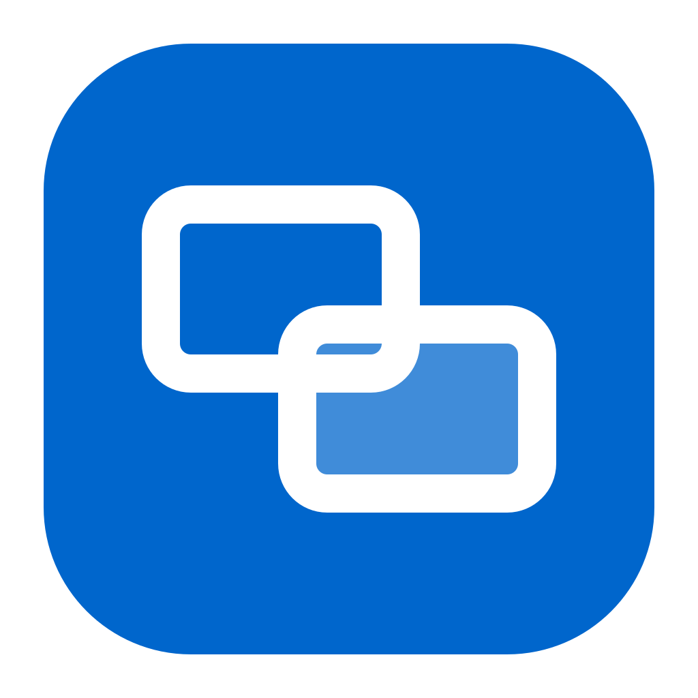
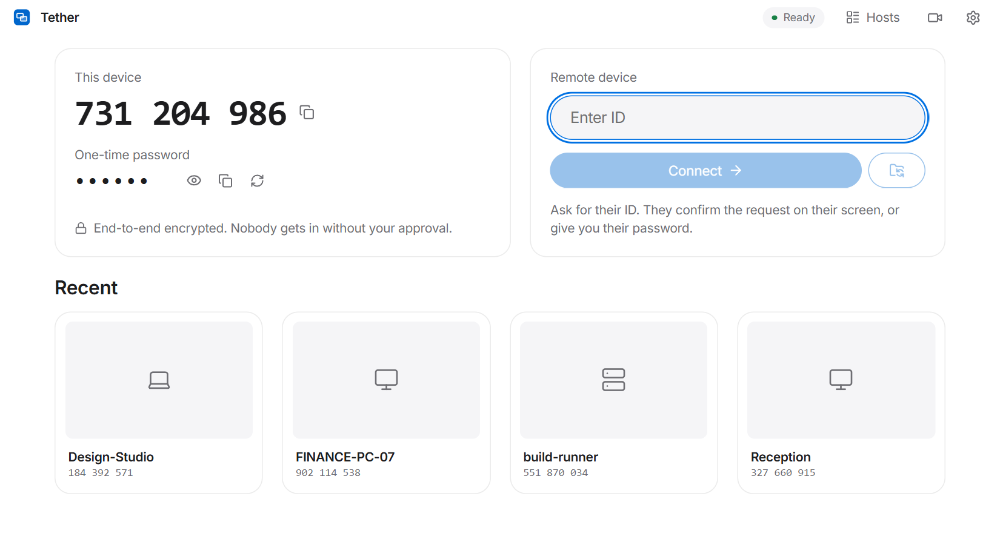
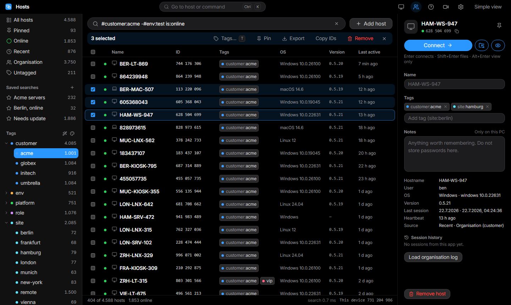
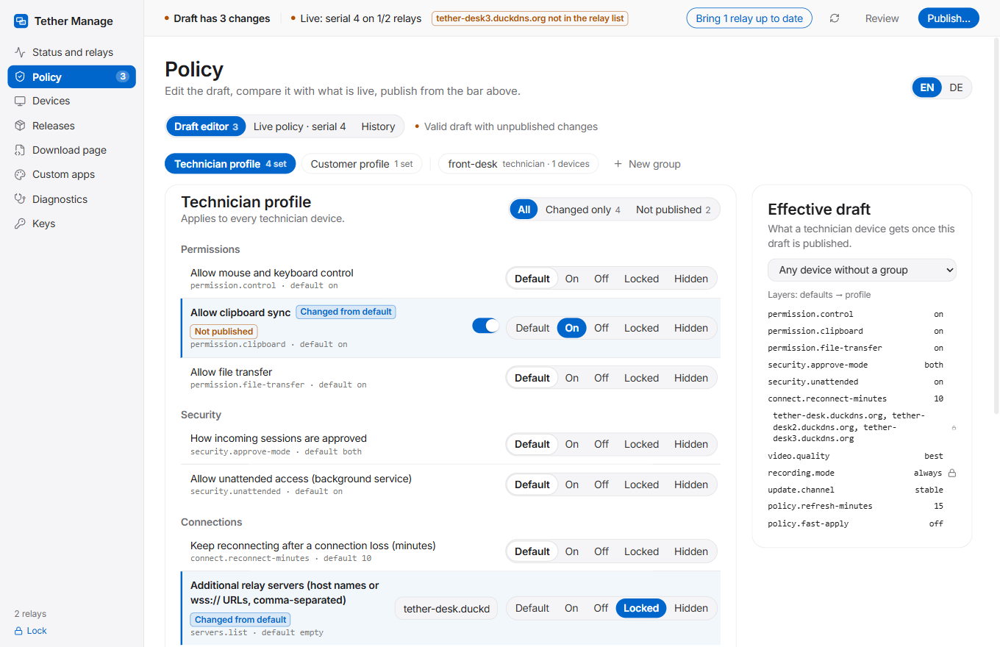

<p align="center"></p>
<h1 align="center">Tether</h1>
<p align="center"><b>Open-source, self-hosted remote desktop and remote support.</b><br>
A free alternative to TeamViewer and AnyDesk that runs on your own server, built on the RustDesk core.</p>
<p align="center">
<a href="https://fnpanic.github.io/tether/">Website</a> ·
<a href="https://fnpanic.github.io/tether/demo/">Try the demo</a> ·
<a href="docs/getting-started.md">Getting started</a> ·
<a href="https://fnpanic.github.io/tether/site/">User guide</a> ·
<a href="https://fnpanic.github.io/tether/site/architecture.html">Architecture</a> ·
<a href="CHANGELOG.md">Changelog</a> ·
<a href="https://github.com/fnpanic/tether/discussions">Questions and feedback</a>
</p>

<picture>
  <source media="(prefers-color-scheme: dark)" srcset="docs/img/home-dark.png">
  
</picture>

## Why Tether

Tether is for IT teams and support technicians who want remote access without a vendor's cloud
in the middle. You run the relay; the apps talk only to it.

- **Private.** Sessions are end-to-end encrypted between the two devices, and Tether refuses
  unencrypted sessions. The relay forwards ciphertext. What is protected and what is not:
  [SECURITY.md](SECURITY.md), [docs/encryption.md](docs/encryption.md).
- **Fast.** 24–30 ms glass-to-glass at 2560×1440 and 57 fps on a GPU host, with hardware
  encoding and decoding. Method, numbers and a comparison with AnyDesk:
  [docs/benchmarks.md](docs/benchmarks.md).
- **Works in corporate networks.** Only outgoing TCP 443 (port 80 as fallback), through system
  proxies and TLS inspection. No open ports on the customer's side:
  [docs/corporate-networks.md](docs/corporate-networks.md).
- **Quick support without installing.** TetherQS is one portable file for the customer: no
  installer, no admin rights. You can brand it: [docs/quick-support.md](docs/quick-support.md).
- **Hundreds of hosts.** Tags, saved searches, bulk actions and a command palette:
  [docs/advanced.md](docs/advanced.md).
- **Health of supported machines.** A separate monitoring agent reports to your relay, and the host
  list shows which machines need attention, with no inbound port on the machine:
  [docs/health.md](docs/health.md).
- **Central management.** Tether Manage signs policies and releases on the administrator's PC;
  the relay only serves them: [docs/management.md](docs/management.md).
- **Also included:** unattended access, file transfer, recording with consent, 2FA, signed
  updates with staged rollout, several relays with failover, Kubernetes, Grafana dashboards.

| Hosts in Advanced mode | Policy editor in Tether Manage |
| --- | --- |
|  |  |

## How it compares

| | Tether | RustDesk (open source) | TeamViewer / AnyDesk |
| --- | --- | --- | --- |
| Source | Open, AGPL-3.0 | Open, AGPL-3.0 | Closed |
| Server | Your own | Your own or public | Vendor's cloud |
| Ports the apps need | TCP 443 only | TCP 21115–21117, UDP 21116 | Vendor ports, 443 as fallback |
| Central policies | Included (Tether Manage) | RustDesk Server Pro (paid) | Paid plans |
| Portable customer module | TetherQS | Portable client | QuickSupport / portable client |
| Platforms | Windows, macOS; relay on Linux | Windows, macOS, Linux, Android, iOS, web | All major |
| Ready-made downloads | No, you build for your relay | Yes | Yes |

Tether is the younger and smaller project. If you need Linux or mobile clients, or a download
that works in five minutes, use RustDesk. Tether is for teams that want a locked-down
deployment that they control from end to end.

## Get started

**Look first:** the [browser demo](https://fnpanic.github.io/tether/demo/) is the real interface
with sample data. It connects to nothing, so a session there shows an empty picture.

**Run it:** there is no public Tether server and no generic download. Each deployment builds its
own apps with its relay's address and public keys compiled in.
[docs/getting-started.md](docs/getting-started.md) goes from an empty server to the first
session:

1. Build Tether Manage and create your keys.
2. Install the relay on a Linux server.
3. Build the apps for it, on your PC or in a fork with GitHub Actions.
4. Publish them to your users with Tether Manage.

**Antivirus warnings:** the maintainer's release files are checked with Microsoft Defender and
VirusTotal. The results, detections included, are in [docs/release-checks.md](docs/release-checks.md).

## Questions, ideas, bugs

- Questions and ideas: [Discussions](https://github.com/fnpanic/tether/discussions).
- Bugs: [Issues](https://github.com/fnpanic/tether/issues).
- Security problems: privately, through [Report a vulnerability](https://github.com/fnpanic/tether/security/advisories/new). Threat model: [SECURITY.md](SECURITY.md).
- Contributing: [CONTRIBUTING.md](CONTRIBUTING.md).

If Tether is useful to you, a star helps others find it.

## How it is built

- **Desktop app:** Tauri 2 + React. One binary is both viewer and host.
- **Core:** a lightly patched fork of the RustDesk core (capture, codecs, input, NAT traversal,
  end-to-end encryption), linked as a library behind a `tauri` feature.
- **Streaming:** FluxRT, a clean-room low-latency profile with hardware encoding on the host and
  WebCodecs hardware decoding in the viewer. See [docs/fluxrt-spec.md](docs/fluxrt-spec.md).
- **Relay:** `hbbs` (ID/rendezvous) and `hbbr` (relay) on Linux via systemd or Docker.
- **Security:** sessions are end-to-end encrypted between the two devices (X25519 key agreement,
  XSalsa20-Poly1305 or DTLS, forward secrecy) and Tether refuses unencrypted sessions. The relay
  forwards ciphertext; host keys are vouched for by the relay's server key, so that key must stay
  secret (whoever holds it and controls hbbs could impersonate hosts). 2FA, strong passwords and
  brute-force limits are built in. Known exceptions (old key exchange with non-Tether peers, legacy
  TCP tunnels, connecting by IP address) and their status are listed in
  [docs/encryption.md](docs/encryption.md#11-known-weaknesses); threat model in [SECURITY.md](SECURITY.md).
- **Design:** [DESIGN.md](DESIGN.md).
- **Networks:** only TCP 443 (port 80 as fallback), works behind proxies and TLS inspection. See
  [docs/corporate-networks.md](docs/corporate-networks.md) and
  [docs/connection-resilience.md](docs/connection-resilience.md).
- **Management:** Tether Manage (`apps/manage`) signs policies and releases; the relay API
  serves them. Customer module TetherQS (`apps/quick`): portable, no admin rights. See
  [docs/management.md](docs/management.md), [docs/policy.md](docs/policy.md),
  [docs/updates.md](docs/updates.md), [docs/quick-support.md](docs/quick-support.md),
  [docs/recording.md](docs/recording.md), [docs/cli.md](docs/cli.md),
  [docs/troubleshooting.md](docs/troubleshooting.md), [docs/api.md](docs/api.md),
  [docs/key-rotation.md](docs/key-rotation.md), [docs/upstream.md](docs/upstream.md) (RustDesk pin and upstream review), [docs/download-page.md](docs/download-page.md) (custom download page templates).
- **Several organisations:** one deployment each; no tenants inside a relay:
  [docs/several-organisations.md](docs/several-organisations.md).
- **Scale and HA:** several relays and Kubernetes: [docs/relay-ha.md](docs/relay-ha.md),
  [docs/kubernetes.md](docs/kubernetes.md); performance: [docs/performance.md](docs/performance.md);
  macOS build: [docs/macos.md](docs/macos.md); Mac builds from the PC while the Mac is locked (signed
  jobs, several projects): [docs/mac-build-runner.md](docs/mac-build-runner.md).
- **Changes:** [CHANGELOG.md](CHANGELOG.md).
- **HTML documentation:** [docs/site/index.html](docs/site/index.html) (user guide for technicians,
  customers and admins) and [docs/site/architecture.html](docs/site/architecture.html) (architecture with
  diagrams). Self-contained files; open them in any browser.

## Layout

```
apps/desktop/            Tauri app (src/ = React UI, src-tauri/ = Rust shell)
patches/                 Our changes to the pinned upstream sources
scripts/bootstrap.sh     Fetch vendor/ at pinned tags (checked against pinned commits) and apply patches
server/                  Relay deployment: Dockerfile, compose, systemd units, install.sh
docs/                    FluxRT spec, benchmarks
```

## Build

Prerequisites:
- Windows: Rust (MSVC), Node 22+, LLVM (`LIBCLANG_PATH`), VS Build Tools.
- macOS: Xcode command-line tools.
- Both: vcpkg (`VCPKG_ROOT`).

```bash
scripts/bootstrap.sh
cd vendor/rustdesk && VCPKG_DEFAULT_HOST_TRIPLET=x64-windows-static \
  $VCPKG_ROOT/vcpkg install --triplet x64-windows-static --x-install-root=$VCPKG_ROOT/installed
cd ../../apps/desktop && npm ci
TETHER_SERVER=relay.example.com TETHER_PUB_KEY=<key from install.sh> npx tauri build
```

On macOS run `bash scripts/build-macos.sh` instead: it installs the prerequisites and builds
both apps as universal binaries ([docs/macos.md](docs/macos.md)). Release builds refuse to compile
without `TETHER_SERVER`, `TETHER_PUB_KEY`, `TETHER_ADMIN_PUB_KEY` and `TETHER_UPDATER_PUB_KEY`.

For development, `npm run dev` serves the UI against an in-browser mock backend. To run a real host
and viewer side by side on one machine, start a second instance with `TETHER_PROFILE=b`.

## Deploy the relay

```bash
# Docker (host networking). The containers run as uid 65532: create the data directory first
# (an existing one, before starting the new image: sudo chown -R 65532:65532 server/data &&
# sudo chmod 0700 server/data; otherwise hbbs/hbbr cannot open their database and key and restart in a loop)
sudo install -d -m 0700 -o 65532 -g 65532 server/data
RELAY_HOST=relay.example.com docker compose -f server/docker-compose.yml up -d
# or systemd with prebuilt binaries
sudo server/install.sh relay.example.com ./bin
```

Tether clients use only TCP 443: put `server/caddy/Caddyfile` (`tether-https.service`) in front. Stock RustDesk clients additionally need TCP 21115–21117 and UDP 21116. See [docs/corporate-networks.md](docs/corporate-networks.md).

## License

AGPL-3.0, inherited from RustDesk ([LICENSE](LICENSE)). You must offer the complete corresponding
source, including `patches/`, to everyone you distribute Tether to.

## Code signing policy

Free code signing provided by [SignPath.io](https://about.signpath.io), certificate by
[SignPath Foundation](https://signpath.org) (application pending). Team roles, privacy and system changes:
[CODE_SIGNING_POLICY.md](CODE_SIGNING_POLICY.md), [PRIVACY.md](PRIVACY.md).
