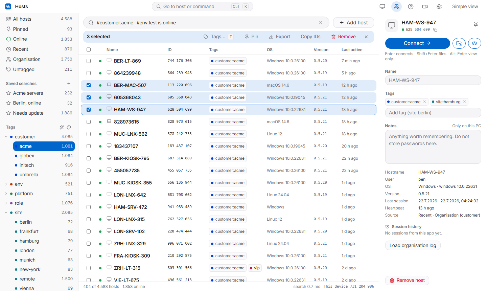
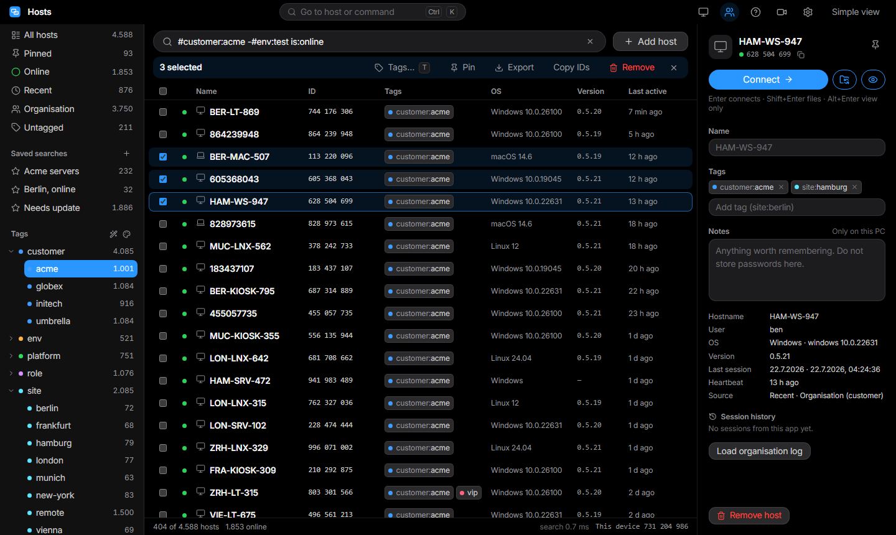
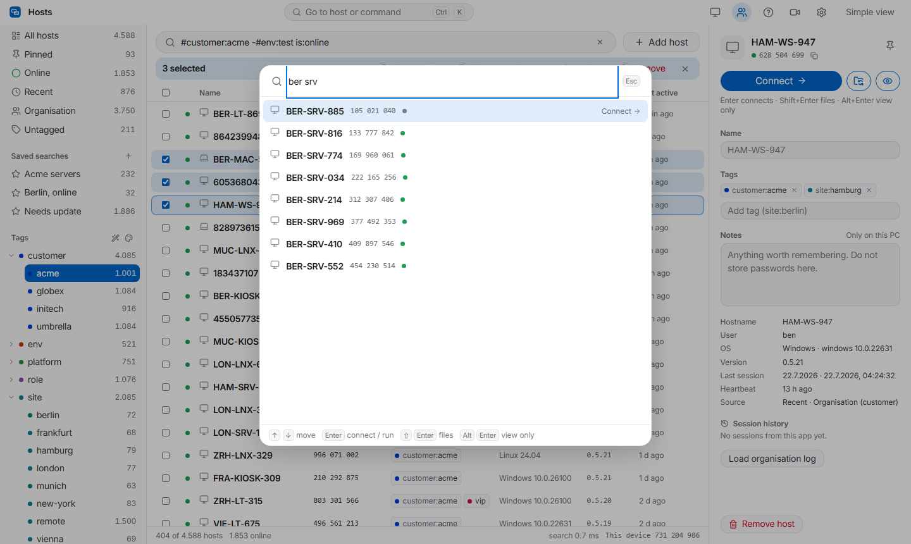
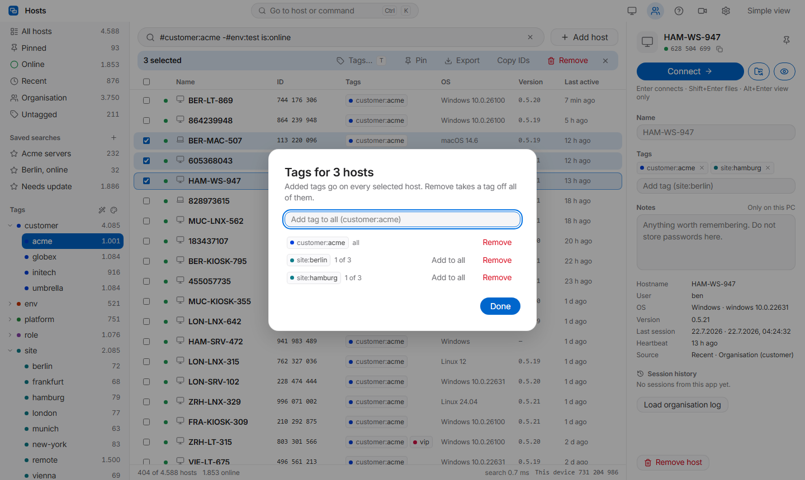

# Advanced mode: the host inventory

For technicians and IT departments who look after hundreds or thousands of machines. Advanced mode
replaces the technician app's **home view** (your ID, one ID box, recent cards) with the whole
inventory: search, tags, saved searches, sessions and team sharing, all keyboard-driven. Session
windows, file transfer and everything else stay exactly the same.

Switch with **Hosts** in the title bar of the simple home view, **Simple view** in the Advanced title
bar, or **Settings → Appearance → Home view**. The choice is remembered on the PC. Policy
`ui.advanced` (technician profile) decides whether users get it:

| `ui.advanced` | Effect |
| --- | --- |
| `available` (default) | Simple by default; users switch as they like |
| `off` | Simple only; the Hosts button and the Settings row are hidden |
| `forced` | Advanced only; no way back to the simple view |

Administrators set it in Tether Manage → Policy (area *interface*), like every feature
([policy.md](policy.md)). Switching to Advanced grows the main window to at least 1280 × 800 (within
the screen); switching back leaves the size alone.




## Decision: a mode of the technician app, not a third app

We considered a separate "Tether Advanced" app next to the technician app (`apps/desktop`),
TetherQS (`apps/quick`) and Tether Manage (`apps/manage`), and chose a mode of the technician app:

1. **Architecture.** Sessions, file transfer, the keyboard mapping and system-key hook, sharpening,
   recordings, the updater, policy enforcement, key rotation, `tether://` links and the RustDesk
   core's peer configs (saved passwords, per-device settings, recent list) all live in the technician
   app. A separate app would duplicate them (a second ~40 MB core with its own ID and config) or force
   a large shared-library refactor plus a new IPC channel into the technician app: new attack surface
   for nothing.
2. **Release cost.** Today 2 apps × 2 platforms are signed, notarised and end-to-end tested per
   release. A third app adds 2 builds, an installer, an updater channel, a download-page card, a
   policy profile and more Defender/SmartScreen exposure, every release.
3. **Ease of use.** Technicians who grow from 8 to 800 hosts keep the same app, same login, same
   session windows; the mode only changes the home view. Nobody has to pick a tool before they know
   how many hosts a customer has.
4. **Control.** Administrators make it available, hide it or force it with one policy feature
   (`ui.advanced`), shown on Tether Manage's Policy page like every other feature.
5. **Performance.** Advanced mode is a separate chunk loaded with a dynamic `import()` only when the
   mode is on, so the simple view's startup does not change (numbers under
   [Performance](#performance)).

Tether Manage stays the administrator's tool: it holds the admin key; the technician app never does.

## Features

| Area | What you get |
| --- | --- |
| Inventory | Every device the core remembers (all of them, not only the 24 recent cards), hosts you added by hand or imported, and with **Team** on, your organisation's devices from the relay's heartbeats. One row per ID: name, hostname, user, OS, app version, tags, last session / last heartbeat, online dot. |
| Online status | One batched query to hbbs per 1,000 IDs every 60 s while the window is visible (and on focus). Unknown (hollow dot) until the relay answers. |
| Search | Instant, fuzzy, over ID, name, hostname, user, OS, version, tags and notes, with filters and AND / OR / NOT (syntax below). Best match first; without words: pinned, online, most recent. Column headers sort. |
| Sidebar | All, Pinned, Online, Recent (30 days), Organisation, Untagged; saved searches with live counts; the tag tree by namespace with counts (click filters, Alt+click excludes). |
| Tags | Many per host, namespaced (`site:berlin`, `customer:acme`, `env:prod`, `site:berlin:lab`), lower-case, at most 32 per host and 64 characters each. A colour per tag or per namespace (shown as a dot; chips stay neutral, see DESIGN.md). Bulk add/remove on a selection with "n of N" counts. |
| Tag rules | "Hosts matching *search* get *tag*": e.g. `os:mac` → `platform:mac`, `host:BER-` → `site:berlin`, `ver:<0.5.21 is:org` → `update:needed`. Rule tags show as dashed chips, are searchable like any tag, and follow the hosts as they change. Rules see stored tags only (no chains, no loops). |
| Per host | Name, private notes (only on this PC), pin, session history from this app, and with the Team audit flag the organisation's session log of that host (last 90 days). |
| Actions | Connect, Transfer files, View only (from the panel, the keyboard, the palette or a double click); Copy ID; remove (store entry and the core's recent entry). |
| Open sessions | Every session window of the app: bring to front; for remote-control sessions send Ctrl+Alt+Del, lock the screen, restart (lock and restart ask first). |
| Import / export | JSON (everything: names, tags, pins, colours, rules, saved searches) or CSV (`id,name,tags,pinned[,notes]`, `,` or `;`). Notes only when you tick "Include notes". Import adds tags, replaces names and notes present in the file, skips invalid IDs with a reason. |
| Team | Share tags, names, rules and saved searches; see the organisation's devices. See [Team sync](#team-sync). |




### Deliberately not offered

- **Connect / transfer files to many hosts at once.** Each session needs its own login or the
  customer's Accept; a bulk action would put a prompt on N customers' screens by mistake.
  Selection actions are the safe ones: tag, pin, export, copy IDs, remove from the list.
- **Live thumbnails.** Every session window decodes its own video in its own webview; a second
  decode for a dashboard is not cheap. The sessions panel lists and controls them instead.
- **Wake-on-LAN.** Upstream sends it only to peers found by LAN discovery (with their MAC), which
  Tether's 443-only networking turns off. **Terminal** sessions: not supported by the session
  window, and every Tether host refuses them (`enable-terminal` is forced to `N`).

## Keyboard

| Keys | Action |
| --- | --- |
| Ctrl K (⌘K) | Command palette: find any host and connect, or run any command, saved search |
| / or Ctrl F | Search box |
| ↑ ↓, Page Up / Down, Home, End | Move the cursor (also while typing in the search box) |
| Shift + move, Shift+click | Extend the selection |
| Space, Ctrl+click | Select / unselect one |
| Ctrl A | Select all shown |
| Enter, double click | Connect |
| Shift Enter | Transfer files |
| Alt Enter | View only |
| T | Tags (one host: tag field; several: bulk dialog) |
| P | Pin / unpin |
| N / E | Notes / rename |
| Delete | Remove from the list (asks) |
| Esc | Clear the selection, then the search |
| ? | Shortcuts and search syntax |

The shortcuts act only while no dialog (palette, Settings, Recordings, any other dialog) is open.
A focused button keeps Enter and Space (Enter on a focused **Add host** presses that button and
opens no session; a select or radio group also keeps its arrow keys); all other shortcuts work
wherever the focus is.

## Query syntax

Space means AND. Every part is case-insensitive.

| Write | Matches |
| --- | --- |
| `berlin srv` | Hosts where every word matches fuzzily (letters in order, within one field) in ID, name, hostname, user, OS, version, tags or notes |
| `"front desk"` | A phrase |
| `#site:berlin` or `tag:site:berlin` | That tag and its children (`site:berlin:lab`) |
| `#site` | Any `site:*` tag |
| `#customer:ac*` | Tag prefix |
| `a \| b`, `a OR b` | Either |
| `-x`, `!x`, `NOT x` | Not |
| `( … )` | Grouping: `(#site:berlin \| #site:munich) -#env:test` |
| `is:online` `is:offline` `is:pinned` `is:org` `is:recent` `is:manual` | Status and source |
| `has:notes` `has:tags` `has:name` | Has a value |
| `id:1234` `name:` `host:` `user:` `note:` `os:mac` | Field contains (OS also by family: `os:win`, `os:linux`) |
| `ver:0.5` `ver:<0.5.21` `ver:>=0.5.20` | App version (prefix or comparison; org devices only) |
| `seen:<7d` `seen:>30d` | Last activity (session from this PC or heartbeat), units `m h d w` |
| `health:crit` `warn` `stale` `setup` `ok` `none` `conflict` | Health from the monitor agent's last report; `none` = no agent, `conflict` = two devices linked to the host on different relays |
| `product:records` | A detected product whose name contains the text (product names are also free text) |
| `version:26.3` | A detected product version starting with the text. Alone: any product; next to `product:` in the same AND group (`product:records version:26.3`) the same product must match both |
| `role:server` `client` `single` | A detected product role. Before health data this was a plain word (in tag rules it still is); `#role:server` still finds that tag |
| `check:backup` `check:backup=crit` | A check whose id contains the text is not OK; `=crit` or `=warn`: in that state |
| `software:garnet` `software:"garnet browser"@126` | An installed program whose name or publisher contains the text; after an `@` outside quotes a version prefix (`software:x@` = any version). Asked of the relays on Enter or 800 ms after typing, as of each computer's last upload of its list. A host without a list, or one the relay could not answer for, matches neither `software:x` nor `-software:x` ([health.md](health.md#searching-installed-software)) |
| `agent:0.1` `agent:none` | Monitor agent version; `agent:none` as `health:none` |
| `customer:47` `customer:none` | The customer reference set by the agent's enrolment token, starting with the text, in any case ([health.md](health.md#customer-reference)); `customer:none` is a host that reports health but has no customer reference (hosts without an agent are `health:none` and `agent:none`) |
| `since:3d` | Warning or critical for at least that long (earliest failing check), units `m h d w` |

The health and software terms work in the search box and in saved searches. In a tag rule they are plain words,
as they were before health data existed (and product names are not part of a rule's free text), so
a shared rule tags the same hosts on every app of the team, older ones included; the Rules dialog
says so in one line. **Needs attention** in the library is
`health:crit | health:stale | health:conflict`, built into the app rather than a saved search, because saved
searches go to the whole team.

A query that cannot be read completely still filters by what could be read; the box says what was
ignored ("Missing )"). Brackets and NOTs nest at most 200 deep; deeper nesting is ignored with
"Too many nested brackets".

## Data model

`hosts.json` in the app's config folder (`%APPDATA%\Tether\config`, `~/Library/Preferences/…`),
written by `hosts_store_save` (JSON object, ≤ 16 MB, temp file + rename; 400 ms after the last change,
on a worker thread):

```json
{
  "v": 1,
  "hosts": { "123456789": { "name": "Reception", "tags": ["site:berlin", "customer:acme"],
                             "notes": "…", "pinned": true, "added": 1793900000,
                             "history": [{ "t": 1793973802, "conn": "default" }] } },
  "tags": { "site": { "color": "teal" } },
  "rules": [{ "id": "r1", "tag": "platform:mac", "when": "os:mac", "off": false }],
  "searches": [{ "id": "s1", "name": "Acme servers", "query": "#customer:acme #role:server" }],
  "team": { "enabled": true, "showOrg": true, "rev": 12, "base": { "…": "last synced shared doc" }, "synced": 1793973900000 }
}
```

If `hosts.json` cannot be read, is damaged or was saved by a newer version of Tether (`v` above
this version's), the file is not written in that run, so the first save cannot destroy it. A
banner above the list says so and what to do: "The host list (hosts.json in Tether's config
folder) is damaged, so it was not loaded and changes are not saved. Restore the file from a
backup, or rename or delete it and restart Tether to start a new list."; "… was saved by a newer
version of Tether: it is shown, but changes are not saved. Update Tether to change it."; "… could
not be read just now: … Changes are not saved. Close this window and open it again, or restart
Tether, to try again." Only a missing or empty file starts a new list.

Not stored: peers (read from the core with `hosts_peers` each time), org devices (`team_devices`),
online status. Code: `apps/desktop/src/lib/hosts/` (model, query, rules, io, sync, store),
`src/pages/Hosts.tsx` (lazy), `src/lib/mode.ts`, `src/components/hosts/`, `src-tauri/src/hosts.rs`, `src-tauri/src/team.rs`.

New Tauri commands: `hosts_peers`, `hosts_store_load`, `hosts_store_save`, `hosts_online`,
`hosts_export` / `hosts_import` (native save/open dialog; `.json`/`.csv` only, ≤ 16 MB),
`main_window_fit`, `sessions_open`, `session_focus_window`, `team_identity`, `team_me`, `team_devices`,
`team_tags_get`, `team_tags_put`, `team_audit`. `open_session` gained `viewOnly`.

## Online status

`hosts_online` sends hbbs an `OnlineRequest` (one bit per ID, at most 1,000 IDs per request) on the
same route as the rendezvous connection: the TCP port below the rendezvous port, which the client
maps to `wss://<relay>/ws/id` on 443-only networks. Stock hbbs answers online queries only on TCP
21115; **hbbs from this release also answers on `/ws/id`** (`vendor/rustdesk-server`
`handle_tcp`, at most 10,000 IDs per query, then the connection closes). Until the relays run it, the
query times out after 3 s, the list says "Online status needs a relay update", and the window stops
asking until you run **Refresh online status** (Ctrl+K). A host counts as online when it registered within the last 30 s.
Online status reveals no more than before: any client could already ask hbbs about any ID on 21115.

## Team sync

Technicians never hold the admin key. Instead:

1. The technician app creates its own Ed25519 key on first use (`team-key` in the config folder,
   created 0600 on macOS/Linux; never sent anywhere, never shown to the webview). It is generated
   only when the file is missing: a damaged or unreadable file is reported ("The team key file is
   damaged." / "The team key file cannot be read: …") and never replaced, because a new key would
   no longer be the enrolled one. A new key is written to a temp file and linked into place
   without replacing, so a key that appeared meanwhile stays. **Team** in the Hosts
   window shows the public key and its fingerprint (`9F3A-12B0-C4D1-77E2`).
2. The administrator adds name + key in Tether Manage → **Team** (comparing the fingerprint read out
   by the technician), chooses *Can edit shared tags* and *Can read session history*, and publishes
   the roster to every relay ([management.md](management.md), [api.md](api.md#team-technician-endpoints)).
3. The app signs each `/api/team/*` request with its key (`Tether-Sig` v2, the scheme admin requests
   use: made for the relay it goes to, timestamp ±300 s, single-use nonce; [api.md](api.md)) and
   follows no HTTP redirect. Revoking = publishing the roster without the key.

What is shared: per-host names and tags, tag colours, rules and saved searches (the *shared doc*).
Notes, pins, history and the team settings stay on the PC. Organisation devices come from the
heartbeat store without IP addresses.

**Conflicts.** The relay keeps one shared doc per relay with a revision. The app keeps the doc it
last synced (`team.base`) and merges three ways: base, local, remote. Tag sets merge by change
(remote + what you added − what you removed), so two technicians tagging different hosts or
different tags never lose each other's work; a field changed on both sides keeps your value; an
entry deleted on one side and untouched on the other is deleted. The write sends `If-Match: <rev>`;
on `409` the app merges again with the doc that won and retries (up to 3 times). Sync runs 2.5 s
after a shared change, every 5 minutes and on **Sync now**. Members without the write flag take the
team's doc as it is. For them the shared fields (names, tags, tag colours, rules, saved searches)
cannot be changed in the app and show "Managed by your team"; pins and notes stay theirs. An
import brings only pins and notes for them.

Shared rules, saved searches and tag colours have the same limits as an import. A shared doc is read with the limits of an import, because every member renders what one member
wrote: IDs of 1 to 64 characters of `A-Z a-z 0-9 _ . @ : -`, valid tags only, known colours only,
at most 500 rules and 500 saved searches, each query at most 1000 characters, at most 5000 tag
entries. Anything else is dropped.

With several relays the app reads and writes the first relay that answers (as for the policy); the
relays do not copy the shared doc between each other, and organisation devices are those that
heartbeat to that relay.

## Security

- **No new host surface.** Nothing changes on the side that is being controlled. View only is the
  core's existing per-device option, which makes the host refuse input; the session window also
  stops sending it. The option is saved per device, so every session sets it at start to how it
  was opened (on for View only, off otherwise). Up to 0.5.29 only a cleanly closed View only window
  switched it back off: after the app quit or crashed, later normal sessions to that device stayed
  view-only without the badge (host ignored all input; fixed 2026-11-08).
- **Policy.** `connect.outgoing` off disables every connect action (the backend refuses as before)
  and the online query.
- **Webview boundary.** Store writes are validated (JSON object, size) and atomic, and
  `hosts_store_save` and `team_tags_put` are accepted from the main window only; IDs are validated
  before any query; export/import go through a native file dialog the user drives, with fixed
  extensions and size limits; the team key stays in the backend.
- **Exports.** Notes are excluded by default; CSV cells that a spreadsheet would run as a formula
  get a leading `'` (undone on import). Passwords are never part of the store.
- **Team endpoints.** Signed requests per member key, roster published by the admin key, size
  limits (shared doc 512 KiB), 120 requests/min per member, failed signatures limited per IP, audit
  log only with the flag and only per host. See [SECURITY.md](../SECURITY.md#team-access).
- **Tags are not secret.** They are visible to the whole team and to whoever can read the relay's
  disk. Do not put credentials in names, tags or rules.

## Performance

Measured on the development PC (Windows 11, `npx vitest run src/lib/hosts/perf.test.ts`; and in the
browser with `e2e/hosts-mock.e2e.mjs`, Chromium and WebKit):

| Measurement | 5,000 hosts |
| --- | --- |
| Search per keystroke (14 query shapes, median of 15) | 0.1–1.2 ms (budget 16 ms, asserted) |
| Search in the page while typing (Chromium / WebKit) | ≤ 3 ms (asserted < 16 ms) |
| Rules + re-index after a change | ~3 ms (asserted < 100 ms) |
| Rows in the DOM | ~30 (virtualised, fixed 36 px rows) |

Bundle and startup (production build, `vite build`; startup = navigation to the home view's input
being ready, Chromium, median of 9, mock backend):

| | Before | After |
| --- | --- | --- |
| Main chunk (loaded by every window) | 386.5 kB (121.1 kB gzip) | 391.5 kB (123.0 kB gzip) |
| Advanced chunk (only in Advanced mode) | – | 77.8 kB (23.5 kB gzip) |
| CSS (one file) | 40.8 kB | 45.2 kB |
| Simple home view ready | 79 ms | 84 ms (within run-to-run noise) |
| Advanced home view ready | – | ~400 ms (chunk + first data) |

The main chunk grows by 5 kB for the mode switch, the Settings row, view-only sessions and the mock
backend's team stubs; the mock fleet is its own chunk too.

Each host keeps one lower-cased search string; the fuzzy matcher does a substring check first and a
per-field subsequence match only when that fails.

## Tests

- `npm test` (vitest): `src/lib/hosts/*.test.ts`: parser and every operator, fuzzy ranking, rules,
  import/export round trips and formula guard, three-way merge, defensive reading of a relay doc,
  performance budget.
- `node e2e/hosts-mock.e2e.mjs` (also in `npm run test:ui`): mode switching (simple by default, the
  Advanced chunk not requested until switched, Hosts / Simple view buttons, window fit, policy `off`
  and `forced`), then 5,000 mock hosts in Chromium and WebKit: virtualisation, search latency, tag/field filters with AND/OR/NOT/parentheses, sidebar, saved
  searches, keyboard flow and that Enter / Shift+Enter / Alt+Enter call `open_session` with the right
  arguments, palette, Ctrl+A + T bulk tagging and removal, debounced save and reload, export without
  notes, sessions panel → `session_ctrl_alt_del`.
- `cargo test` in `apps/desktop/src-tauri`: `hosts::` (store, online bits, ID cleaning, export names),
  `team::` (key file, errors); `vendor/rustdesk-server`: `online_query_answers_one_bit_per_id`;
  `server/api/tests/team.rs` and `crates/tether-trust` team tests for the relay side.
- Screenshots: `node e2e/hosts-shots.mjs` → `docs/advanced/*.png`.

Mock mode: `npm run dev`, open `http://localhost:1420/?hosts=5000#/` and click **Hosts** (`hosts=` sets
the fleet size; `team=none` shows the "not a member" state; `ui=off|forced` sets the policy).
