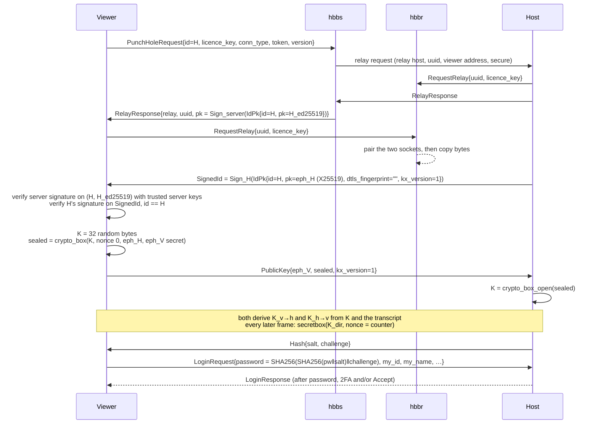
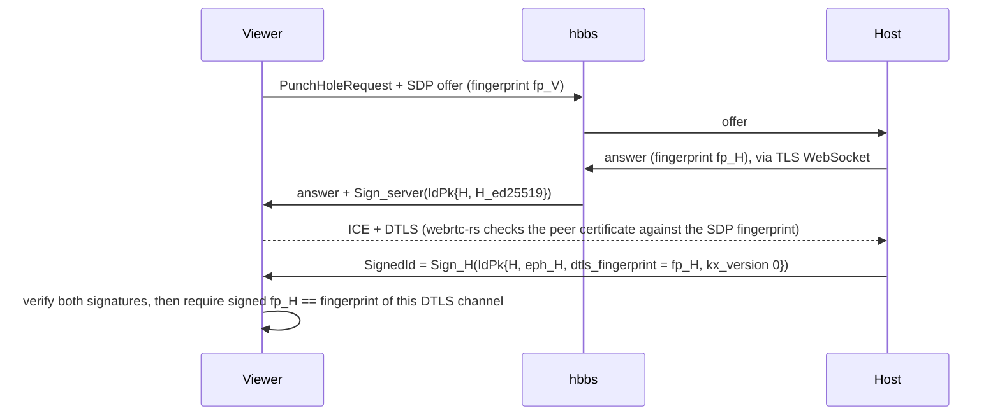
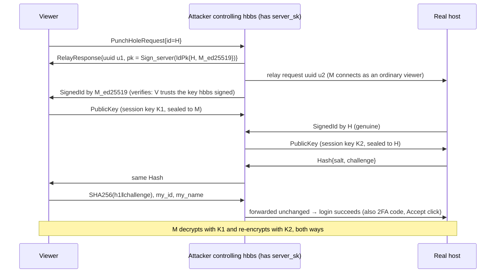

# How a Tether connection is encrypted end to end

This page describes what the code does, not what RustDesk's documentation says. Every claim cites
the source. Paths under `vendor/rustdesk` and `vendor/rustdesk-server` are the upstream sources
at the pinned tags with `patches/*.patch` applied (`scripts/bootstrap.sh`); line numbers refer to
that patched tree at the commit that added this page. `hbb_common` is
`vendor/rustdesk/libs/hbb_common`. Crypto primitives come from libsodium through `sodiumoxide`
(`box_`, `secretbox`, `sign`, `generichash`).

Short version:

- Screen, input, clipboard, audio, chat and files travel inside one end-to-end encrypted stream
  between the two devices. On the relay and LAN paths that stream is XSalsa20-Poly1305 with
  per-direction keys. On the WebRTC paths it is DTLS, bound to the host's signed identity.
- Session keys are fresh per connection and come from ephemeral X25519 keys on both sides, so a
  later leak of a long-term key does not decrypt recorded traffic (forward secrecy).
- hbbr (relay), a network observer and a TLS-inspecting proxy see metadata (including keystroke
  timing) but not content. None of them can take a Tether-to-Tether session to plaintext, because
  Tether refuses unencrypted sessions.
- There are cases where the inner encryption is broken or absent: key exchange version 0 with
  non-Tether peers, legacy TCP tunnels, connecting by IP address. They are listed with their status
  under [Known weaknesses](#11-known-weaknesses).
- **The viewer learns the host's public key from hbbs, signed with the server key.** Nothing else
  authenticates the host: there is no key pinning and no host-side display of its own key. Whoever
  holds the server private key **and** can answer the viewer's rendezvous requests (control of an
  hbbs node, or a TLS man-in-the-middle on the viewer's WebSocket to hbbs) can impersonate a host
  and run an active man-in-the-middle on new sessions. This is the main residual risk. See
  [Active attacks with the server key](#active-attacks-with-the-server-key).

## 1. Keys and identities

| Key | Algorithm | Generated / stored | Used for |
| --- | --- | --- | --- |
| Device identity | Ed25519 (`sign::gen_keypair`, 32-byte public key, 64-byte secret key) | Created on first use by `Config::get_key_pair` (`hbb_common/src/config.rs:1302-1323`). Stored in the `key_pair` field (`config.rs:267`) of `<config dir>/Tether.toml`: `%APPDATA%\Tether\config\` per user; for the Windows service `C:\Windows\ServiceProfiles\LocalService\AppData\Roaming\Tether\config\` (upstream `patch()`, `config.rs:516-524`); macOS `~/Library/Preferences/app.tether.Tether/` (`config.rs:526`). TetherQS uses `Tether-QS.toml` (`apps/quick/src-tauri/src/main.rs:22,31`), `TETHER_PROFILE=x` gives `Tether-x.toml` (`apps/desktop/src-tauri/src/main.rs:33-38`). | Signing the host's ephemeral key in each handshake; registered with hbbs |
| Server key | Ed25519 | `id_ed25519` (base64 secret key) and `id_ed25519.pub` in the working directory of hbbs/hbbr, `/var/lib/tether` (`server/systemd/tether-hbbs.service`). hbbs creates it on first start if missing (`vendor/rustdesk-server/src/common.rs:107-150`); hbbr runs the same code after a 300 ms wait (`relay_server.rs:612-613`), so on a fresh node hbbr can be the one that creates it. The same pair is copied to every relay node ([relay-ha.md](relay-ha.md), [kubernetes.md](kubernetes.md)). | hbbs signs `IdPk{id, device public key}` for viewers (`rendezvous_server.rs:1506-1528`); its public half is the `licence_key` clients present |
| Compiled-in server public key | Ed25519 public | `TETHER_PUB_KEY` at build time (`hbb_common/src/config.rs:139-142`); release builds refuse to compile without it (`apps/desktop/src-tauri/build.rs:4-14`). | Trust anchor for the signed `IdPk` when no server key list is cached |
| Signed server key list | Ed25519-signed JSON (admin key) | `server-keys.json` + rollback floor `server-keys.serial` in the config folder (`crates/tether-trust/src/serverkeys.rs`, applied by `apps/desktop/src-tauri/src/policy.rs:197-208` into `hbb_common::config::POLICY_SERVER_KEYS`). | Replaces the compiled-in key for Tether's own servers. Rule (`config.rs:155-164` `server_keys_for`): when the server key in use (the `key` option if set, else the first active listed key) is one of the listed keys, every active listed key is trusted; for any other `key` value, that value alone is trusted. Without a valid cached list the compiled-in key is used. See [key-rotation.md](key-rotation.md) and [W3](#w3-the-trust-anchor-can-be-changed-locally). |
| Host ephemeral box key | X25519 (`box_::gen_keypair`) | Per incoming connection, memory only (`vendor/rustdesk/src/server.rs:281`) | Receiving the sealed session key |
| Viewer ephemeral box key | X25519 | Per connection attempt, memory only (`vendor/rustdesk/src/common.rs:2466`) | Sealing the session key |
| Session key | 32 random bytes (`secretbox::gen_key`, `common.rs:2467`) | Memory only | Derives the two stream keys |

File permissions:

- Device key: on Linux/macOS the config file is written with mode `0600` (`config.rs:760-773`).
  On Windows no ACL is set by the code; the file inherits the ACL of the profile folder it is in.
  The secret key is **not encrypted** in the file: `Config::store` (`config.rs:901-917`) only
  transforms `password` and `id`. Anyone who can read the file can sign as that device.
- Server key: hbbs creates `id_ed25519` with `File::create` and the process umask (no `UMask=` in
  `tether-hbbs.service`, so normally `0644`), inside `/var/lib/tether`, which `install.sh` creates
  as `0750 tether:tether` (`server/install.sh:41`). `server/rotate-key.sh switch` installs a new key
  with `0600` (`rotate-key.sh:53`). hbbr also reads the secret file to derive the public key it
  compares (`relay_server.rs:612-613` → `common.rs:107`), so a node that runs only hbbr still
  holds the secret key.

## 2. Registration: what hbbs stores and sees

```mermaid
sequenceDiagram
    participant H as Host (Tether)
    participant P as Caddy/nginx (TLS, 443)
    participant S as hbbs
    H->>P: WSS /ws/id (TLS, WebPKI + OS roots)
    P->>S: WebSocket, X-Forwarded-For = peer IP
    H->>S: RegisterPk{id, uuid = machine uid, pk = Ed25519 public key}
    S->>S: first time: store (id, uuid, pk, ip)<br/>later: refuse other uuid; refuse other pk from other IP
    S-->>H: RegisterPkResponse OK
    loop heartbeat
        H->>S: RegisterPeer{id, serial}
    end
```

- The host sends `RegisterPk{id, uuid, pk}` (`vendor/rustdesk/src/rendezvous_mediator.rs:1340-1370`);
  `uuid` is `hbb_common::get_uuid()`, the machine uid (`hbb_common/src/lib.rs:318`).
- Tether always uses the WebSocket transport (`allow-websocket = Y`, `disable-udp = Y`,
  `apps/desktop/src-tauri/src/netpolicy.rs:121-127`), so `use_ws()` is true
  (`config.rs:2985-2988`). On that transport the client skips the rendezvous key exchange
  (`common.rs:2296-2305` `secure_tcp_impl`): **the client-to-hbbs channel is protected by TLS
  only.** The server key is not used to authenticate hbbs itself on this path. TLS (`wss://`) is
  chosen only for a domain name with an `https` `api-server`, which Tether forces for its own
  servers; an endpoint given as an IP address gets plain `ws://` (`hbb_common/src/websocket.rs:628-649`,
  [W4](#w4-plain-ws-for-ip-endpoints)).
- hbbs accepts the first `RegisterPk` for an ID, then refuses a different `uuid`, and refuses a
  different `pk` only when it also comes from a different IP (`rendezvous_server.rs:693-723`).
- hbbs stores per peer: `id`, `uuid`, `pk`, creation time and an `info` JSON with the IP
  (`vendor/rustdesk-server/src/database.rs:74-84`, `peer.rs:93-111`), and logs id, address,
  uuid and key at info level on every key update (`peer.rs:102`). It sees every registration,
  heartbeat, the source IP of every client and which ID asks for which.

## 3. Rendezvous and handshake (relay path)

Tether's default and corporate-network path. The same handshake runs on the LAN and WebRTC paths
(section 5).



Step by step, with the code:

1. **Host public key from hbbs.** hbbs answers with `pk = sign(IdPk{id, pk}, server_sk)`
   (`rendezvous_server.rs:532, 785, 1506-1528`); the viewer stores it as `signed_id_pk`
   (`vendor/rustdesk/src/client.rs:1258, 1307`).
2. **Viewer checks the server signature.** `secure_connection` (`client.rs:1942`) verifies it
   against every trusted server key (`decode_id_pk_any`, `common.rs:2427-2432`;
   `server_keys_for`, `config.rs:157-164`) and requires the signed id to equal the requested ID
   (`client.rs:1963-1968`). A signature by no trusted key aborts with the "server key not
   trusted" message in Tether builds (`client.rs:1974-1978`).
3. **Host proves its identity.** The host signs `IdPk{id, pk = ephemeral X25519 key,
   dtls_fingerprint, kx_version}` with its device Ed25519 key (`server.rs:281-316`). The viewer
   verifies it with the key from step 2 (`decode_id_pk_dtls`, `client.rs:2004-2006`,
   `common.rs:2443-2457`) and checks the id again.
4. **Session key.** The viewer creates its own ephemeral X25519 pair and a random 32-byte key and
   seals the key with `crypto_box` (X25519 + XSalsa20-Poly1305) to the host's ephemeral key
   (`create_symmetric_key_msg`, `common.rs:2464-2471`). The all-zero box nonce is safe because
   both box key pairs are new for every connection. The host opens it (`Encrypt::decode`,
   `hbb_common/src/tcp.rs:404-424`).
5. **Key exchange version.** The host advertises `KX_VERSION_LATEST = 1` inside its signed
   `IdPk` (`server.rs:294-298`, `tcp.rs:31`); the viewer picks `min(advertised, 1)`
   (`tcp.rs:40-42`, `client.rs:2022-2028`); the host refuses a pick above what it offered and
   accepts any pick at or below it, including 0 (`server.rs:327-333`).
   - **Version 1** (every Tether build): two stream keys, one per direction,
     `BLAKE2b-256(key = K, "rdkx-spl" ‖ direction ‖ advertised ‖ picked ‖ eph_V ‖ eph_H)`
     (`tcp.rs:348-380`). The viewer, which sent the sealed key, sends with the "initiator" key.
     Changing the advertised or picked version, or either ephemeral key, gives different keys and
     the first frame fails to decrypt (unit tests `test_split_binds_the_transcript`,
     `test_split_directions_use_different_keys` in `tcp.rs`).
   - **Version 0** (the original scheme): one key for both directions (`stream.rs:104-108`),
     and both directions count nonces from 1 (`test_v0_shares_one_key_across_directions`), so
     every nonce is used twice under the same key. Against anyone in the path this is broken, not
     just weak: the XSalsa20 keystream repeats (the XOR of two plaintexts leaks), the Poly1305
     one-time key repeats (forgery becomes possible), and a frame can be reflected back to its
     sender, which accepts it as the peer's. Two Tether builds never pick it, but it is reachable:
     a Tether host accepts version 0 from a viewer that picks it, and a Tether viewer runs it
     against a host that advertises no version (a stock RustDesk host, which Tether's hbbs also
     serves on 21115-21117). Such a session still counts as encrypted and shows the shield.
     Changing the unauthenticated `PublicKey.kx_version` in transit does not force it: the two
     sides then derive different keys and the first frame fails. See [W1](#w1-key-exchange-version-0).
6. **Record encryption.** Every frame after the exchange is `secretbox` (XSalsa20-Poly1305,
   256-bit key, 128-bit tag) with a 24-byte nonce whose first 8 bytes are a per-direction
   little-endian counter starting at 1 (`tcp.rs:248-252, 382-402`). The receiver increments its
   own counter per frame, so a dropped, reordered, replayed or altered frame fails authentication
   and ends the connection. Sends go through `send_raw` → `enc` (TCP `tcp.rs:193-200`, WebSocket
   `websocket.rs:473-479`), receives through `next` → `dec` (`tcp.rs:213-222`,
   `websocket.rs:528-536`); once encrypted, a WebSocket text frame is an error
   (`websocket.rs:537-545`). Frames of 0 or 1 byte are passed through without decryption
   (`tcp.rs:383-385`): they cannot carry a message, so a relay can inject only empty frames.
7. **What is inside.** The session is one stream of protobuf `Message`s: video and audio frames,
   keyboard and mouse, clipboard, file transfer, chat, permissions, all sent with `send` on the
   same `Stream`, so all of it is encrypted. File transfer opened as its own connection runs the
   same handshake. **Exception: legacy TCP tunnels.** A port forward that is not multiplexed
   switches the stream to raw mode after login on both ends (`set_raw()`: host
   `connection.rs:1373-1380`, viewer `port_forward.rs:261, 532`; raw mode drops the cipher,
   `tcp.rs:178-181`, `websocket.rs:416-418`), so the tunnelled bytes cross the relay without the
   inner encryption ([W2](#w2-legacy-tcp-tunnels-are-not-end-to-end-encrypted)). Multiplexed
   forwards (`pf.multiplex`, `connection.rs:1838-1847`) stay encrypted. Message sizes and timing
   are not hidden (no padding): each key press is its own small `KeyEvent` frame, so the relay,
   TURN and an inspecting proxy see typing rhythm and key counts ([W11](#w11-traffic-analysis)).
8. **Login.** Only after the exchange does the host send `Hash{salt, challenge}`, the challenge
   being 6 random characters per connection (`connection.rs:549-553`). See section 6.

**Forward secrecy: yes.** The session key is random and travels only sealed between two
ephemeral X25519 keys that are never stored (`server.rs:281`, `common.rs:2466`). The long-term
Ed25519 keys only sign. Someone who records the traffic and later steals a device key or the
server key cannot decrypt it. A compromise of an endpoint while the session runs exposes that
session.

**Per-session uniqueness:** new ephemeral key pairs and a new session key for every connection,
including every reconnect.

## 4. No plaintext fallback, and where it is missing

| Case | Behaviour | Code |
| --- | --- | --- |
| Viewer gets no signed host key, or one that does not verify | Handshake continues unencrypted, then Tether refuses the session ("Connection blocked") | `client.rs:1979-1991, 2056-2063`; `io_loop.rs:246-255`; `client.rs:5378-5391` |
| Host: transport not flagged secure, device key missing, peer sends no key or no key exchange | Host aborts | `server.rs:267-275, 344-356` |
| LAN direct path without signed key or not encrypted | Refused | `client.rs:297-307` |
| Direct listener (21118) | Same key exchange as the relay | `rendezvous_mediator.rs:1488-1494` |
| Relay or proxy strips the key or the version | Fails closed (refusal or decryption error): denial of service, not a downgrade | as above, `server.rs:327-333`, `tcp.rs:358-380` |
| Peer that speaks only version 0 | Runs version 0, reported as encrypted | [W1](#w1-key-exchange-version-0) |
| Legacy (non-multiplexed) TCP tunnel | Raw after login, no inner encryption | [W2](#w2-legacy-tcp-tunnels-are-not-end-to-end-encrypted) |
| **Viewer connects by IP address or `host:port`** | No rendezvous, no handshake (`client.rs:609-636`), and the insecure-session refusal is skipped for direct IP access (`io_loop.rs:247`). A Tether host refuses such a connection (step 3 above), but **a stock RustDesk host with direct IP access enabled would get an unencrypted session without a warning.** The ID field, `tether://` links and the CLI accept IPs (`apps/desktop/src-tauri/src/security.rs:81-92`). The session window then shows no shield, but no dialog; the challenge response also crosses unencrypted. | [W7](#w7-connecting-by-ip-address) |

## 5. Transport paths

| Path | Wire | Inner protection | Who is in the middle |
| --- | --- | --- | --- |
| Relay (default, and always with a proxy) | WSS `/ws/relay` on 443 (fallback route for Tether's own servers: TLS on port 80, `websocket.rs:655, 740-782`; a relay named by IP address is plain `ws://`, [W4](#w4-plain-ws-for-ip-endpoints)) to Caddy/nginx, then plain WebSocket on localhost to hbbr (`server/caddy/Caddyfile:27-37`) | Section 3 (secretbox, version 1) | Proxy (if any), Caddy, hbbr |
| LAN direct | TCP 21118, found by a UDP broadcast lookup that names the target ID in clear (`tether-find <id>`, `src/lan.rs:129-150`). On Windows the firewall rule limits the listener to the local subnet (`apps/desktop/src-tauri/windows/hooks.nsh:37-38`); on macOS it listens whenever the application firewall is off, with no subnet limit ([W10](#w10-macos-direct-listener-not-subnet-limited)) | Section 3; refused unless secured (`client.rs:297-307`) | none; LAN observers see the looked-up ID |
| WebRTC (IPv6 direct, NAT punch, TURN) | ICE over UDP; offer/answer travel inside the hbbs WebSocket. STUN/TURN only on hbbs UDP 21116 of Tether's own relays (`netpolicy.rs:71-82`); behind a proxy ICE is LAN-only ([corporate-networks.md](corporate-networks.md)) | DTLS (webrtc-rs) only. The handshake of section 3 still runs, but the version is forced to 0 and `WebRTCStream::set_key` ignores the key: "WebRTC traffic is DTLS-encrypted regardless; the secretbox key is unused" (`hbb_common/src/webrtc.rs:1384-1390`, `client.rs:2022-2028`, `server.rs:291-298`). | TURN on hbbs relays DTLS records |
| Plain TCP/UDP rendezvous and relay (21115-21117, 21116/udp) | not used by Tether (`disable-udp`, `allow-websocket` forced); open on the server for stock RustDesk clients | – | – |

### WebRTC binding

A WebRTC channel is authenticated by binding its DTLS certificate to the host's signed identity:



- The host signs its local DTLS fingerprint into `IdPk.dtls_fingerprint` (`server.rs:283-290,
  299-316`; empty fingerprint on WebRTC is refused, `server.rs:288-290`).
- The viewer compares it with the fingerprint of the channel it negotiated and fails closed on any
  mismatch, missing fingerprint or unverifiable identity (`client.rs:2007-2020, 2047-2071`;
  `dtls_fingerprint_bound`, `common.rs:2460-2462`; test `test_dtls_fingerprint_travels_signed_and_binds`).
- An SDP-swapping hbbs or proxy therefore cannot sit in the DTLS channel without a host signature.
- The host does not check the viewer's DTLS fingerprint against anything signed: viewers have no
  identity key (section 7).
- Certificates are webrtc-rs defaults (none is configured in `webrtc.rs`); this page does not pin
  the DTLS version or cipher suite, which are webrtc-rs's choice. DTLS key agreement is ephemeral,
  so forward secrecy holds here too.

## 6. Password authentication

- **Never sent in clear, not even inside the encryption.** The host sends `salt` (permanent
  password salt) and a per-connection 6-character `challenge` (`connection.rs:549-553`). The
  viewer sends `SHA256(SHA256(password ‖ salt) ‖ challenge)` (`client.rs:5084-5093`). The host
  recomputes and compares in constant time (`connection.rs:2603-2624`).
- **Stored form on the host.** The permanent password is stored as `h1 = SHA256(password ‖ salt)`
  (`compute_permanent_password_h1`, `hbb_common/src/config/permanent_password.rs:23-33`), which `verify_h1` uses directly
  (`connection.rs:2603-2611`). `h1` is password-equivalent: whoever reads it from the config can
  answer any challenge. It is wrapped with `symmetric_crypt`, whose key is the machine uid padded
  to 32 bytes (`password_security.rs:212-219`). That uid is not secret (local users can read it,
  and the host sends it to hbbs in `RegisterPk`), so treat this as obfuscation, not encryption.
- **One-time password.** 10 characters by default (`apps/desktop/src-tauri/src/security.rs:26-29`)
  from a 32-character alphabet (`config.rs:111-114`), i.e. 50 bits. The user (Settings) or admin
  policy may set 6 or 8 ([policy.md](policy.md)). It rotates after 10 consecutive wrong attempts from any address
  (`connection.rs:2656-2700`).
- **Brute-force limits** (`connection.rs:4661-4745`), per source address as the host sees it
  (for relayed sessions: the address hbbs reports, `rendezvous_mediator.rs:772`): more than 6
  failures within the same minute → "try 1 minute later"; more than 30 in total → blocked; IPv6
  prefixes /64, /56, /48 are blocked above 60, 80 and 100 failures. Counters are in memory and
  reset when the host process restarts or after a successful login.
- **2FA.** Optional TOTP after the password (`connection.rs:3189-3222`, `src/auth_2fa.rs`), with
  its own failure counter.
- **Accept.** With approve mode "click" (or "both" without a valid password) the host user must
  click Accept in the connection manager (`connection.rs:3135-3152`).
- **Unauthenticated connections** are closed after 180 s and limited to 64 at a time
  (`connection.rs:87-92`).

**Ways in without the password, 2FA or Accept.** All are bearer secrets the viewer presents, not
a viewer identity:

- **Resume ticket:** a reconnect of an accepted remote session within 120 s that presents the
  same session key and the 128-bit `companion_secret` of its `LoginRequest` is admitted without
  password, 2FA or Accept (`is_resume_of_authed_session`, `connection.rs:5998-6008`;
  `RESUME_WINDOW`, `connection.rs:8096-8114`; the branch at `connection.rs:3131-3136`).
- **File-transfer companion:** a file-transfer connection with the same session key and
  `companion_secret` as a running authorised remote session is admitted the same way
  (`connection.rs:3127-3136, 5975-5996, 8073-8080`).
- **Trusted-device token:** after a correct permanent password, a valid token skips 2FA
  (`src/server/connection/trusted_devices.rs:9-35`).
- **Recent session (upstream):** within 30 s of the last activity of an authenticated session with
  the same session key, the one-time password that was valid for it is accepted again
  (`is_recent_session`, `connection.rs:2749-2775`; `SESSION_TIMEOUT`, `connection.rs:514`).

**Offline guessing.** Whoever obtains one challenge response together with its salt and challenge
(the host sends both) can test password guesses offline, two SHA-256 computations per guess; the
6-character challenge (about 30 bits) only prevents replay. Inside an encrypted session only the
endpoints see it. Others can get it through a server-key MITM or a host impersonation (section 8),
or from a direct-IP session to a non-Tether host
([W12](#w12-offline-guessing-from-a-captured-challenge-response)).

None of this stops a relayed man-in-the-middle (section 8): the challenge response, the 2FA code
and the Accept click are all things a MITM can pass through, and it learns the `companion_secret`.

## 7. What each side knows about the other

- The viewer verifies the host (sections 3 and 5) but only as far as hbbs vouches for the host's
  key.
- The host does **not** cryptographically verify the viewer. The viewer's ID and name in
  `LoginRequest.my_id` / `my_name` are self-reported (`connection.rs:1496-1498` says so for the ID
  whitelist). The ID whitelist, the name in the Accept prompt and the audit log entries show what
  the viewer claims, not a proven identity. Access is granted by the password, 2FA and/or the
  Accept click, or by one of the bearer secrets in section 6.
- **No key pinning.** The viewer does not remember a host's key between sessions. It shows the
  host key's fingerprint (hex of the 32-byte public key, `common.rs:2184-2196`;
  `io_loop.rs:259-260`; tooltip and stats in `apps/desktop/src/pages/Session.tsx:653, 761`), but
  neither Tether nor TetherQS shows a device its own fingerprint, so there is no supported way to
  compare it out of band. A trusted-device token is bound to the host key it was issued under
  (`vendor/rustdesk/src/trusted_devices/client.rs:172-213`), so it is not handed to a different
  key; that is the only place a host key is remembered.

## 8. Who can decrypt, who can attack

### Passive or key-less parties

| Party | Can decrypt content? | Why |
| --- | --- | --- |
| hbbr operator (relay node without access to hbbs or the server key) | No | hbbr pairs two sockets by `uuid` and copies bytes (`relay_server.rs:437-488` and `relay()` from line 490); it never takes part in the handshake. The session key exists only sealed to the host's ephemeral key. |
| hbbs operator, passive | No | hbbs signs the host's long-term key but never sees the session key; the viewer seals it to an ephemeral key the host signed. |
| Network observer (Wi-Fi, ISP) | No | TLS to Caddy on the relay path, then the inner encryption. |
| TLS-inspecting corporate proxy | No (content); yes (signalling) | It terminates the WSS (trusted through the OS root store, `verifier.rs:165-180`, `websocket.rs:318-372`) and sees the rendezvous messages and the handshake, but the session key is sealed to the host's ephemeral key and the host's signature cannot be forged. Measured: frames seen by an inspecting mitmproxy look random ([corporate-networks.md](corporate-networks.md), "Zscaler-style corporate PC"). |
| Anyone who strips keys or versions | No | Fails closed (section 4), except the direct-IP gap. |

### Active attacks with the server key

Can hbbs plus the server private key run a man-in-the-middle? **Yes, and nothing in the code
detects it.**



Why it works, from the code:

- The only proof that the host key belongs to the ID is hbbs's signature (step 2 of section 3).
  Whoever has `server_sk` can sign any key for any ID.
- The viewer pins nothing, and the host has no reference fingerprint on screen (section 7).
- The host does not authenticate viewers, so the attacker's second leg is an ordinary connection.
- Challenge, 2FA code and Accept are relayed as they are.

What the attacker needs, both at once:

1. the server private key (`/var/lib/tether/id_ed25519` on every relay node, also read by hbbr),
   or the admin key, which can publish a server key list that adds the attacker's key
   (`tether_trust::serverkeys`; a list needs the admin signature and a higher serial); **and**
2. a position to answer the viewer's rendezvous requests: control of the hbbs process or node, or
   a TLS man-in-the-middle on the viewer's WSS to hbbs, which needs a certificate the viewer's
   machine trusts (a corporate inspection CA in the OS store qualifies, `verifier.rs:165-180`).

A shortcut needs neither: whoever can set the `key` and server options on the viewer's machine
(a local administrator, or any user where policy allows `settings.server`) chooses the trusted key
without stealing anything ([W3](#w3-the-trust-anchor-can-be-changed-locally)).

Weak signals a victim might notice: the viewer's peer fingerprint differs from earlier sessions;
a trusted device is asked for 2FA again because its token is not offered to the new key; the
host's audit record shows the attacker's address (audit posts are unauthenticated, so the log is
a hint, not evidence: [W13](#w13-audit-records-can-be-forged)).

What Tether does to reduce the risk:

- The server key lives only on the relay nodes; clients carry only the public key
  (`config.rs:139-142`).
- Key rotation without reinstalling, via a list signed by the admin key, which never leaves the
  admin's PC; the list has a monotonic serial and a persisted floor, so a relay cannot add keys
  or roll back ([key-rotation.md](key-rotation.md), `serverkeys.rs`).
- Client traffic to Tether's own hbbs is TLS on 443 with certificate verification and no
  unverified fallback (`allow-insecure-tls-fallback = N`, `security.rs:14`; `tls.rs:84-87`). Not
  so for endpoints given as IP addresses ([W4](#w4-plain-ws-for-ip-endpoints)). The native-tls
  retry (`websocket.rs:337-351`) uses native-tls's default protocol range and the OS stack's; the
  certificate is still verified, and Caddy/nginx accept TLS 1.2 or later only.
- The trusted server key cannot be changed from the UI unless policy allows `settings.server`
  (default off, `apps/desktop/src-tauri/src/policy.rs:127-135`); see
  [W3](#w3-the-trust-anchor-can-be-changed-locally).
- Server hardening, front-end rules and monitoring ([SECURITY.md](../SECURITY.md#server-hardening),
  [monitoring.md](monitoring.md)).

Residual risk, plainly: **a compromise of any relay node that yields the server key and control of
hbbs allows undetected interception of new sessions.** Running sessions are not affected (their
keys are ephemeral), and recorded past sessions stay safe (forward secrecy).

### Related: replacing a host's key at hbbs without the server key

hbbs accepts a `RegisterPk` that changes the key of an ID when it carries the ID's registered
`uuid` and comes from the same IP as the current registration (`rendezvous_server.rs:693-723`,
upstream rule). The `uuid` is the machine uid: hbbs, a TLS-inspecting proxy (it travels in
`RegisterPk`) and readers of the audit log (`docs/api.md`, audit records carry it) can learn it,
including a team member with the `audit` flag (the team device list itself carries the heartbeat's
install uuid, not the machine uuid; [api.md](api.md)) and anyone who reads hbbs's log
(`peer.rs:102`). All clients behind one NAT or one proxy share an IP as hbbs sees it. From the
code, such a party can make hbbs sign its own key for that ID: the real host's sessions then fail
(its signature no longer matches), and a viewer that reaches the attacker's machine talks to the
attacker, sees the attacker's screen and hands over a challenge response that can be attacked
offline. **Untested, and probably short-lived:** the real host sends `RegisterPk` again on each
WebSocket reconnect (comment at `rendezvous_server.rs:686-687`), from the same IP, which puts its
own key back. See [W8](#w8-key-replacement-at-hbbs-via-registerpk).

## 9. Who sees what

| | Session content (screen, input, clipboard, files, audio, chat) | Passwords | Device IDs | IP addresses | Timing and sizes | Other |
| --- | --- | --- | --- | --- | --- | --- |
| hbbs operator | No (but see section 8 with the server key) | No | Yes: every registration and who asks for whom | Yes, all clients (X-Forwarded-For) | Connection times; not session volume | machine uuid, device public keys, connection type (remote, file transfer, terminal, …), WebRTC SDP incl. ICE candidates, TURN credentials it issued |
| hbbr operator | No (except legacy tunnels, W2, and version 0, W1) | No | The host's ID (inside the clear `SignedId` at the start of the stream) | Both ends (X-Real-IP) | Yes: every frame's size and time, including keystroke timing | relay uuid, presented server public key, the host's ephemeral key and version, the viewer's `PublicKey` message |
| TURN on hbbs | No (DTLS) | No | – | Both ends | Yes | – |
| Network observer | No | No | No (TLS); on the LAN, the ID being looked up (`tether-find`) | Yes | Yes (TLS record sizes) | relay host name (SNI) |
| TLS-inspecting proxy | No (except W1, W2) | No | Yes | Yes | Yes | everything hbbs sees from the clients behind it (machine uuids included), and hbbr's view of their streams |
| Tether Manage admin | No | No | Yes | Yes (heartbeats, audit) | No | audit log: time, host ID and machine uuid, technician's claimed ID and name, technician IP, approval method, session id, alarms, file paths and up to 10 file names with sizes per transfer ([api.md](api.md), [SECURITY.md](../SECURITY.md#session-audit-log)); records are unauthenticated and can be forged. Holds the admin and updater keys, so can change trusted server keys and ship signed code: the admin is fully trusted. |
| Team member | No | No | Yes | No in the device list; yes in audit records with the `audit` flag | No | [SECURITY.md](../SECURITY.md#team-access) |

## 10. Verifying these claims

- Unit tests: `hbb_common/src/tcp.rs` (`test_v0_shares_one_key_across_directions`,
  `test_wire_vectors`, `test_split_*`, `test_kx_version_for_picks_the_highest_shared`);
  `vendor/rustdesk/src/common.rs` (`test_secure_tcp_*`, `test_dtls_fingerprint_travels_signed_and_binds`,
  `test_server_key_rotation_selection`); `vendor/rustdesk/src/client.rs` handshake tests (from
  line 6200); `crates/tether-trust/src/serverkeys.rs`; `vendor/rustdesk-server/src/common.rs`
  `key_tests`.
- Empirical: the inspecting-proxy test in [corporate-networks.md](corporate-networks.md).
- Not covered by tests here: a live man-in-the-middle with the server key (section 8) and the
  `RegisterPk` key replacement; both follow from reading the code.

## 11. Known weaknesses

Each entry has one status line; update only that line when the code changes. "Open" means the
code behaves as described today.

### W1. Key exchange version 0

A Tether host accepts version 0 and a Tether viewer runs it against a host that advertises no
version (`server.rs:327-333`, `tcp.rs:40-42`). Version 0 reuses one key and the same nonces in
both directions (`stream.rs:104-108`, `tcp.rs:248-252, 382-402`): keystream and Poly1305 key
reuse, reflection of frames. Only reachable with a non-Tether peer; the shield still shows.
Section 3, step 5.

Status: fixed in the next release (CHANGELOG [Unreleased]): both sides refuse version 0 outside WebRTC (`kx_version_refused`, `check_kx_pick` in server.rs, `secure_connection` in client.rs); stock RustDesk peers older than 1.5.1 are refused. Effective once both ends run it.

### W2. Legacy TCP tunnels are not end-to-end encrypted

A non-multiplexed port forward switches both ends to raw mode after login
(`connection.rs:1373-1380`, `port_forward.rs:261, 532`), so the tunnelled bytes are protected only
by the TLS to Caddy: hbbr and a TLS-inspecting proxy see them. The host allows it when
`enable-tunnel` is on (policy `permission.tunnel`, default N, `crates/tether-trust/src/policy.rs:122`).
The Tether viewer does not start port forwards; other RustDesk viewers can. Section 3, step 7.

Status: fixed in the next release: the host refuses non-multiplexed tunnels (`legacy_tunnel_refused` in connection.rs) and the viewer only opens the multiplexed, encrypted tunnel (port_forward.rs).

### W3. The trust anchor can be changed locally

`server_keys_for` trusts any configured `key` on its own (`config.rs:157-164`), and
`custom-rendezvous-server`, `relay-server` and `key` are UI options (`security.rs:57-71`). The UI
refuses to write them unless policy allows `settings.server` (default N,
`apps/desktop/src-tauri/src/policy.rs:35, 127-135`); an administrator of the machine can still set
them with `--option` (`src/core_main.rs:515-534`). Whoever sets them decides which key vouches for
hosts.

Status: fixed in the next release: while `settings.server` is off, policy blanks `key`, `custom-rendezvous-server` and `relay-server` on every apply (policy.rs `apply_core`), so values written earlier or by `--option` are not used; `id@server` targets other than `@public` are refused (`peer_target_refused` in client.rs).

### W4. Plain `ws://` for IP endpoints

A rendezvous or relay endpoint that is an IP address (an `id@1.2.3.4` peer, an IP as custom
server, or a relay name hbbs hands out) gets `ws://` without TLS (`hbb_common/src/websocket.rs:628-649`).
End-to-end encryption is unaffected; the signalling (IDs, uuids, keys, SDP) is then in clear.

Status: fixed in the next release: `websocket::check_tls` allows only `wss://` (or `ws://` to loopback) once the apps call `require_tls()` in `apply_policy`.

### W5. hbbs/hbbr WebSocket ports reachable directly

hbbs and hbbr bind their WebSocket ports 21118/21119 on all interfaces (`listen_any`,
`rendezvous_server.rs:1693-1697`, `relay_server.rs:95`). `install.sh` does not open them, but it
configures a firewall only where firewalld, ufw or a REJECT iptables chain is active
(`server/install.sh:163-189`). Reached directly, they take the client IP from headers the client
sends: hbbs the last `X-Forwarded-For` hop (`rendezvous_server.rs:1750-1754`), hbbr `X-Real-IP`
or `X-Forwarded-For` (`relay_server.rs:415-426`). That defeats per-IP limits and the IP check of
the `RegisterPk` rule (W8), and the connection has no TLS.

Status: fixed in the next relay release: hbbs/hbbr bind 21118/21119 to `WS_BIND`, default `127.0.0.1` (`listen_ws` in rustdesk-server common.rs); the Helm chart sets `WS_BIND=0.0.0.0` for its separate proxy pod. Effective once the relays are updated.

### W6. Host authenticity rests on hbbs and the server key

No host-key pinning, no own-fingerprint display, no viewer identity key. Whoever holds the server
key and can answer rendezvous requests can impersonate hosts and run a MITM. Section 8.

Status: open — by design today.

### W7. Connecting by IP address

No rendezvous, no handshake, no refusal (`client.rs:609-636`, `io_loop.rs:247`). Fails against a
Tether host; runs unencrypted against a stock RustDesk host with direct IP access. Section 4.

Status: fixed in the next release: the viewer refuses address peers (IP or host:port) before any connection (`peer_target_refused` in client.rs).

### W8. Key replacement at hbbs via RegisterPk

Same uuid from the same IP may replace an ID's key (`rendezvous_server.rs:693-723`). The uuid is
not secret. Impact untested; the real host's next `RegisterPk` restores its key. Section 8.

Status: open (upstream rule).

### W9. Unsigned update manifest

`latest.json` is not signed: a compromised relay can offer an older signed build under a higher
version or block sessions with a high `minimum_version` (`apps/desktop/src-tauri/src/update.rs:77-96`,
`apps/quick/src-tauri/src/update.rs:79-83`). Unsigned code is still refused.

Status: open.

### W10. macOS direct listener not subnet-limited

Windows limits the direct listener to the local subnet by firewall rule (`hooks.nsh:37-38`).
macOS listens whenever the application firewall is off (`netpolicy.rs:86-112`, `may_listen`), on every
network the Mac is on. The key exchange and login checks still apply.

Status: open.

### W11. Traffic analysis

No padding: frame sizes and timing are visible to hbbr, TURN and an inspecting proxy, including
one small frame per key press (typing rhythm, password length typed in the remote session).

Status: open.

### W12. Offline guessing from a captured challenge response

One challenge response plus the salt and challenge allows offline password guessing at
two SHA-256 per guess (`client.rs:5084-5093`, `connection.rs:2603-2624`). Only relevant where a
third party gets the response (W6, W7, W8). Section 6.

Status: open.

### W13. Audit records can be forged

Audit posts are unauthenticated device telemetry ([SECURITY.md](../SECURITY.md#session-audit-log)):
anyone who reaches a relay can add records under any ID. Use them as a hint, not as evidence.

Status: open — by design today.
