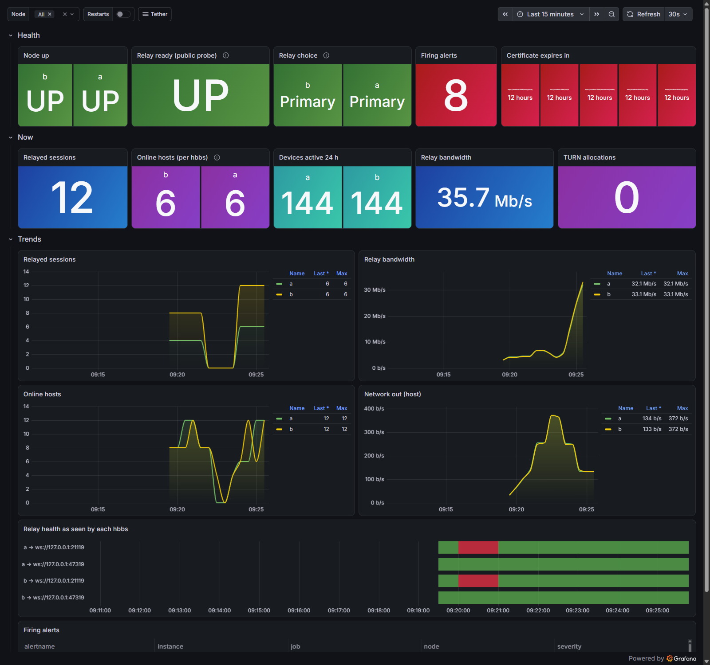
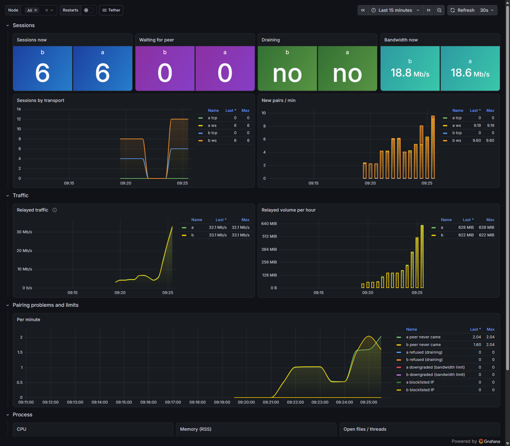
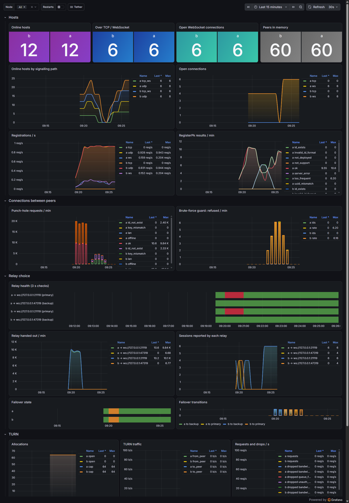
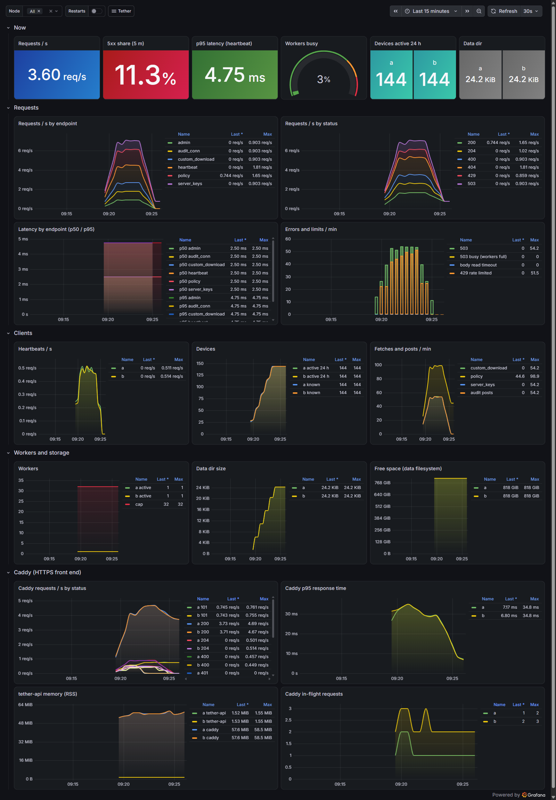
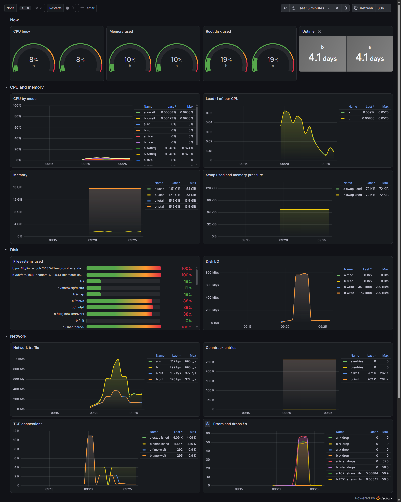
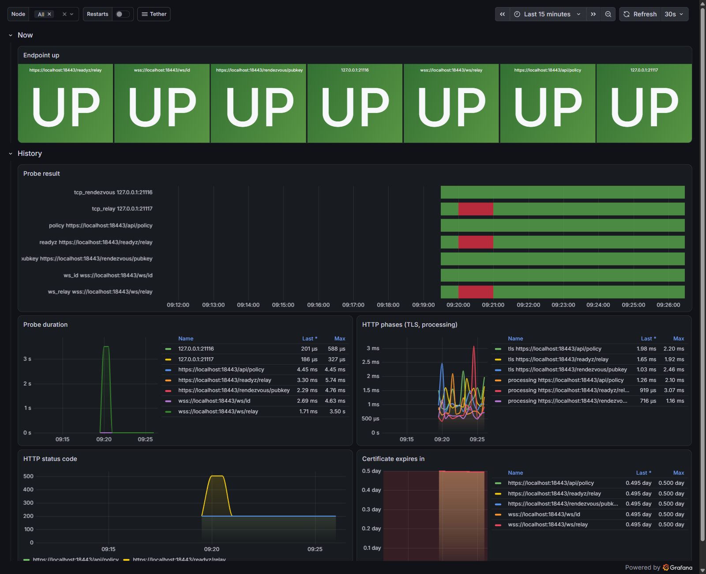

# Relay monitoring

Prometheus metrics from hbbs, hbbr, tether-api, Caddy and the hosts, public endpoint probes from
the other node, alert rules, and Grafana dashboards. Everything is free software, runs on the two
relay nodes themselves and listens on 127.0.0.1; nothing new is reachable from the Internet except
Grafana behind two passwords and `/_metrics/*` for the monitoring node's IP only.

Why Prometheus + Grafana (checked November 2026): they are still the common self-hosted baseline.
The usual alternatives are drop-in compatible rather than replacements: VictoriaMetrics (a
PromQL-compatible store that uses less RAM, worth it at much larger scale), Grafana Mimir
(multi-tenant, for platform teams), and OpenTelemetry, which has become the instrumentation and
transport layer but still needs a backend like Prometheus. None of that pays off for two nodes and
a few thousand series. Sources: [AppSignal, 5 alternatives to Prometheus in 2026](https://blog.appsignal.com/2026/06/18/5-alternatives-to-prometheus-in-2026.html),
[Simple Observability, Prometheus alternatives](https://simpleobservability.com/blog/prometheus-alternatives),
[SigNoz, Grafana alternatives](https://signoz.io/blog/grafana-alternatives/).

## Architecture

```
            Hetzner tether-desk (monitoring node)                 Oracle tether-desk2
 ┌───────────────────────────────────────────────────┐    ┌──────────────────────────────────┐
 │ Grafana 127.0.0.1:3000 ◄── Caddy /grafana/ (443)  │    │ Caddy /_metrics/* (443)          │
 │    │                       basic auth + login     │    │   only from 46.224.17.114        │
 │ Prometheus 127.0.0.1:9090 ── 30 d, ≤ 4 GB ────────┼────┼─► + basic auth, then localhost:  │
 │    │  scrapes localhost:                          │HTTPS│   hbbs 21123  hbbr 21124        │
 │    │  hbbs 21123 hbbr 21124 api 21120 caddy 21125 │    │   api 21120   caddy 21125        │
 │    │  node 9100  blackbox 9115                    │    │   node 9100   blackbox 9115 ──┐  │
 │ Alertmanager 127.0.0.1:9093 ── Telegram (opt.)    │    └───────────────────────────────┼──┘
 │ blackbox 9115 ──► probes tether-desk2's public ───┼──────────────────────►            │
 │                    endpoints                      │◄──────── probes tether-desk ◄──────┘
 └───────────────────────────────────────────────────┘
```

- **Where it runs:** Prometheus, Alertmanager and Grafana on the Hetzner primary (CX23, 4 GB; they
  take about 300-450 MB together, capped by systemd at 600 + 128 + 512 MB). The Oracle backup
  (1 GB) runs only node_exporter and blackbox_exporter (about 20 MB each).
- **Binaries:** official static releases of Prometheus, Alertmanager, node_exporter and
  blackbox_exporter in `/usr/local/bin` (pinned versions, SHA-256 checked by the installer), run by
  hardened systemd units as their own system users. Grafana OSS from Grafana's RPM repository, so
  the nightly dnf-automatic run patches it with the OS. Under SELinux enforcing all of them run as
  `unconfined_service_t` like the Tether services (binaries in `/usr/local/bin`, `bin_t`); no
  booleans, port labels or policy modules are needed. No containers.
- **The other node** is scraped over HTTPS through its Caddy at `https://tether-desk2.duckdns.org/_metrics/<job>`:
  connections from any IP other than the monitoring node's are closed at once; the monitoring
  node then needs the scrape password (basic auth, bcrypt in the Caddy snippet). No firewall port,
  no tunnel, and the same certificate the relay already has. WireGuard would work too but adds a
  kernel interface, keys and a UDP port to both firewalls for no gain at this size.
- **Probes** run from the other node: Hetzner's blackbox_exporter probes the Oracle endpoints,
  Oracle's (through its `/_metrics/probe`) probes Hetzner's. A probe that fails therefore means
  "not reachable from outside", not "process down".
- **Gap:** when the Hetzner node itself is down nothing alerts, because Prometheus is on it. For
  that, point the always-firing `Watchdog` alert at a free dead man's switch such as
  healthchecks.io (Alertmanager webhook receiver, see Notifications); not configured.

## Metrics reference

All endpoints answer `GET /metrics` in the Prometheus text format and are bound to 127.0.0.1
(hbbs/hbbr: `METRICS_ADDR`, `METRICS_PORT`; port 0 turns them off). No label carries a peer ID,
IP, key or token; label values come from fixed sets, except `relay`, which comes from hbbs's own
`-r` list (at most 16). Every process also exports `process_cpu_seconds_total`,
`process_resident_memory_bytes`, `process_virtual_memory_bytes`, `process_threads`,
`process_open_fds`, `process_max_fds`, `process_start_time_seconds` and `tether_build_info{version}`.

### hbbs (127.0.0.1:21123)

| Metric | Type | Labels | Meaning |
|---|---|---|---|
| `hbbs_peers_online` | gauge | | hosts registered within the last 30 s |
| `hbbs_peers_signalling` | gauge | `transport` = `tcp_ws` / `udp` | online hosts by signalling path (TCP or WebSocket connection, or UDP) |
| `hbbs_peers_in_memory` | gauge | | peers held in memory, online or not |
| `hbbs_connections` | gauge | `transport` = `tcp` / `ws` | open connections to the rendezvous ports (21116, 21118 behind Caddy) |
| `hbbs_register_peer_total` | counter | `transport` = `udp` / `tcp` / `ws` | RegisterPeer messages (UDP includes hbbs's own self-test, 1/s) |
| `hbbs_register_pk_total` | counter | `result` = `ok`, `uuid_mismatch`, `too_frequent`, … | RegisterPk answers |
| `hbbs_punch_hole_total` | counter | `result` = `ok`, `lan`, `offline`, `id_not_exist`, `key_mismatch` | connection requests from viewers |
| `hbbs_ip_blocked_total` | counter | `reason` = `rate` / `ids` | RegisterPk refused by the per-IP brute-force guard (> 30/min, > 300 IDs/day) |
| `hbbs_relay_healthy` | gauge | `relay`, `role` = `primary` / `backup` | 1 if the relay passed the last 3 s health check |
| `hbbs_relay_sessions` | gauge | `relay`, `role` | sessions the relay reported in that check |
| `hbbs_relay_assigned_total` | counter | `relay`, `role` (`relay="none"`: none available) | relay handed out with a punch hole / relay response |
| `hbbs_relay_failover` | gauge | | 1 while no primary is healthy and backups are handed out |
| `hbbs_relay_failover_transitions_total` | counter | `to` = `backup` / `primary` | switches |
| `hbbs_relay_checks_total` | counter | | health rounds (only with more than one relay) |
| `hbbs_turn_enabled`, `hbbs_turn_allocations`, `hbbs_turn_allocations_max` | gauge | | TURN on, open allocations, `TURN_MAX_ALLOCATIONS` |
| `hbbs_turn_allocations_total`, `hbbs_turn_allocations_refused_total` | counter | | allocations made / refused at the cap |
| `hbbs_turn_requests_total` | counter | | TURN control datagrams taken |
| `hbbs_turn_dropped_total` | counter | `reason` = `unauth_rate`, `queue_full`, `bandwidth_to_peer`, `bandwidth_from_peer` | datagrams dropped by the rate limit, a full queue or the per-allocation bandwidth cap |
| `hbbs_turn_bytes_total` | counter | `direction` = `to_peer` / `from_peer` | bytes relayed by TURN |

Not measured: lock wait times (not cheap to do without touching every lock site).

### hbbr (127.0.0.1:21124)

| Metric | Type | Labels | Meaning |
|---|---|---|---|
| `hbbr_sessions` | gauge | `transport` = `tcp` / `ws` | sessions being relayed (`ws` if either side is WebSocket) |
| `hbbr_pairs_total` | counter | `transport` | relay requests paired with their peer |
| `hbbr_pair_waiting` | gauge | | requests waiting for their peer |
| `hbbr_pair_timeouts_total` | counter | | requests whose peer did not come within 30 s |
| `hbbr_pair_refused_draining_total` | counter | | new requests refused while draining |
| `hbbr_relayed_bytes_total` | counter | | relayed bytes; each byte is received from one side and sent to the other once, so in = out (rate: `rate(...[5m]) * 8` bit/s) |
| `hbbr_downgrades_total` | counter | | sessions slowed to `LIMIT_SPEED` by the bandwidth limiter |
| `hbbr_blocked_total` | counter | | connections or sessions closed for a blocklisted IP |
| `hbbr_draining` | gauge | | 1 while draining (stopping) |

### tether-api (127.0.0.1:21120/metrics)

Answered to loopback peers only; Caddy forwards only `/api/*` and `/q/*`, so it is never public.

| Metric | Type | Labels | Meaning |
|---|---|---|---|
| `tether_api_requests_total` | counter | `endpoint`, `code` | requests; `endpoint` = `policy`, `server_keys`, `heartbeat`, `audit_conn`, `audit_file`, `audit_alarm`, `diag_upload`, `custom_download`, `admin`, `metrics`, `other` |
| `tether_api_request_duration_seconds` | histogram | `endpoint` | time from request to response written (5 ms … 120 s) |
| `tether_api_workers_active`, `tether_api_workers_max` | gauge | | requests being served, and the cap (32) |
| `tether_api_busy_rejected_total` | counter | | 503 busy at the cap |
| `tether_api_body_timeouts_total` | counter | | request bodies that did not arrive in time |
| `tether_api_devices`, `tether_api_devices_active_24h` | gauge | | devices in the list, and with a heartbeat within 24 h |
| `tether_api_data_bytes` | gauge | | size of `/var/lib/tether-api` (releases, audit, diagnostics, state) |
| `tether_api_data_fs_free_bytes`, `tether_api_data_fs_size_bytes` | gauge | | its filesystem |

Heartbeats/s, audit posts, policy and server-key fetches and custom-app downloads are
`tether_api_requests_total` by endpoint. Release downloads (`/download/*`) are served by Caddy
straight from disk and show up in Caddy's metrics only (not per file).

### Caddy (127.0.0.1:21125/metrics)

The admin API stays off: the Caddyfile turns on the `metrics` global option and serves the
`metrics` handler on a site bound to 127.0.0.1:21125. Useful series: `caddy_http_requests_total`,
`caddy_http_request_duration_seconds`, `caddy_http_requests_in_flight`, `caddy_http_response_size_bytes`.

### Hosts and probes

node_exporter (127.0.0.1:9100): CPU, memory, disks and filesystems, network, conntrack
(`node_nf_conntrack_*`), file descriptors (`node_filefd_*`), TCP (`node_netstat_*`) and the
systemd state of the Tether, monitoring and hardening units (`node_systemd_unit_state`).

blackbox_exporter (127.0.0.1:9115), per node, from the other node (`node` = the probed node,
`probe_from` = the prober, `probe` = which check):

| `probe` | Target | Passes when |
|---|---|---|
| `readyz` | `https://<host>/readyz/relay` | 200 (hbbr ready, not draining) |
| `pubkey` | `https://<host>/rendezvous/pubkey` | 200 |
| `policy` | `https://<host>/api/policy` | 200 (a policy is published) |
| `ws_id`, `ws_relay` | WebSocket upgrade of `/ws/id`, `/ws/relay` on `<host>:443` (raw request over TLS; instance `wss://<host>:443/ws/…`) | `HTTP/1.1 101` |
| `tcp_rendezvous`, `tcp_relay` | `<host>:21116`, `<host>:21117` | TCP connect |

The TLS certificate's expiry comes from the HTTPS probes (`probe_ssl_earliest_cert_expiry`).

## Dashboards

Provisioned read-only from `deploy/monitoring/grafana/dashboards/*.json` (folder "Tether"; the
Overview is the home dashboard). They are generated by
`node deploy/monitoring/grafana/build-dashboards.mjs`: change that file, regenerate, commit both.
Every dashboard has a `Node` selector and marks process restarts.

| Dashboard | Shows |
|---|---|
| Overview | node up, relay ready from outside, relay choice (primary / FAILOVER), firing alerts, certificate expiry; sessions, online hosts, active devices, bandwidth, TURN now; trends; relay health timeline; alert list |
| Relay (hbbr) | sessions by transport, pairs, waiting, draining, traffic and hourly volume, timeouts / refusals / downgrades / blocks, hbbr CPU, memory, fds |
| Signalling (hbbs) | online hosts by path, connections, registrations, RegisterPk results, punch holes by result, brute-force refusals, relay health timeline, relay hand-outs and load, failover state and transitions, TURN allocations, traffic, requests and drops, hbbs process |
| API | request rate, 5xx share, p95, workers gauge, devices, data dir; by endpoint and status, latency p50/p95, errors and limits; heartbeats, devices, fetches and posts; workers, data size, free space; Caddy requests, latency, memory, in-flight |
| Hosts | CPU, memory, root disk gauges, uptime; CPU by mode, load, memory, swap; filesystems, disk I/O; network, conntrack, TCP, drops and retransmits; open files; systemd unit states |
| Probes | every endpoint up/down, history, durations, TLS and processing time, status codes, certificate days left |








(Screenshots from the local end-to-end test, `scripts/test-monitoring.sh`: one machine playing
both nodes, `a` scraped directly and `b` through Caddy's `/_metrics/*`; the dip is the scripted
failover of the primary relay.)

## Alerts

Prometheus rules in `deploy/monitoring/prometheus/rules/tether.yml`, unit-tested with
`promtool test rules deploy/monitoring/prometheus/rules/rules.test.yml`. Firing alerts show on the
Overview and in Grafana › Alerting (Alertmanager data source).

| Alert | Fires when | Severity |
|---|---|---|
| NodeDown | node_exporter of a node unreachable for 2 min (for the other node: also its Caddy path) | critical |
| TargetDown | hbbs/hbbr/api/caddy/blackbox/alertmanager metrics unreachable for 5 min | warning |
| ProbeFailed | a public endpoint fails from the other node for 3 min | critical |
| RelayUnhealthy | a relay fails hbbs's health check for 1 min | critical |
| RelayFailover | an hbbs hands out backups (no healthy primary) for 30 s | critical |
| ServiceUnitFailed | a watched systemd unit is failed | warning |
| ServiceRestarting | hbbs/hbbr/tether-api restarted more than twice in 15 min | warning |
| CertificateExpiringSoon | TLS certificate expires in under 14 days | warning |
| DiskAlmostFull | a filesystem over 85 % for 10 min | warning |
| HighCpu | CPU over 90 % for 15 min | warning |
| MemoryLow | under 10 % memory available for 10 min | warning |
| ConntrackAlmostFull | conntrack table over 80 % | warning |
| HbbrSaturated | over 150 relayed sessions on a node, or hbbr over 80 % of its fds, for 5 min | warning |
| TurnAllocationsNearCap | TURN over 80 % of `TURN_MAX_ALLOCATIONS` | warning |
| ApiErrors | over 5 % of tether-api requests 5xx (and > 0.01/s) for 5 min | warning |
| ApiWorkersExhausted | tether-api answered 503 busy in the last 10 min | warning |
| Watchdog | always (proves the pipeline; never notified) | none |

The 150-session threshold of HbbrSaturated is a guess for a CX23's shared ~1 Gbit/s: tune it in
`tether.yml` once real numbers exist.

### Notifications

Off by default (Alertmanager receiver `none`). Proposed free channel: **Telegram**, natively
supported by Alertmanager (`telegram_configs`), pushes to the phone, no server to run:

1. In Telegram, talk to @BotFather, `/newbot`, keep the token. Send the new bot any message, then
   open `https://api.telegram.org/bot<token>/getUpdates` and read `"chat":{"id":…}`.
2. On the monitoring node: `sudo TELEGRAM_CHAT_ID=<id> TELEGRAM_BOT_TOKEN=<token> REMOTE_HOST=tether-desk2.duckdns.org ./install.sh monitor`
   (token in `/etc/tether-monitoring/telegram.token`, 0640 root:alertmanager).
3. Test: `amtool --alertmanager.url=http://127.0.0.1:9093 alert add Test severity=warning node=test`.

Alternatives: ntfy.sh (a webhook receiver; topics on the public server are readable by anyone who
guesses the name), e-mail via a free SMTP relay (`email_configs`). A dead man's switch for the
monitoring node itself: a healthchecks.io check plus a `webhook_configs` receiver routed for
`alertname="Watchdog"` with `repeat_interval: 5m`.

## Access to Grafana

`https://tether-desk.duckdns.org/grafana/` from anywhere (no IP allow-list, the admin's IP is
dynamic):

1. the browser asks for Caddy's password: user `tether`, password `/etc/tether-monitoring/grafana-web.pass`
   (bcrypt in `/etc/tether/caddy.d/grafana.caddy`); without it nothing of Grafana is reachable;
2. then Grafana's own login: user `admin`, password `/etc/tether-monitoring/grafana-admin.pass`
   (set on Grafana's first start; Grafana locks an account after repeated failed logins).

No anonymous access, no sign-up, no Gravatar, no public snapshots, no update checks; cookies are
`Secure` and `SameSite=Strict`; Caddy's `Authorization` header is not passed to Grafana.
Read the passwords once with `sudo cat /etc/tether-monitoring/grafana-web.pass /etc/tether-monitoring/grafana-admin.pass`
and keep them in a password manager. Prometheus and Alertmanager have no web access from outside;
use an SSH tunnel if needed: `ssh -L 9090:127.0.0.1:9090 tadmin@tether-desk.duckdns.org`.

## Install

From a checkout of this branch (LF line endings), copy `deploy/monitoring` and `server/caddy` to
both nodes, keeping the layout (`<dir>/deploy/monitoring`, `<dir>/server/caddy`):

```bash
# on the PC
tar -czf /tmp/mon.tgz deploy/monitoring server/caddy
scp /tmp/mon.tgz tadmin@tether-desk.duckdns.org:/tmp/
scp -i ~/.ssh/tether_oracle /tmp/mon.tgz opc@tether-desk2.duckdns.org:/tmp/
```

The hbbs, hbbr and tether-api binaries must be the ones with metrics (this branch; deploy them the
usual way, docs/relay-ha.md). Old binaries keep working; their targets just show as down.

1. **Hetzner (monitoring node):**
   ```bash
   mkdir -p /tmp/mon && tar -xzf /tmp/mon.tgz -C /tmp/mon && cd /tmp/mon/deploy/monitoring
   sudo REMOTE_HOST=tether-desk2.duckdns.org ./install.sh monitor
   ```
   Installs the exporters, Prometheus, Alertmanager, Grafana, the new Caddyfile (if the node's is
   older; the old one is kept as `Caddyfile.bak-<date>`) and `caddy.d/grafana.caddy`, validates the
   Caddy config, restarts Caddy (about a second without HTTPS). It prints the command for step 2
   with the bcrypt hash of the scrape password, and where the Grafana passwords are.
2. **Oracle (scraped node):**
   ```bash
   mkdir -p /tmp/mon && tar -xzf /tmp/mon.tgz -C /tmp/mon && cd /tmp/mon/deploy/monitoring
   sudo PEER_HOST=tether-desk.duckdns.org SCRAPE_FROM=46.224.17.114 SCRAPE_HASH='<hash printed in step 1>' ./install.sh target
   ```
3. Check on Hetzner: `curl -s 127.0.0.1:9090/api/v1/targets | grep -o '"health":"[a-z]*"' | sort | uniq -c`
   (all `up`), then open Grafana.

Re-running either command is safe (secrets are kept). Nothing is opened in firewalld, the
Hetzner Cloud Firewall or the OCI security list. Files: `/etc/tether-monitoring/` (configs,
secrets), `/var/lib/prometheus`, `/var/lib/alertmanager`, `/var/lib/grafana`,
`/etc/tether/caddy.d/`, units in `/etc/systemd/system/`.

**Secrets** (all generated by the installer, none in the repository):

| File (monitoring node) | What | Who reads it |
|---|---|---|
| `/etc/tether-monitoring/scrape.pass` | scrape password for the other node's `/_metrics/*` | prometheus (0640); its bcrypt hash goes to the other node |
| `/etc/tether-monitoring/grafana-web.pass` | Caddy basic auth in front of Grafana (user `tether`) | root only (0600); bcrypt in `caddy.d/grafana.caddy` |
| `/etc/tether-monitoring/grafana-admin.pass` | Grafana `admin` password (first start) | grafana (0640) |
| `/etc/tether-monitoring/telegram.token` | Telegram bot token (optional) | alertmanager (0640) |

To change one, edit/delete the file and re-run the installer (for Grafana's admin password after
the first start: `sudo grafana cli admin reset-admin-password '<new>'`; for the scrape password,
re-run step 2 with the new hash too).

### Kubernetes (Helm)

`metrics.enabled=true` exposes hbbs and hbbr metrics on the pod network (`METRICS_ADDR=0.0.0.0`,
ports `metrics` 21123/21124 on the headless services); `metrics.serviceMonitor.enabled=true` adds a
Prometheus Operator ServiceMonitor (`metrics.serviceMonitor.labels` for your Prometheus' selector).
The Grafana dashboards work there too if the scrape adds a `node` label (the ServiceMonitor sets it
to the pod name). tether-api's `/metrics` is loopback-only and not scraped in the chart.

## Runbook

| Alert / symptom | First checks |
|---|---|
| NodeDown (Oracle) | `ssh` to it; `systemctl status node_exporter tether-https`; from Hetzner `curl -su prometheus:$(sudo cat /etc/tether-monitoring/scrape.pass) https://tether-desk2.duckdns.org/_metrics/node \| head` (401 = password, connection closed = IP not allowed: did the Hetzner IP change?) |
| NodeDown (Hetzner) | you will not get it (see Gap); the nightly reboot at 04:00 shows as a short gap |
| ProbeFailed `readyz` | `curl -s https://<host>/readyz/relay`; 503 `draining` = hbbr stopping; `journalctl -u tether-hbbr -n 50` |
| ProbeFailed `ws_*` / `tcp_*` | Caddy (`systemctl status tether-https`), firewalld/cloud firewall, hbbs/hbbr up? |
| RelayUnhealthy / RelayFailover | Signalling dashboard › Relay health: which relay, seen by whom. `printf rs \| nc -q1 127.0.0.1 21115` on the node lists what hbbs hands out. Sessions move to the backup by themselves; fix the primary's hbbr / network. |
| CertificateExpiringSoon | `journalctl -u tether-https \| grep -i -E 'acme\|certificate'`; TLS-ALPN-01 needs 443 reachable and DNS pointing at the node |
| DiskAlmostFull | `du -sh /var/lib/* \| sort -h`; Prometheus caps itself at 4 GB; tether-api releases in `/var/lib/tether-api/download` |
| ApiErrors / ApiWorkersExhausted | `journalctl -u tether-api -n 100`; API dashboard › Errors and limits (503 busy vs 500 internal vs 507 storage) |
| HbbrSaturated | Relay dashboard: sessions, traffic; Hosts › network; consider raising the threshold or adding a relay |
| TargetDown for hbbs/hbbr/api | old binary without metrics, or the service is down: `systemctl status tether-hbbs` |

Prometheus/Alertmanager/Grafana themselves: `systemctl status prometheus alertmanager grafana-server`,
`journalctl -u prometheus -n 50`. Rule changes: edit `tether.yml`, run promtool's test, re-run the
installer (or copy to `/etc/tether-monitoring/rules/` and `systemctl reload prometheus`).

## Tests

- Unit tests: `vendor/rustdesk-server/src/metrics.rs` (rendering, counters, bounded relay labels,
  the localhost listener) and `server/api/src/metrics.rs` (endpoint set, histogram, timeouts), run
  by `scripts/test-relay.sh`.
- End to end on one Linux machine: `scripts/fetch-monitoring-tools.sh` then
  `scripts/test-monitoring.sh [build-dir]` (after `scripts/build-relay.sh`). Checks every target
  up, every dashboard panel query non-empty, all rules healthy, RelayFailover fired during a
  scripted failover, Watchdog in Alertmanager, Caddy's `/_metrics` and `/grafana` auth, and the
  rule unit tests. `KEEP=1` leaves the stack running (Grafana on http://127.0.0.1:3000/grafana/,
  `admin` / `admin-e2e`).
