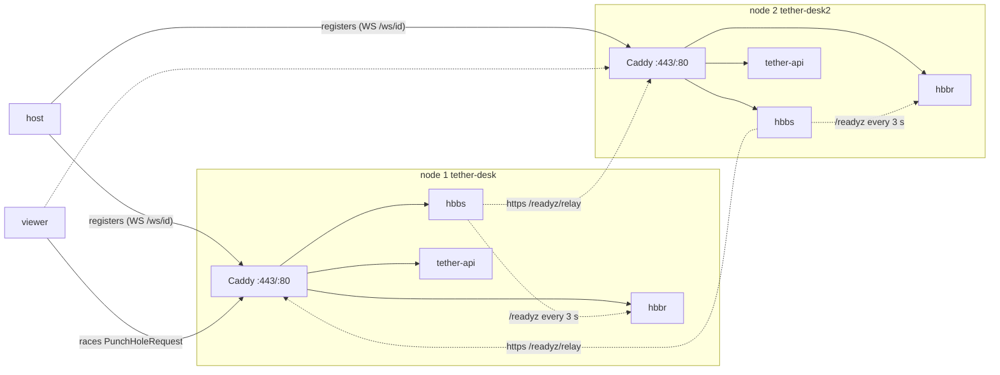

# Relay high availability

Tether can run any number of **independent relay nodes**. Each node is the full stack that runs
on the production VM today (hbbs, hbbr, Caddy, tether-api, see [deployment.md](deployment.md)).
The nodes share no state: there is no cluster protocol and no shared database. What they share is
the server key pair, so clients' pinned `TETHER_PUB_KEY` works with all of them. Availability
comes from the clients, which register with and race across all nodes, and from each hbbs being
able to hand out any node's relay.

Running nodes: `tether-desk.duckdns.org` (relay 1) and `tether-desk2.duckdns.org` (relay 2), both
Oracle Always Free E2.1.Micro VMs. Kubernetes runs the same design with per-pod nodes
([kubernetes.md](kubernetes.md)).

## Topology



## Connection flow

1. **Hosts register with every node** (client list, client side). Each node's hbbs keeps the
   host's WebSocket as its signalling path, the same as today.
2. **The viewer races its PunchHoleRequest across the nodes.** The first hbbs that knows the host
   wins. That hbbs picks a relay and sends `PunchHole{relay_server}` to the host over the host's
   registration.
3. **Relay choice (hbbs, server side).** Each hbbs has a relay list (`-r`, systemd
   `RELAY_SERVERS`). An entry has the form `<address>[|<health URL>]`:
   - Every 3 s hbbs fetches every health URL. hbbr's `/readyz` answers `200 ready sessions=N`, or
     `503 draining sessions=N` while it drains. A failed fetch (2.5 s timeout) or a non-200 status
     removes the relay from the healthy set until a later check passes.
   - hbbs hands out the **least loaded** healthy relay, by open sessions. Ties rotate. Locality
     does not matter: the relay path is client to relay, whichever hbbs answered.
   - Entries without a health URL keep the old TCP connect check on port 21117. `ws://`/`wss://`
     entries without one are always treated as healthy.
4. The host connects to the relay and returns `RelayResponse` **to the same hbbs**
   (`rendezvous_mediator` sends it to the server the PunchHole came from). That hbbs forwards it
   to the viewer, which connects to the same relay. hbbr pairs the two connections by uuid.

Production relay lists:

```
relay 1: tether-desk.duckdns.org|http://127.0.0.1:21121/readyz,tether-desk2.duckdns.org|https://tether-desk2.duckdns.org/readyz/relay
relay 2: tether-desk2.duckdns.org|http://127.0.0.1:21121/readyz,tether-desk.duckdns.org|https://tether-desk.duckdns.org/readyz/relay
```

The node checks its own hbbr directly and the other node through Caddy's `/readyz/relay` route.
Until relay 1 runs the new Caddyfile, `/readyz/relay` on relay 1 hits Caddy's catch-all
`200 Tether relay`. Relay 2's hbbs reads that as healthy with load 0, so the two versions work
together.

## Direct paths beside the relay

With policy `network.direct = auto` (default, [policy.md](policy.md#direct-connections-networkdirect))
the viewer races a direct path against the relay flow above. Nothing changes on the relays.

| Path | Badge | Status | Needs |
| --- | --- | --- | --- |
| Same LAN | `Direct (LAN)` | shipped | host with the direct listener (see below); no relay change |
| IPv6, both global | `Direct (IPv6)` | not yet | hbbs forwarding `socket_addr_v6` (newer rendezvous protocol), host side change |
| NAT hole punching | `P2P` | not yet | hbbs forwarding WebRTC offer/answer/ICE, STUN server, host side change |
| Relay (WSS/443) | `Relay` | unchanged | – |

LAN flow:

1. When the session starts, the viewer broadcasts a lookup for the host's ID (UDP 21119, every
   IPv4 interface) while it sends the PunchHoleRequest. A host with direct connections on answers
   with its listener port (21118), nothing else.
2. When the relay answer (`RelayResponse`, step 4 above) arrives, the viewer connects to the relay
   **and** to the host's LAN address at the same time. The LAN attempt runs the normal key
   exchange (the host proves the key hbbs signed for its ID, `RelayResponse.pk`) before it
   can win; a ready relay is held up to 300 ms while it is in flight.
3. The first secured path carries the session; the other is dropped (the host's relay leg times
   out at hbbr, no Accept prompt appears for it because no login is sent).

Measured 2026-11-04 (Windows PC → TetherQS in the Hyper-V VM, same subnet): LAN lookup answered in
5 ms, LAN connection secured 2–56 ms after the relay answer, badge 1.3–1.7 s and first frame
1.5–1.9 s after `--connect` (relay run before: 1.8 s / 2.5 s). Corporate VM (technician inside
the VM, egress blocked): relay as before, relay leg 118–183 ms, 19/19 `vm-ft-e2e` checks.

When nobody answers the lookup within 300 ms (other network, corporate PC whose firewall blocks
outbound UDP, also a host whose firewall blocks its own outbound answer) there is no LAN attempt and the relay is used exactly as before. The host's
password / Accept / companion-secret and permission checks run on the LAN connection like on a
relayed one (same `Connection` code; an unencrypted handshake is refused).


### IPv6 and NAT hole punching (not enabled yet)

The core already contains both (WebRTC/ICE is the path RustDesk built for WebSocket deployments:
host candidates = LAN and global IPv6, server-reflexive candidates = NAT hole punching, DTLS
bound to the signed host identity). They are off in Tether (`enable-webrtc`, `enable-udp-punch`,
`enable-ipv6-punch` = N) because the production hbbs (rustdesk-server protocol before WebRTC)
drops what they need: it rebuilds `PunchHole` without `webrtc_sdp_offer` / `socket_addr_v6`,
and does not know `IceCandidate` (rendezvous field 29). Needed, in order:

1. hbbs: update `libs/hbb_common/protos/rendezvous.proto` in vendor/rustdesk-server to the
   client's version and forward `PunchHoleRequest.{webrtc_sdp_offer,socket_addr_v6}` into
   `PunchHole`, `RelayResponse/PunchHoleSent.{webrtc_sdp_answer,socket_addr_v6}` back, and
   `IceCandidate` both ways (by peer id, over the host's WebSocket registration); test with the
   local relays (WSL) and the relay harness, then deploy to both relays.
2. A STUN server for server-reflexive candidates: coturn (STUN only, no TURN) on each relay on
   UDP 3478, or a public STUN server in `ice-servers`.
3. Clients (both ends, policy `network.direct = auto`, no proxy): `enable-webrtc = Y`,
   `ice-servers = stun:<relay>:3478`, `relay-fallback-delay` ≈ 0.5 s so a UDP-blocked network
   without a proxy waits at most that long (with a proxy no offer is made at all).

## Failures

| Event | Effect | Recovery |
| --- | --- | --- |
| hbbr process or node dies | Sessions on it drop. | The client notices (connection closed, or 3 s of silence with WS ping liveness), asks any live hbbs again and re-pairs on a healthy relay. kind measurements: 20–40 ms after a pod kill, 1.02 s after a silent node freeze with 1 s detection ([kubernetes.md](kubernetes.md)). The dead relay leaves every hbbs's healthy set within 3 s + 2.5 s; a pick that lands on it before then fails fast and the client asks again. |
| hbbs or node dies | Hosts stay registered with the other nodes. New sessions go through them (viewers race). Sessions that are already relayed do not use hbbs and continue. | The host re-registers when the node returns. |
| Planned hbbr restart (drain) | On SIGTERM hbbr reports not-ready at once and keeps relaying open sessions. For the first 5 s it still pairs new uuids (hbbs may hand it out until its next check); after that it refuses new pairings. It exits when the last session ends or after `DRAIN_TIMEOUT` (systemd 300 s, k8s 3600 s). A second signal exits at once. | Sessions still open at the timeout reconnect through another relay. |
| Planned hbbs restart | hbbs is not-ready for `DRAIN_TIMEOUT` (default 0), then exits. | Hosts re-register. Viewers use the other nodes meanwhile. |
| Caddy restart | The WebSockets through it are cut. | Clients reconnect (kind: 20–40 ms). Restart Caddy only for config changes. |
| DuckDNS or IP change | The name follows the VM (ddns timer every 5 min). | Clients use the other node meanwhile. |

Drain on a VM, with 2 nodes: `sudo systemctl restart tether-hbbr` on node 1 waits up to 300 s for
the sessions on it to end. New sessions go to node 2 within 3 s. Watch progress with
`curl -s localhost:21121/readyz`. `sudo systemctl kill -s KILL tether-hbbr` skips the wait.

## Health endpoints

Plain HTTP on every node. The OCI security list and firewalld do not open these ports; Caddy
exposes only `/readyz/relay`.

| Port | Process | `/healthz` | `/readyz` |
| --- | --- | --- | --- |
| 21121 | hbbr | 200 while running | 200 `ready sessions=<paired sessions>` / 503 `draining …` |
| 21122 | hbbs | 200 while running | 200 `ready sessions=<hosts registered over WS>` / 503 `draining …` |

`HEALTH_PORT=<port>` overrides the port, and `HEALTH_PORT=0` turns the endpoint off.
`DRAIN_TIMEOUT=<s>` sets the drain window (default 0: exit at once, the old behaviour).

## Policy, releases, devices and diagnostics on N nodes

Chosen approach: **Tether Manage writes to every node; the nodes stay independent.** Everything
Manage publishes is either signed and versioned (policy) or verified by the client (release
signatures). A node that missed a write is stale, not wrong, and Manage can see that and repair
it. Server-to-server replication would add a client, peer trust and failure modes to each
tether-api for no gain at this scale.

Server half (implemented):
- `POST /api/admin/diag-ticket` accepts an optional `"ticket":"<8 chars>"`. Manage gets the ticket
  from the first node and opens the **same ID** on the others, so the client's upload works on
  whichever node it uses. A wrong format is rejected with `400`, an existing ID with `409`
  (`server/api/tests/api.rs`).
- `GET /readyz/relay` per node (Caddy). Manage can show node health from it.

Tether Manage (implemented in 0.4.0; the server setting is a comma-separated relay list):
1. Setting: a relay list instead of one URL (default `tether-desk.duckdns.org`,
   `tether-desk2.duckdns.org`).
2. Policy: `PUT /api/admin/policy` to every node. Show the per-node result and
   `policy_serial` from `/api/admin/status`. Offer "re-publish" for nodes behind; the same signed
   document can be PUT again, and any node with a lower serial accepts it.
3. Releases and download page: upload to every node. Write each node's `latest.json` with that
   node's own host in `platforms.*.url`, so an update never depends on another node. Upload
   artifacts first and `latest.json` last on each node.
4. Devices: `GET /api/admin/devices` from every node. Merge by `uuid` and keep the newest
   `last_seen`, because a client heartbeats to whichever node it uses.
5. Diagnostics: create the ticket on the first reachable node, then `{"ticket": …}` on the others.
   List `GET /api/admin/diag` from all nodes and download from the node that reports `uploaded`.

## Capacity

- Relays carry the session traffic; hbbs carries only signalling. One E2.1.Micro has 1/8 OCPU,
  1 GB RAM and up to 480 Mbit/s network. Oracle's Always Free outbound allowance is 10 TB/month.
  Estimate (not measured): a remote-desktop session averages 1–5 Mbit/s, so one micro VM is
  bandwidth-bound at a few dozen concurrent sessions before CPU limits matter. hbbr holds two
  WebSockets per session and a small buffer; memory is not the limit.
- Least-loaded choice spreads sessions across nodes. Load is sampled every 3 s, so a burst inside
  one interval goes to the same relay (`shortcut:` comment in `rendezvous_server.rs`).
- Add a node: provision as in [deployment.md](deployment.md), copy the key pair, then add the node
  to every node's `RELAY_SERVERS` and the client server list. Restarting hbbs to load the list
  does not interrupt relayed sessions.

## Code

- `vendor/rustdesk-server/src/common.rs`: `listen_signal_and_drain`, `serve_health`.
- `vendor/rustdesk-server/src/relay_server.rs`: session count, refuse new pairings while
  draining, health server, drain on SIGTERM.
- `vendor/rustdesk-server/src/rendezvous_server.rs`: `<address>|<health URL>` entries, HTTP(S)
  checks, `pick_relay` (least loaded, then rotation), hbbs drain and health.
- Patch: `patches/rustdesk-server.patch` (regenerate with `scripts/make-patches.sh`).
- Builds and tests: `scripts/build-relay.sh`, `scripts/test-relay.sh` (WSL, static musl).

## Enabling HA on relay 1 (applied for 0.4.0)

Relay 1 and relay 2 both run the 0.4.0 bundle. How relay 1 was joined to relay 2:

```bash
# bundle from a checkout of this branch (LF line endings, see .gitattributes), with the new binaries
#   dist/linux-relay/{install.sh,bin/{hbbs,hbbr,tether-api},systemd/,caddy/}
scp -i ~/.ssh/tether_oracle -r dist/linux-relay opc@tether-desk.duckdns.org:/tmp/
ssh -i ~/.ssh/tether_oracle opc@tether-desk.duckdns.org
cd /tmp/linux-relay && sudo RELAY_SERVERS='tether-desk.duckdns.org|http://127.0.0.1:21121/readyz,tether-desk2.duckdns.org|https://tether-desk2.duckdns.org/readyz/relay' ./install.sh tether-desk.duckdns.org
# keeps /etc/tether/api.env and duckdns.env; rewrites server.env; restarts all services
curl -s https://tether-desk.duckdns.org/readyz/relay     # -> ready sessions=0
```

The installer restarts hbbr, hbbs and Caddy, so sessions open on relay 1 at that moment
reconnect (through relay 2 once clients know it). Do it at a quiet time. Later restarts of the
new hbbr drain.
