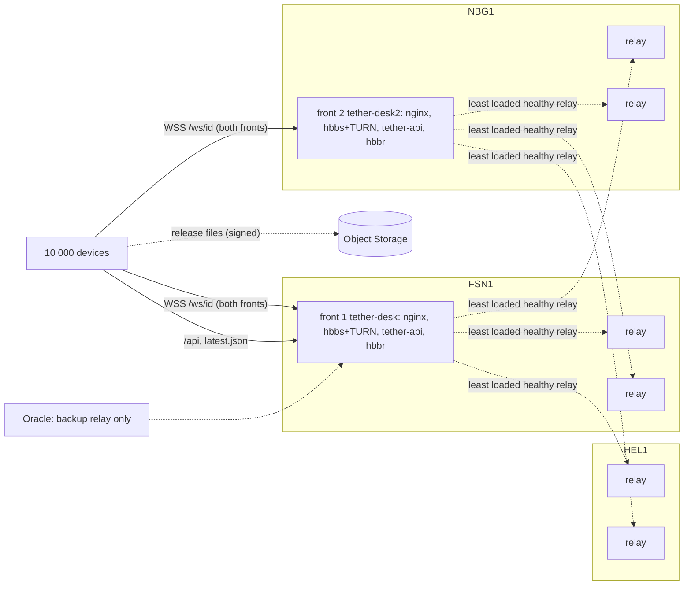

# Scaling to 10 000 users and 3 000 concurrent sessions

Target: 10 000 registered devices (hosts and technician apps; every one keeps a registration at
each rendezvous node) and 3 000 sessions at the same time. This page has the capacity model, what
was measured and how, the bottlenecks found and fixed, the architecture and cost, and the rollout
and runbook. Everything stays wire-compatible: old clients keep working with the new servers and
new clients with old servers.

Numbers marked *measured* come from `tools/load` on one PC (method below); *assumed* ones are
estimates with the reason given; *computed* ones follow from the two.

## Short version

| | Today (CX23 + Oracle) | Needed for 10k / 3k |
|---|---|---|
| Rendezvous (hbbs + front end), per node | breaks around 4 000 devices on Oracle (1 GB RAM), ~5 000 on the CX23 (CPU) | 10 000 WebSockets: nginx 0.41 GB + 0.43 core (Caddy 1.1 GB + 0.76 core), hbbs 0.24 GB + 0.22 core (*measured*, [proxy-benchmark.md](proxy-benchmark.md)) |
| Relay traffic | one 1 Gbit node | 1.6–1.8 Gbit/s peak expected, 2.7 pessimistic, 3.5 Gbit/s if every session were relayed (*computed*) |
| Relay CPU | – | 3.2–3.5 cores per relayed Gbit/s at 0.5–1 Gbit/s per node, front end + hbbr, about the same for nginx and Caddy (*measured*) |
| tether-api | fine | 33 req/s normal, 500 req/s with `policy.fast-apply`; 1 500 req/s took one core (*measured*) |
| Recommended | | **8 × Hetzner AX41 in FSN1 / NBG1 / HEL1 (3 / 3 / 2), nginx fronts: €472/month** + object storage for releases (€6.49): a whole location down still leaves the pessimistic peak at 53 % of port and CPU ([Target architecture](#target-architecture-10-000--3-000-with-failures-and-headroom)) |
| Cheaper | | 6 × AX41 (€354): N+1, survives a location only at the expected peak; Cloud fleet (€308): best-effort bandwidth |

Fixed on this branch (tests before/after below): hbbs restart took minutes behind busy NATs, hbbs
listen backlog overflowed in reconnect storms, hbbr spent a third of its CPU in musl's allocator,
tether-api rate-limited whole offices' heartbeats, custom-app downloads held tether-api workers,
the device list was capped at exactly 10 000.

## Capacity model

### Sessions: direct or relayed

Paths in order of preference ([relay-ha.md](relay-ha.md)): same LAN, WebRTC (IPv6 / NAT hole
punching), TURN over UDP through hbbs, WebSocket relay through hbbr on 443. A proxy at either end,
UDP blocked, or `network.direct = off` forces the WebSocket relay; Tether's market (managed
companies) has many such ends.

| Path | Expected | Pessimistic | Why (*assumed*) |
|---|---|---|---|
| LAN | 10 % | 5 % | in-house IT supporting colleagues |
| WebRTC direct (IPv6 / P2P) | 35 % | 15 % | both ends without proxy, UDP open, NATs not both symmetric |
| TURN (Relay UDP, hbbs) | 5 % | 5 % | at most `TURN_MAX_ALLOCATIONS` = 64 per hbbs node; the rest goes to hbbr |
| WebSocket relay (hbbr) | 50 % | 75 % | proxy or UDP blocked at either end |

At 3 000 sessions: 1 500 relayed by hbbr expected, 2 250 pessimistic, 3 000 worst case.

### Bitrate per session

Host to viewer, from [performance.md](performance.md) (*measured* there, AV1, internet relay):
idle 136–169 kbit/s, scrolling 533–641 kbit/s, photo every 2 s 5.6–7.6 Mbit/s, full-screen
motion 4.8 Mbit/s on a constrained path (36–38 Mbit/s unconstrained). Time mix of a support
session (*assumed*):

| Content | Share of time | Mbit/s |
|---|---|---|
| idle / reading | 55 % | 0.16 |
| typing, scrolling, office | 35 % | 0.6 |
| photos, image-heavy pages | 8 % | 6.5 |
| video / full-screen motion | 2 % | 10 (path- and QoS-limited) |
| **mean** | | **1.0** |

Viewer to host (input, acks): 0.05 Mbit/s (*assumed*, not measured). hbbr carries both
directions, so a relayed session costs **1.05 Mbit/s in and 1.05 Mbit/s out** of the relay node.
Per session the spread is large (σ ≈ 2.1 Mbit/s); summed over n independent sessions the peak
(p99.9) is mean + 3.1 σ √n:

| Relayed sessions | Mean out | p99.9 out |
|---|---|---|
| 1 500 (expected) | 1.58 Gbit/s | 1.83 Gbit/s |
| 2 250 (pessimistic) | 2.36 Gbit/s | 2.67 Gbit/s |
| 3 000 (all relayed) | 3.15 Gbit/s | 3.51 Gbit/s |

Monthly relay egress (*computed*, 3 000 concurrent for the equivalent of 6 h on 22 workdays =
132 h): 94 TB expected, 140 TB pessimistic. Hetzner bills outgoing traffic only.

### Rendezvous (hbbs) per node

Each device keeps one TLS WebSocket to every rendezvous node (`tether-desk`, `tether-desk2`), so
**each** node holds all 10 000:

| | Per second | Source |
|---|---|---|
| WebSocket pings in / pongs out | 10 000 / 10 000 | client pings every second (3 s silence = reconnect) |
| hbbs heartbeats out / echoes in | 500 / 500 | every 20 s |
| Session set-ups | ~2 (×2: viewers race both nodes) | 3 000 sessions of ~30 min (*assumed*) |
| Outbound bytes | ~0.8 MB/s = 6.4 Mbit/s = **2.1 TB/month** | pong 24 B TLS record + 52 B TCP/IP per device per second (*computed*) |
| Sockets | 10 000 TLS + 10 000 loopback (Caddy↔hbbs): Caddy 20 012 fds, hbbs 10 020 (*measured*) |
| conntrack entries | ~20 000 (both legs tracked) + relayed legs |

Stock RustDesk clients on UDP or TCP 21116 are cheaper for hbbs than WebSockets (below).

### tether-api

All devices use the **first** reachable relay API (`tether-desk`). Per device every
`policy.refresh-minutes` (15): `GET /api/server-keys`, `GET /api/policy` (304 when current),
`POST /api/heartbeat`.

| | Requests/s |
|---|---|
| normal (15 min) | 33 |
| `policy.fast-apply` (1 min) | 500 |
| all 10 000 devices within 20 s (after an outage) | 1 500 |
| update manifests (`update.check-hours` 6, served by Caddy) | 0.5 |
| session audit posts (~4 per session) | ~7 |

Audit volume: ~7 records/s × ~450 B ≈ 120 MB per busy day, so the default `AUDIT_MAX_MB=50` keeps
less than a day. For 90 days set `AUDIT_MAX_MB=12000` in `/etc/tether/api.env` (12 GB disk;
the admin audit view reads files linearly, so keep `since` narrow).

Device status (`/api/status`): the relay paces devices to `STATUS_TARGET_RPS` (10 posts/s) by
the `next` it answers. `tools/load/status-run.sh` (same PC as below): 20 000 devices with 4
products and 3 faults each (every 20th: 8 and 10), posting at that pace for 10 min with 5 % full
reports, 2 new enrolments per second for 5 min, the team summary (member-signed) every 30 s and
`/metrics` every 15 s (*measured*, 2026-11-24, after `nonces.json` moved out of the state lock):

| | baseline p50 / p99 / p99.9 / max | during the run p50 / p99 / p99.9 / max |
|---|---|---|
| `POST /api/heartbeat` | 0.42 / 0.83 / 1.08 / 7.4 ms | 0.42 / 0.85 / 3.44 / 13.7 ms |
| `GET /api/policy` | 0.41 / 0.80 / 1.27 / 7.4 ms | 0.42 / 0.84 / 3.09 / 16.2 ms |

6 044 status posts, all 200 (no 429); 600 enrolments, all 200; no 5xx. All criteria passed,
including "no request slower than 50 ms". With `SELF_CHECK=1` the generator reports its own
pauses (a 1 ms sleep woke up at most 2.9 ms late during the run), and with `STATUS_TRACE_LOCK=1`
tether-api logs every state-lock hold over 20 ms: none in this run. tether-api RSS: 30.6 MiB
right after start with the 20 000 pins, 32.2 MiB after the warm-up (the reference), 34.2 MiB at
the end and at the peak. The run before (2026-11-23) failed the 50 ms limit (117.7 ms): every
member- or admin-signed request then wrote and fsynced `nonces.json` under the state lock; it is
now written after the lock is released, before the answer.

Software lists (`STATUS_SBOM=on`): *measured*, 2026-11-24, **a short run at 5 000 devices, not the
20 000-device run above**: `DEVICES=5000 SECS=240 WARMUP=30 BASELINE=30 SELF_CHECK=1
tools/load/status-run.sh`, the relay and the generator on one developer PC under WSL2 (the machine
was not otherwise idle; made before the review fixes to the order of the upload checks, not
repeated after them), once without and once with `STATUS_SBOM=on`. With it, one thread uploads
a 60 KiB document for each device in turn (`PUT /api/status/sbom`, device-signed) at
`STATUS_SBOM_RPS`, the default 2 per second, for the whole run: 480 uploads, 28 MiB. Everything
else is as in the run above, but with 5 000 devices (2 351 and 2 393 status posts, 480 enrolments).
p50 / p99 / p99.9 / max in ms, baseline then during the run:

| | without uploads | with uploads |
|---|---|---|
| `POST /api/heartbeat`, baseline | 0.48 / 2.03 / 4.95 / 4.95 | 0.48 / 4.99 / 29.77 / 29.77 |
| `POST /api/heartbeat`, during | 0.50 / 2.55 / 15.77 / 30.96 | 0.51 / 3.32 / 15.02 / 24.94 |
| `GET /api/policy`, baseline | 0.48 / 1.16 / 6.00 / 6.00 | 0.47 / 10.57 / 18.26 / 18.26 |
| `GET /api/policy`, during | 0.50 / 2.39 / 16.67 / 28.27 | 0.31 / 5.45 / 24.31 / 33.19 |
| `PUT /api/status/sbom` | | 3.67 / 45.87 / 95.07 / 95.07 |

478 of the 480 uploads were `204`; two were `429 busy` (the generator spaces them 500 ms apart and
the relay counts per wall-clock second, so a second can get three). No `5xx` and no connection
error in either run. The probes stayed under 50 ms; other requests did not: the slowest status post,
enrolment and summary took 361.6, 486.4 and 116.0 ms without uploads and 39.6, 96.7 and 72.1 ms
with them (a short run on a PC that was doing other things: single slow requests, not a trend). tether-api RSS: 12.0 MiB after the
warm-up without uploads and 14.8 MiB at the end and at the peak; 12.1 MiB and 15.2 MiB with them.
In both runs the generator's own criteria show FAIL on a short run: the RSS at the end is more
than 10 % above the reference taken after a 30 s warm-up (it keeps growing for the first minutes
of a run; the 20 000-device run above is 10 minutes with a 60 s warm-up) and, without uploads,
the p99.9 of the probes is above 1.5 x the baseline's (a baseline of 600 samples has a noisy
p99.9: with uploads the baseline itself had 29.8 ms). The two runs do not separate the uploads' cost from this machine's noise: the uploads were
accepted (478 of 480) and no `5xx` occurred, and that is all they show. They do not show a pass of the
20 000-device criteria, the run at 20 000 devices with uploads was **not done**, and both runs
predate the two rounds of review fixes to the upload checks (the order of the checks, the budget,
the device's hour, the record scan), which were not measured again. The differences between the two
columns are within the spread of one run to the next here: do not read them as an effect of the
uploads, in either direction.

**1 000 technician desktops** (*measured*, 2026-11-25, same PC: i5-13600KF, WSL2 Ubuntu 24.04,
kernel 6.18; the static musl `tether-api` of `scripts/build-relay.sh`, as deployed, in a systemd user
scope with `MemoryMax=64M` and `MemorySwapMax=0`; team audit log on; raw output in
`tools/load/results/status-members-2026-11-25-*.txt`). Command:

```
API_BIN=~/ha-build/bin/tether-api DEVICES=20000 SECS=900 WARMUP=60 BASELINE=60 MEMORY_MAX=64M \
  STATUS_SBOM=on SBOM_DEVICES=2000 SBOM_UPLOAD_RPS=0 CUSTOMERS=500 SELF_CHECK=1 [STATUS_TRACE_LOCK=1] \
  MEMBERS=1000 SCOPED=500 JUNK=32 tools/load/status-run.sh
```

20 000 devices in 500 customers post at the paced 10 per second (`next` 2 000 s, 5 % full reports),
2 000 of them have a stored 60 KiB software list (none uploaded during the run), 600 enrol in the
first 5 minutes. 1 000 members of a signed team document, each with its own key (`kid`) and
address: 500 see every customer, 500 one customer each (40 devices), so 501 scopes. Each fetches
the summary every 5 minutes with `If-None-Match` (90 % with `Accept-Encoding: gzip`, 10 % without,
as a desktop before 0.7), opens one host's report every 5 minutes and one software list every 15.
Meanwhile 32 junk requests a second (member signatures of unknown keys without `kid`) come at once
from one address. The reference run is the same without members and junk (`MEMBERS=0`).

| p50 / p99 / p99.9 / max, ms | devices only | with 1 000 desktops (final code) |
|---|---|---|
| `POST /api/heartbeat` probe, baseline | 0.51 / 0.88 / 1.37 / 22.4 | 0.46 / 0.84 / 1.94 / 6.9 |
| `POST /api/heartbeat` probe, during the run | 0.51 / 0.90 / 4.30 / 137.1 | 0.46 / 0.91 / 4.02 / 32.4 |
| `POST /api/status` (device posts, 9.9 per s) | 0.55 / 12.6 / 69.1 / 154.2 | 0.50 / 4.96 / 55.9 / 102.0 |
| member summary (3.33 per s) | | 6.6 / 363 / 1 661 / 2 408 |
| member host report (3.33 per s) | | 3.1 / 67 / 119 / 156 |
| member software list (1.11 per s) | | 3.1 / 60 / 211 / 212 |
| junk without `kid` (32 per s) | | 1.3 / 5.0 / 60 / 185; 28 727 `429` (the failure limit), 64 `401`, 9 `503 busy` |

- **Summary size**: 20 257 KB plain, 1 756 KB gzip for 19 954 hosts (11.5 ×; the design's
  estimate was 8 to 10 ×). Writing the gzip copy takes about 0.19 s and 0.25 MB of memory (RSS
  +0.25 MB, peak +0.44 MB, flate2 1.1.11 with miniz_oxide 0.9.1, measured on its own on that file).
- **Bytes out for summaries**: 6.0 MB/s at 3.33 summaries a second: the 10 % of old desktops
  without gzip took 3.4 of them (200 answers of 15.2 MB on average), the 90 % with gzip 2.6 MB/s.
  All with gzip would be about 2.9 MB/s, all without about 34 MB/s (*computed* from these answers).
  These are loopback numbers: TLS and Caddy were not in the path.
- **304 share**: 33.3 % (1 000 of 3 000). In 15 minutes each member polls 3 times and its first poll
  has no tag, so at most 67 % can be `304`. Members of one customer got `304` on every later poll
  but the first after the enrolment phase; members who see every customer got almost none: at
  20 000 devices something every one of them sees changes in every 30 s (here new hosts and their
  first full reports; in a real fleet any change of health), so the whole-fleet summary is sent
  again on nearly every poll. Rounding `last_seen` per entry, as the design proposed, would not
  have given `304` either: with 20 000 devices about 3 per second cross such a rounding boundary.
  The tag therefore leaves `last_seen` (and `next`) out and hashes the window of the stale threshold
  instead ([api.md](api.md#get-apiteamstatus-member-signed)). At 20 000 devices that window is 90
  minutes (3 × `next` of 2 000 s, rounded down to 15 minutes): while `304`s come, a desktop's
  "reported N ago" can be up to that old; the `stale` flag is not affected (it is part of the tag). The next step for whole-fleet members
  is a delta route, as the design says; not built.
- **Rebuilds**: 1 497 summary builds in 900 s took 21.7 s together; a whole-fleet build takes about
  1 s (31 builds took 31.9 s in the reference run, the longest 2.9 s), so the ~1 470 one-customer
  builds took about a second together (*estimated* from the totals). Every one-customer poll
  rebuilds its scope (its file is older than 30 s), walking the whole fleet in chunks of 1 000 under
  the lock, but copying only its own hosts: cheap at this rate, so it was left so. With the
  former limit of 32 cached scopes, a one-customer request that came while a whole-fleet build ran
  found no file of its own and waited for the build holding a worker (the code then allowed up to
  30 s): in that run 2 heartbeats, 3 posts and a host report got `503 busy`. Every scope now keeps
  its file (up to 2 001, one per possible member) as long as all files together stay under the
  256 MiB bound; at 20 000 devices one broad scope is about 22 MB (plain and gzip), so 12 or more
  broad scopes evict each other. A request whose scope has no file waits for a build, but at most 4
  requests wait at once relay-wide, each at most 5 s; any other gets `503 status summary not ready`
  with `Retry-After: 5` at once, so waiting requests can hold at most 4 of the 32 workers.
- **Memory**: RSS 35.9 MiB after the warm-up, 40.3 MiB at the peak (reference run: 38.7 MiB). The
  scope's `memory.peak` was 64 MiB, its limit, in every run: the page cache of the files the relay
  writes (summaries, `seen.json`, reports) counts against `MemoryMax`, and the kernel reclaimed it
  (7 132 `max` events, no OOM kill; at the end 37.7 MiB anonymous, 18.9 MiB file). A **glibc** build
  of the same code (the default of `status-run.sh` without `API_BIN`) grew to 61.6 MiB RSS and was
  OOM-killed after 9 minutes of the same load: the deployed build is the musl one; do not run a
  glibc build under `MemoryMax=64M` with this load.
- **Audit log**: 5 017 records in 15 minutes (1.4 MB), none dropped, no failed write; the
  summary is one record per member and hour, every report and software-list read one record.
- **Refused**: no `429` for any member or device; `503 busy` for 10 requests in 900 s (1 device
  post, 9 junk): 32 junk connections a second at once fill all 32 workers for a moment. The run's
  own checks printed FAIL three times, for these: "no 5xx and no connection errors" (the 10
  `503 busy`), "every status post accepted or 429" (the one device post with `503`) and "every
  member request answered 200 or 304" (11 host reports `404`: devices enrolled during the run had no
  report yet).
  `STATUS_TRACE_LOCK=1`: 3 state-lock holds over 20 ms, all `maintain` (28 ms at most).
- **One run stalled**: a repeat of the run (the same code) had a pause of about 10 s in which
  every route waited (heartbeat max 9.5 s, 1 196 `503 busy`, among them 275 heartbeat probes and 167
  device posts). The generator's own pauses stayed under 50 ms, so the relay (or its I/O) stood
  still; the run with the lock trace did not show it again. *Not explained*: candidates are a
  writeback stall of the WSL disk with the scope at its memory limit, or the host. Measure on a
  real server before relying on more than one run here.

Not measured: TLS and Caddy in front, real networks, more than 15 minutes, 2 000 members, desktops
signed in through an identity provider (sessions), uploads of software
lists during the member load, the fleet's real rate of health changes (which decides the 304 share
of whole-fleet members).

**Staff sign-in** (0.7.0; *measured* by hand, 2026-11-25, static musl build): the HTTPS client that
fetches the provider's keys made `tether-api` 1.89 MB larger (3 085 408 to 4 973 808 bytes) and its
RSS after start 0.7 MB larger (2 584 to 3 320 kB); one real key fetch from Microsoft's public
endpoint (discovery and keys, 330 ms) raised the peak RSS by 0.8 MB. A session is about 300 to 400
bytes in memory (*estimated*), at most 5 000 of them; a token is verified once per person, relay and
renewal (about once an hour), not per request. Member lookup over 2 000 key entries: about 105 ms
for the last key without `kid` (release build, outside the state lock), about 3 ms with `kid`.
*Not measured*: a load run with 1 000 signed-in desktops, renewals at scale, the provider's answer
times from a real relay.

**Software search** (*measured*, 2026-11-25, same PC and build, `MemoryMax=64M`; raw output in
`tools/load/results/status-search-2026-11-25-*.txt`). The run above with every one of the 20 000
devices holding a stored list (60 KiB, 200 programs each, with install paths and a hardware serial),
`SEARCH=1`: `STATUS_SOFTWARE_SEARCH=on`, the signed team document written before the start, no
sidecar at the start (the scan builds them all), and one search every 10 s from the start of the
warm-up (eight terms in turn: programs on most hosts, on a few, a version prefix, and terms nobody
has). 600 s run, 60 s warm-up and baseline; the reference is the same run without the search.

```
API_BIN=~/ha-build/bin/tether-api DEVICES=20000 SECS=600 WARMUP=60 BASELINE=60 MEMORY_MAX=64M \
  STATUS_SBOM=on SBOM_DEVICES=20000 SBOM_UPLOAD_RPS=0 CUSTOMERS=500 SELF_CHECK=1 STATUS_TRACE_LOCK=1 \
  MEMBERS=1000 SCOPED=500 JUNK=32 SEARCH=1 SEARCH_S=10 tools/load/status-run.sh
```

- **Start-up scan**: 19 900 sidecars built (234 MB, about 12 KB each) in about 350 s, about 57 a
  second, while the relay served the full load; searches meanwhile counted the rest as `pending`.
- **Search time** over 19 900 sidecars once all were built: 2.1 to 4.3 s (p50 about 2.7 s); the
  slowest are terms nobody has (every line of every sidecar is read). Cold and warm are the same
  here: the 234 MB of sidecars do not fit in the page cache the scope's 64 MiB leaves, so every search
  reads them from disk. Answers of 2 000 hosts were 176 to 206 KB.
- **Memory**: peak RSS over the relay's life 46.5 MiB with the search (reached while the scan built
  sidecars), 42.1 MiB without; RSS at the end 41.7 vs 40.2 MiB. A search itself moved RSS by less
  than 1 MiB.
- **Device requests**: heartbeat probe during the run p50 / p99 / p99.9 / max 0.45 / 3.29 / 16.7 /
  41.2 ms with the search, 0.51 / 1.22 / 18.9 / 134.8 ms without; device posts p99 29.7 ms vs
  13.8 ms. The p99 rise is the disk: reading 234 MB every 10 s inside the 64 MiB scope (91 420
  `max` reclaim events against 4 797). No state-lock hold over 20 ms came from the search or the scan.
  On a real server, the first thing to check is the disk.
- **The run with the search FAILED the load tool's own latency checks** for heartbeats and policy
  reads (the limits are derived from the baseline minute before the load): heartbeat p99 3.29 ms
  against a limit of 3.03 ms (1.2 x 0.86 + 2), p99.9 16.67 ms against 14.71 ms (1.5 x 6.47 + 5);
  policy p99 3.28 ms against 3.10 ms, p99.9 17.15 ms against 14.77 ms: 0.2 to 0.3 ms over at p99,
  2 to 2.4 ms over at p99.9. The slowest-request check passed. (The reference run without the
  search failed other checks, listed in its raw output.)
- **Search time against the plan's limit**: 2.1 to 4.3 s per search once all sidecars were built,
  against the 5 s the plan set. It grows with the size of the lists (this run had 200 programs per
  machine; several hundred more per machine pass 5 s) and with the number of machines; past the
  10 s budget a search answers `"partial": true`.
- **Under contention**: one search runs at a time relay-wide, so at this size about 20 searches a
  minute can run at all. Members with a customer scope do not share cached answers with each other
  or with unscoped members (the cache key holds the scope). When many technicians search at once,
  most are answered `429 busy` and their desktop retries a few times before it says the relay is
  busy.

Disk writes of the status store at 20 000 devices: `seen.json` (about 22 MB, *estimated* from the
entry sizes) is rewritten at most every 5 minutes, about 6 GB a day; a hard kill loses at most 5
minutes of last-seen times (a stop by systemd flushes it). Summary entries are capped at 2 KiB.

Pre-existing, independent of device status: `maintain` writes and fsyncs `devices.json` (the
Tether heartbeat list, about 1.4 MB per 10 000 devices, *measured* above) under the state lock
once a minute when it changed. That hold grows with the fleet (*not measured* at 50 000; a few
to some tens of ms *estimated*). Follow-up: flush it from a snapshot outside the lock, as
`seen.json` is. The
default `STATUS_MAX_DEVICES` is 20 000, the size tested within `MemoryMax=64M`; for more devices
allow about 1.5 MiB per 1 000 devices above that (for example 50 000 devices: `MemoryMax=128M`,
*not measured*).

Releases: a 35 MB update to all 10 000 devices is 350 GB, normally spread over
`update.check-hours` (6 h: 130 Mbit/s). A **forced** update or a policy change makes every device
check within its 15-minute policy cycle: 350 GB in 15 min would need 3.1 Gbit/s, so one 1 Gbit
node is saturated for ~50 minutes, together with the sessions it relays. Roll releases out per
channel (policy groups with `update.channel`), not to everyone at once, or point `platforms.*.url`
in `latest.json` at a node that relays nothing (the updaters accept any https URL; the files are
signed). Downloads cost Caddy little CPU: 5 Gbit/s over TLS took 1.8 cores (*measured*).

### TURN

TURN media runs inside hbbs on its single UDP socket, at most 64 allocations per node
(`TURN_MAX_ALLOCATIONS`), 32 Mbit/s each. Not load-tested here (it needs WebRTC clients;
`tools/turn-bench` measures one session). With 64 × ~1 Mbit/s per node it is a small share; when
allocations run out, ICE fails over to the WebSocket relay, which the node count above already
covers. hbbs now asks for an 8 MiB UDP receive buffer (`-M`, sysctl `rmem_max`).

## Measured

### Method

- PC: Intel i5-13600KF, WSL2 Ubuntu 24.04 (12 CPUs visible, 16 GB), everything on loopback. CPU
  is given as **% of one PC core** (`/proc/<pid>/stat`, 5 s samples, `tools/load/sample.sh`);
  memory is RSS. A Hetzner vCPU is slower than one of these cores; this page assumes 0.5–0.7 of
  one (*not measured*).
- `tools/load/stack.sh` starts hbbs, hbbr, tether-api and Caddy 2.10.2 with the production
  Caddyfile (`tls internal`, ports 25xxx/28xxx) and a second, client-side Caddy that adds TLS for
  the load generator, so the Caddy under test does exactly the production TLS work.
- `tether-load` (`vendor/rustdesk-server/src/bin/tether-load.rs`): hosts register like the
  client (RegisterPk, WebSocket ping every second, heartbeat echo, 3 s silence = reconnect) from
  many loopback source IPs (127.1.x.y, i.e. NATs of a given size); viewers send PunchHoleRequest
  and the host answers RelayResponse through hbbs; relay pairs pump timestamped frames at a given
  bitrate both ways; tether-api devices run their 15-minute cycle with X-Forwarded-For.
- Raw results: `tools/load/results/*.jsonl` (one JSON line per 5 s report or sample). Each script
  in `tools/load` says how to run it; builds: `scripts/build-relay.sh` (now also `tether-load`).
- Limits: loopback has no RTT, loss or NIC (relay latencies here are CPU queueing only); one PC
  runs server and load generator, which share CPUs; runs are 1–2 minutes.

### Rendezvous

| Run | hbbs CPU | hbbs RSS | Caddy CPU | Caddy RSS | Latency |
|---|---|---|---|---|---|
| 10 000 WebSocket hosts, direct, before | 25 % | 239 MB | – | – | ping RTT p99 0.3 ms, PunchHole p99 0.3 ms, RelayResponse p99 0.6 ms |
| same, after (no lock per frame) | 20–23 % | 239 MB | – | – | same |
| 30 000 WebSocket hosts, direct | 46–50 % | 697 MB | – | – | ping p99 0.7 ms, RelayResponse p99 2.0 ms |
| 10 000 hosts through Caddy with TLS | 22 % | 239 MB | **78–81 %** | **1 415–1 430 MB** | registration p99 7–21 ms, RelayResponse p99 3.2 ms |
| 10 000 hosts through Caddy, no TLS | – | 238 MB | – | 1 090 MB | |
| 10 000 TCP hosts (21116) | 5–7 % | 385 MB | | | |
| 10 000 UDP hosts (21116) | 6 % | 46 MB | | | |

hbbs is linear (≈ 2.2 % of a core per 1 000 WebSocket hosts, 24 KB per host) and not the limit.
**Caddy is**: ~145 KB and ~0.08 % of a core per idle TLS WebSocket. Its WebSocket proxy holds
two 32 KB copy buffers per connection, which no Caddyfile option changes. `GOMEMLIMIT=400MiB`
(below the working set) made Caddy spend 10 cores on garbage collection: never set GOMEMLIMIT or
a systemd MemoryMax below ~1.6 × devices × 145 KB. (Re-measured with the front-end benchmark, PSS with an
HAProxy client layer: Caddy 111 KB, nginx 41 KB, HAProxy 20 KB per idle TLS WebSocket;
[proxy-benchmark.md](proxy-benchmark.md).)

### Relay

1 Mbit/s host→viewer + 50 kbit/s back per pair, 30 frames/s each way:

| Run | hbbr CPU | Caddy CPU | Throughput | Frame latency |
|---|---|---|---|---|
| 500 pairs, direct, musl allocator / mimalloc | 93 % / 58 % | – | 0.5 Gbit/s | p99 1.1 / 0.9 ms |
| 1 000 pairs, direct, musl / mimalloc | 178 % / 124 % | – | 1.0 Gbit/s | p99 1.6 / 1.4 ms |
| 1 500 pairs, direct, musl / mimalloc | 238 % / 157 % | – | 1.5 Gbit/s | p99 2.2 / 1.7 ms |
| 1 500 pairs, direct, hbbr default `TOTAL_BANDWIDTH` | 140–155 % | – | **capped at 1.06 Gbit/s** | **p50 1.2–1.5 s, p99 14–16 s**, stalls |
| 500 pairs through Caddy with TLS (mimalloc) | 51 % | **170 %** | 0.5 Gbit/s | p99 1.9 ms |

Per relayed Gbit/s: hbbr ~1.1 cores, Caddy (TLS) ~3.3 cores, together **4.4 PC cores**. Caddy
RSS during relaying: ~210 KB per relayed WebSocket (two per session). hbbr: ~45 KB per session.
At 1 Gbit/s per node the same comparison gives 3.3 PC cores per Gbit/s for Caddy + hbbr and 3.2
for nginx + hbbr ([proxy-benchmark.md](proxy-benchmark.md) (b)): the 4.4 above is the 0.5 Gbit/s
point, where fixed per-frame costs weigh more. Planning below uses 3.5.

hbbr's `TOTAL_BANDWIDTH` (default 1024 Mb/s for the whole process) is a hard cap: above it every
session on that relay queues, by seconds. It equals a 1 Gbit/s port, so size nodes so that
neither is reached (≤ 65 %), and set `TOTAL_BANDWIDTH` to what the node can actually send if that
is more (k8s pods, 10G servers).

### tether-api

| Run | CPU | RSS | Latency | Notes |
|---|---|---|---|---|
| 10 000 devices, 1-min cycle (500 req/s), 200 IPs | 10–13 % | 6.4 MB | p99 1 ms | before: a 429 burst for 50 % of heartbeats every minute (50 devices per IP > 30/min); after: only new devices in the first minute |
| all 10 000 devices in 20 s (1 500 req/s) | 74–89 % | 5 MB | p99 6 ms | no 503; `devices.json` 1.36 MB |
| 30 slow `/q/` downloads (2 Mbit/s each) + 8 API clients, before | | | | 30 of 32 workers held; 503 to heartbeats and policy fetches |
| same, after (Caddy sends the file) | | | | 0 × 503, tether-api 35 threads instead of 65 |
| 40 release uploads, 1 byte / 25 s (forged `Tether-Sig` with a current `ts`) + 1 heartbeat/s for 90 s, before | | | | 32 uploads held every worker for the whole run: 83 of 83 heartbeats `503` |
| same, after (4 upload slots, 16 KiB/s minimum after 30 s) | | | slowest 2 ms | 83 of 83 heartbeats `200`; 36 uploads `503` + `Retry-After` at once, 4 cut off with `408` |
| 50 000 devices (`MAX_DEVICES`): start, admin list, 16 team lists at once, periodic flush, before | | peak 40 → 43.5 → **85.4 MB**, steady 30 MB | | above `MemoryMax=64M`: an OOM restart (the startup flush runs again) |
| same, after (lists via a temp file, flush streamed from the map) | | peak 40.3 MB (loading `devices.json` at start), steady 29.8 MB; lists and flush add nothing | | |

The last two rows: `cargo test --release --test api -- --ignored --nocapture many_devices_memory`
in `server/api` (VmHWM/VmRSS of the process; `TETHER_API_BIN` measures another build); the
slow-upload rows with a local script against 127.0.0.1 (WSL, both builds side by side).

tether-api's cost grows with its open file descriptors (each request scans `/proc/self/fd` to
set socket timeouts): fine at Caddy's keep-alive pool sizes, the reason the 1 500 req/s run used
almost a core.

### Restarts and reconnect storms

| Run | Before | After |
|---|---|---|
| hbbs restart, 2 000 known hosts behind 20 NAT IPs (100 each) | 640 back per minute, all after ~200 s | all back within 5 s |
| hbbs restart, 10 000 known hosts behind 100 IPs | (≈ 3 200 per minute, computed) | all back within 10 s, no refusals |
| 10 000 connects in 0.5 s (Caddy or node restart) | 18 040 SYNs dropped (`ListenOverflows`), registration p50 340 ms | 0 dropped, p50 31–96 ms |

The remaining tail in a storm of **new** devices (registration p99 3 s, some 3-second reconnects)
is hbbs's single SQLite writer inserting 10 000 new keys; it happens once per device, not after
restarts.

## Bottlenecks found and fixed

1. **hbbs: per-IP registration limit after a restart.** Every WebSocket (re)connect sends
   RegisterPk, and upstream allows 32 per source IP per minute (and 300 new ids per IP per day).
   An office of 500 hosts behind one NAT needed 16 minutes to come back after any hbbs restart
   (the 04:00 reboot included). Now a RegisterPk that repeats the exact registered uuid and key
   passes the limit (it changes nothing); wrong uuids and new ids still count. Both limits are
   configurable (`IP_BLOCK_PER_MIN`, `IP_BLOCK_IDS_PER_DAY`; the unit sets 300 and 5 000 for
   large sites). Test: `hosts_behind_one_nat_reregister_after_restart` (fails before, passes
   after); load: table above.
2. **hbbs/hbbr: listen backlog 128.** 10 000 clients reconnecting at once overflowed it
   (18 040 dropped SYNs, retried after 1–3 s). Backlog 8192 (capped by `net.core.somaxconn`,
   set to 8192 by the sysctl file): 0 dropped.
3. **hbbr: musl's allocator.** perf showed `a_cas`/`get_meta` (musl mallocng's lock) and
   `memcpy` on top; hbbr's CPU grew faster than its traffic. mimalloc as global allocator:
   30–38 % less CPU at every load (table above). hbbs keeps musl's allocator: same CPU at 10 000
   hosts, 22 % less memory than with mimalloc.
4. **tether-api: heartbeats limited per IP.** 30 heartbeats per IP per minute meant any site with
   more than 450 devices behind one IP (30 × 15 min) lost heartbeats every cycle. The per-IP limit
   now applies only to unknown devices; known ones are limited by their own 60 s interval
   (`heartbeat` test).
5. **tether-api: custom-app downloads (`/q/<token>`) held workers.** A 35 MB TetherQS to a slow
   customer held one of 32 workers for minutes. tether-api now prepares the exe with its profile
   trailer once (`qcache/<id>--<exe>`, outside `download/`, dropped when the app changes) and
   answers with `X-Accel-Redirect`; Caddy's `handle_response` sends the file. Only when Caddy
   sets `X-Tether-Accel: 1` (new Caddyfile); old Caddyfile + new tether-api and new Caddyfile +
   old tether-api both still download correctly (`tools/load/qdl-check.sh`, all three
   combinations checked; `qcache` is not reachable by URL). Test: `custom_apps`.
6. **tether-api: `MAX_DEVICES` = 10 000.** Equal to the target; reinstalls (new uuids) within the
   180-day device TTL would push real devices out. Now 50 000 (~7 MB `devices.json`).
7. **hbbs: global lock per WebSocket frame** (audit item 16). Each ping took the `TCP_PEERS`
   lock; now it is read only after a registration message. Not measurable at 10 000 hosts
   (25 % → 20–23 % CPU, within noise), but it removes 10 000 lock round trips per second.
8. **hbbs: the punch-request log grew without bound** (one entry per session set-up, ~150 B,
   tens of MB per month). Capped at the last 10 000.

Checked and left as they are:
- `send_to_tcp_keep` holds the `tcp_punch` lock while writing (audit item 16): it blocks only when
  a viewer's socket buffer is full (hundreds of KB of signalling); not reproducible with real
  message sizes.
- hbbs's SQLite (one connection): reads are cached in memory after the first registration; only
  first-time registrations write.
- Caddy memory per WebSocket: no setting; buy RAM (below).
- Kernel: `ip_local_port_range` is ample (Caddy's upstream connections are per destination
  port), but the service ports are now reserved so a restarted service can always bind them.

## Target architecture: 10 000 / 3 000 with failures and headroom

Revised after the front-end benchmark ([proxy-benchmark.md](proxy-benchmark.md)). The goal is not
"fits on paper" but "still fits after a failure, with room to spare".

### Design criteria

1. **Failure tolerance.** Any single node down **and** any whole Hetzner location down (nodes
   spread over FSN1, NBG1, HEL1): the **pessimistic** peak (2.67 Gbit/s relayed out, p99.9) still
   fits on the remaining nodes at **≤ 60–65 %** of port, CPU, RAM and file descriptors.
2. **Reconnect storms.** After a node or location failure (and when it comes back) every affected
   host re-registers and every affected session re-pairs within seconds, without SYN drops or
   overload.
3. **Signalling.** Each remaining front holds all 10 000 devices' WebSockets **plus a 2× burst**
   (20 000 during a reconnect storm).
4. **Downloads and API storms** (a release of 35 MB × 10 000, a `fast-apply` policy, all devices
   after an outage) cannot starve the relayed sessions.
5. **TURN** capacity is accounted for.
6. **Alerts fire before the headroom is gone**, so scale-out happens while criterion 1 still holds.

### Planning numbers (*measured* on the PC, per PC core; one AX41 ≈ 6 PC cores, *assumed*)

| Item | nginx front (recommended) | Caddy front (today) | Source |
|---|---|---|---|
| Idle TLS WebSocket (1 ping/s) | 41 KB + 0.0043 core | 111 KB + 0.0076 core | proxy-benchmark.md (a) |
| hbbs per WebSocket host | 24 KB + 0.0022 core | same | Measured › Rendezvous |
| 10 000 devices on one front | **0.65 GB + 0.65 core** | 1.35 GB + 0.98 core | sum of the two rows |
| Relay, per relayed Gbit/s at ≥ 1 Gbit/s per node | 2.1 (front) + 1.1 (hbbr) = **3.2 cores**; plan **3.5** | 2.5 + 0.8 = 3.3 | proxy-benchmark.md (b) |
| Relay at 0.5 Gbit/s per node | 2.6 + 1.4 = 4.0 cores per Gbit/s | 3.5 + 1.0 = 4.5 | same (fixed per-frame cost) |
| RAM per relayed session | 45 KB hbbr + 2 × 42 KB nginx ≈ 130 KB | ≈ 420 KB | same |
| TLS handshakes + WebSocket upgrades + registrations | 10 000 within 1 s, no failed connect, 7.8 CPU-s (≈ 1 300 per core-second) | same, 12 CPU-s | proxy-benchmark.md (c) |
| tether-api, 1 500 req/s (all devices within 20 s) | tether-api 0.9 core + front 0.12 core | tether-api 0.9 + Caddy 0.42 core | (e), Measured › tether-api |

The old figure of 4.4 cores per relayed Gbit/s came from a single 0.5 Gbit/s run with a Caddy
client layer; per node at the planned 0.5–0.65 Gbit/s the relay costs 3.5–4 PC cores per Gbit/s
whichever front runs. What nginx changes is the signalling side (2.7× less memory, 45 % less CPU
per idle device) and small nodes (Oracle, Cloud).

### Options

All prices excl. VAT, monthly, cancellable monthly, from hetzner.com on 2026-11-07. Ports and
locations as Hetzner states them (dedicated: 1 Gbit/s guaranteed, unlimited traffic; Cloud: no
bandwidth guarantee, "about 300–500 Mbit/s", 20 TB included, €1/TB more).

| | A: 8 × AX41 (recommended) | B: 6 × AX41 | C: Cloud, 2 × CCX23 + 15 × CX33 |
|---|---|---|---|
| Layout (FSN1 / NBG1 / HEL1) | front 1 + 2 relays / front 2 + 2 relays / 2 relays | front 1 + 1 / front 2 + 1 / 2 | front 1 + 5 / front 2 + 5 / 5 (fronts do not relay) |
| Relay capacity at 65 % | 8 × 0.65 = 5.2 Gbit/s | 3.9 | 15 × 0.30 = 4.5 (best effort) |
| Cost | **€472** | €354 | 2 × 86.49 + 15 × 8.99 = **€308** |
| + release downloads on Object Storage | €6.49 (1 TB egress incl.) | same | same |

**Failure math, pessimistic peak 2.67 Gbit/s (out), share per relaying node:**

| Situation | A: per node | port | CPU (front node) | B: per node | port | C: per relay | of 0.46 Gbit/s |
|---|---|---|---|---|---|---|---|
| all up | 0.33 Gbit/s | 33 % | 1.2 + 0.7 = 1.9 cores = 32 % | 0.45 | 45 % | 0.18 | 39 % |
| one node down | 0.38 | 38 % | 34 % | 0.53 | 53 % | 0.19 | 41 % |
| largest location down | 5 left: **0.53** | **53 %** | 1.9 + 1.3 (20 000 WebSockets) = 3.2 = **53 %** | 4 left: 0.67 | **67 % ✗** | 10 left: 0.27 | 58 % |
| all relayed (3.51), location down | 0.70 | 70 % (above plan, below the port) | 62 % | 0.88 | 88 % | 0.35 | 76 % |
| expected (1.83), location down | 0.37 | 37 % | 37 % | 0.46 | 46 % | 0.18 | 40 % |

RAM is never the limit on an AX41 (64 GB): a front with 20 000 WebSockets and 450 relayed
sessions needs ~1.4 GB; file descriptors ~61 000 of 1 048 576; conntrack ~45 000 of 524 288.
On a CX33 front (C: CCX23, 16 GB, 4 dedicated vCPU ≈ 2.8 PC cores) 20 000 WebSockets take
1.3 cores = 46 %, so C's fronts do not relay.

- **A** meets every criterion with the pessimistic peak, has the most failure domains (losing one
  node is 1/8 of capacity) and no traffic accounting. **Recommended: €472/month (+ €6.49).**
- **B** meets N+1 and survives a location loss at the *expected* peak, not the pessimistic one
  (67 %). €118/month cheaper; a fine intermediate step (path below).
- **C** fits the numbers at €308 but rests on best-effort bandwidth (0.46 Gbit/s per CX33 is an
  assumption: Hetzner promises none), shared vCPUs (steal time) and a server type that was
  "currently unavailable" on 2026-11-07. Only if A's cost is unacceptable; measure each node
  with `tools/load/relay-run.sh` from outside before relying on it.

A 10G uplink (€43/month per dedicated server, not on every model, traffic then billed) would
need fewer, bigger nodes but puts a third of the capacity in each box: a single node failure then
costs as much as a location. Not recommended at this size.



- **Fronts** keep the names clients know (`tether-desk`, `tether-desk2`) and run the whole bundle;
  devices register with both, viewers race both, each hbbs hands out any healthy relay (least
  loaded). They relay too. **Relay nodes** run the same bundle under their own names, listed in
  both fronts' `RELAY_SERVERS` only (no client change to add one). Oracle stays a `|backup` relay.
- Set `TOTAL_BANDWIDTH` on every hbbr above its port (e.g. 2048): its default (1024 Mb/s) would
  cap a node exactly at the port, with seconds of queueing (Measured › Relay).
- The two fronts sit in different locations; HEL1 holds relays only, so losing it never costs a
  front. Relays in HEL1 add ~25 ms RTT for German users: hbbs's least-loaded choice uses them
  mostly when the German relays are busy or down.

### Criterion 2: reconnect storms

| Event | What reconnects | Load per node | Measured capacity | Time |
|---|---|---|---|---|
| a relay node fails | its sessions: ≤ 2 250 / 8 ≈ 280 sessions, 560 WebSockets | ≈ 110 re-pairs per remaining relay | ≈ 1 300 new TLS WebSockets per core-second per node | ~1 s after detection (relay-ha.md: 20–40 ms after a kill, 1.0 s after a freeze; the dead relay leaves every healthy set within 5.5 s) |
| a location fails (A: FSN1, front 1 + 2 relays) | ~845 relayed sessions (1 690 WebSockets) re-pair on 5 relays; the 10 000 devices stay registered at front 2 (they always hold both) | ≈ 340 WebSockets per relay; front 2: session set-ups only (~4/s) | same | seconds |
| front 1 comes back | all 10 000 devices register again (TLS + WebSocket + RegisterPk) | 10 000 on front 1 | 10 000 within 1 s, no failed connect, 7.8 CPU-s (≈ 1 300 per core-second) | connected within ~1 s, registered within 5–10 s (hbbs, Measured › Restarts); the clients' back-off spreads it further |
| hbbs or nginx restart on a front | same 10 000 | same | same | same; hbbs keeps known hosts (Measured › Restarts) |

The listen backlogs (nginx 8192, hbbs/hbbr 8192, `somaxconn` 8192) hold a full 10 000-device
burst without SYN drops (Measured › Restarts and reconnect storms; the `ListenQueueOverflow` alert
watches it in production).

### Criteria 3–5: signalling, downloads, API, TURN

- **Signalling**: front 2 alone with 20 000 WebSockets: nginx 0.82 GB + 0.86 core, hbbs 0.48 GB +
  0.44 core (*computed* from the planning rows), on top of its relay share: 53 % CPU in the worst
  case above. With Caddy instead: 2.2 GB + 1.5 cores of signalling, 64 % CPU: the reason the
  fronts should run nginx.
- **Release downloads**: put the release files on object storage (Hetzner Object Storage,
  ~€6.49/month with 1 TB egress included; one full rollout = 0.35 TB) and point
  `platforms.*.url` in `latest.json` there; the updaters accept any https URL because the files
  are signed. The relays then serve only the manifest. As a safety net the nginx config caps
  `/download/` and `/q/` per node at 32 parallel downloads × 512 KB/s = 128 Mbit/s (13 % of the
  port; more get 503 and the updaters retry on their next check), so even a forced update served
  from a front leaves the relayed sessions ≥ 87 % of the port. The manifest is never limited.
- **API storms**: all 10 000 devices within 20 s = 1 500 req/s: tether-api 0.9 core +
  nginx 0.12 core on front 1 (Measured › tether-api, proxy-benchmark.md (e)): 20 % of an AX41 on
  top of the worst-case 53 % lands at ~70 % for the 20 s of the storm, then back. If front 1 is
  down the devices use front 2 (their server list), which then carries the same.
- **TURN**: 64 allocations per hbbs (`TURN_MAX_ALLOCATIONS`) × 2 fronts = 128 sessions over UDP
  (~4 % of 3 000). With a front down, 64 sessions fall back to the WebSocket relay: +67 Mbit/s,
  2.5 % of the pessimistic peak, inside the table above.

### Criterion 6: headroom alerts (deploy/monitoring, docs/monitoring.md)

In layout A the largest location holds 3 of 8 nodes: after losing it the rest carry 8/5 = 1.6×
their load. To still be under 65 % then, the normal load must stay under 65 % / 1.6 = **40 %**.
The `tether-headroom` rule group (`deploy/monitoring/prometheus/rules/tether.yml`) warns at that
level, early enough to order a node (AX41: usually provisioned within a day):

| Alert | Fires when | Action |
|---|---|---|
| `CapacityEgress` | a node sends > 40 % of its port for 15 min | add a relay node (keep the locations balanced) |
| `CapacityCpu` | CPU > 40 % for 30 min | add a node |
| `CapacityMemory` | memory used > 40 % for 30 min | find the cause (on AX41 it should never happen) |
| `CapacitySignalling` | a front holds > 15 000 WebSockets for 30 min | the device count outgrew the 10 000 plan: fronts need 2× room |
| `ListenQueueOverflow` | any listen-queue overflow | check backlogs / somaxconn |

The existing `HighCpu` (90 %), `MemoryLow`, `ConntrackAlmostFull`, `HbbrSaturated` (per-node
sessions; set its threshold to the node's plan, e.g. 620 for an AX41) and `TurnAllocationsNearCap`
stay as the "now" alarms. For other layouts the factor is N / (N − largest location).

### Path from today (1 CX23 primary + 1 Oracle backup)

Relayed peak by device count (pessimistic: 30 % of devices in a session at peak, 75 % of those
relayed, p99.9 as in the capacity model) and the smallest layout that survives losing its largest
location at ≤ 65 %:

| Devices | Relayed sessions | Peak out (p99.9) | Layout (FSN1 / NBG1 / HEL1) | Capacity after losing a location | Cost |
|---|---|---|---|---|---|
| today (< 1 000) | < 225 | < 0.33 Gbit/s | CX23 + Oracle (no location redundancy) | – | ~€5 |
| 1 000 | 225 | 0.33 | 1 / 1 / – (two AX41 fronts) | 0.65 | €118 |
| 2 500 | 560 | 0.75 | 1 / 1 / 1 | 1.30 | €177 |
| 5 000 | 1 125 | 1.40 | 2 / 2 / 1 | 1.95 | €295 |
| 7 500 | 1 690 | 2.04 | 2 / 2 / 2 (option B) | 2.60 | €354 |
| 10 000 | 2 250 | 2.67 | 3 / 3 / 2 (option A) | 3.25 | €472 |

Steps (each: watch the alerts and the dashboards for a week before the next):

1. **Now** (no new servers): switch both nodes to nginx (`PROXY=nginx`, proxy-benchmark.md
   "Migration"): Oracle (1 GB) then holds memory for ~9 000 instead of ~4 000 devices, the CX23
   gets 45 % less signalling CPU. Install the monitoring (docs/monitoring.md) if not done.
2. **At ~1 000 devices, or before relying on the setup**: order an AX41 in NBG1, install it as
   `tether-desk2` (same key pair; DNS switch as in relay-ha.md "Hetzner primary, Oracle backup"),
   Oracle becomes `|backup` relay only. Move release files to object storage.
3. **Before ~2 500 devices**: replace the CX23 front by an AX41 in FSN1 (`tether-desk`: copy key,
   tether-api data and certificate state, switch DNS), add the first HEL1 relay.
4. **At ~5 000 devices** (or `CapacityEgress`): one more relay in FSN1 and NBG1 (2 / 2 / 1).
5. **At ~7 500**: second HEL1 relay (2 / 2 / 2).
6. **At ~10 000** (or `CapacityEgress` again): the third node in FSN1 and NBG1 (3 / 3 / 2).

Adding a relay: `PROXY=nginx install.sh relayN.<domain>` with the same key pair (and `keys.env`
during a rotation), add it to both fronts' `RELAY_SERVERS`, restart hbbs on the fronts (sessions on
hbbr are untouched), add it to the monitoring.

## Kernel and limits

`server/sysctl/90-tether.conf` (installed by `install.sh`):
`nf_conntrack_max` 524 288 (two tracked connections per proxied WebSocket),
`somaxconn` / `tcp_max_syn_backlog` 8192 (storms), `rmem_max` 8 MiB (hbbs `-M`), BBR + fq,
`ip_local_reserved_ports` 21114-21126. File descriptors: hbbs/hbbr/Caddy units already have
`LimitNOFILE` ~1M (a front needs ~20 000 for Caddy, 10 000 for hbbs, plus 2 per relayed session);
tether-api now 65 536.

## Monitoring

What this model needs per node. The metrics and alerts now exist ([monitoring.md](monitoring.md));
the scale-out thresholds are the `tether-headroom` alerts above (40 %), this table lists the
signals behind them:

| Signal | Source today | Alert |
|---|---|---|
| registered hosts (WebSocket) | hbbs `/readyz` `sessions=N` | < 80 % of yesterday's at the same time (mass disconnect) |
| relayed sessions | hbbr `/readyz` `sessions=N` | per node > 70 % of planned (AX41 ~620, CX33 ~285 at 1.05 Mbit/s) |
| egress bit/s | NIC (`/proc/net/dev`) | > 65 % of port (AX41) / > 300 Mbit/s (Cloud) for 5 min |
| front-end memory | process (Caddy) / node memory (nginx) | Caddy > 1.6 × devices × 111 KB + 420 KB × relayed sessions; nginx 41 KB + 130 KB |
| CPU, steal | `/proc/stat` | > 70 % for 5 min; steal > 10 % (Cloud) |
| `ListenOverflows`, `ListenDrops` | `nstat` | any increase |
| conntrack count / max | `/proc/sys/net/netfilter/` | > 70 % |
| tether-api 429 / 503 rate | Caddy access log or a counter | 503 > 0 |
| hbbs `TOO_FREQUENT` answers | hbbs log | sudden rise (new site behind one IP: raise `IP_BLOCK_*`) |
| relay failover lines | hbbs log `relay failover:` | any |

## Rollout plan

The steps by device count are in [Path from today](#path-from-today-1-cx23-primary--1-oracle-backup).
Each software update, on every node (Oracle backup first, then the others one by one): build from
this branch (`scripts/build-relay.sh`, `scripts/test-relay.sh`); back up binaries, front-end
config and units (`*.bak-…`); install `hbbs`, `hbbr`, `tether-api`, the front-end config
(`server/caddy/Caddyfile` or, with `PROXY=nginx`, `server/nginx/nginx.conf` through install.sh),
the units and `server/sysctl/90-tether.conf` (`sysctl -e -p …`; a `dist/linux-relay` bundle needs
`sysctl/` next to `install.sh`); `systemctl daemon-reload`; restart tether-api, then hbbs (hosts
re-register in seconds), then the front end (Caddy: `systemctl restart tether-https`, validate
first with `RELAY_HOST` set; nginx: `systemctl reload tether-https`, which keeps the WebSockets),
hbbr last (it drains). Checks: `/readyz` on 21121/21122, `/api/policy`, a `/q/` link download
(headers + size), a session through each relay, `nstat ListenOverflows`, hbbs log free of
`TOO_FREQUENT` bursts. Rollback: the `.bak` files (for the front end: proxy-benchmark.md
"Rollback").

## Runbook

- *Many hosts offline after a restart*: `journalctl -u tether-hbbs | grep -c TOO_FREQUENT`; known
  hosts are no longer limited, new ones from one IP are: raise `IP_BLOCK_PER_MIN` /
  `IP_BLOCK_IDS_PER_DAY` in `/etc/tether/server.env`, restart hbbs.
- *Sessions lag on one relay*: `curl -s localhost:21121/readyz` (sessions), NIC throughput,
  hbbr log `Downgrade` lines; at the 1 Gbit/s cap every session there queues: add a relay node.
- *Caddy killed (OOM)*: devices × 111 KB is the floor; no GOMEMLIMIT/MemoryMax below it. nginx
  needs 41 KB per device.
- *API 503 "busy"*: 32 workers busy; with the new Caddyfile downloads no longer hold workers.
  Check for slow clients in Caddy's log.
- *Heartbeats 429 for a whole site*: new devices behind one IP are limited to 30/min; they appear
  over the next minutes.
- *Release day*: publish per channel, files on object storage. Served by an nginx front, downloads
  are capped at 128 Mbit/s per node (32 × 512 KB/s; the 33rd gets 503 and retries later); a
  Caddy front has no cap and a forced update to all devices saturates it for ~50 minutes.
- Load test a change: `tools/load/hosts-run.sh`, `relay-run.sh`, `relay-ab.sh` (two builds),
  `api-run.sh`, `qdl-run.sh`, `dl-run.sh`, `restart-run.sh`; profile hbbr with `relay-perf.sh`.

## Not verified

- The target architecture: AX41 availability in HEL1 at order time, the ~6 PC-core equivalence of
  an AX41, Cloud bandwidth (0.46 Gbit/s per CX33 is an assumption), Hetzner Object Storage price
  (third-party figure €6.49 with 1 TB egress) and its reliability for release downloads.
- The nginx front under SELinux enforcing on EL9 (labels and boolean set by install.sh, not run on
  such a host); the layouts were computed, not load-tested across locations.

- Hetzner vCPU speed relative to the test PC (0.5–0.7 assumed), AX41 CPU equivalent (~6 PC cores
  assumed). Measure on the first new node with `tools/load/relay-run.sh` from a second machine.
- Real paths (RTT, loss, NICs); all tests ran on loopback. Viewer→host bitrate (0.05 Mbit/s) and
  the session content mix are assumptions.
- The path mix (how many sessions are relayed) is an estimate; the new metrics should replace it.
- TURN under load; Kubernetes (`examples/scale-10k.yaml` was linted and rendered with `helm`, the
  sidecar and proxy Caddyfiles adapted with `caddy adapt`, not deployed to kind).
- mimalloc 0.1.52 / libmimalloc-sys 0.1.49 were the current crates at build time; their age was
  not checked against the two-week rule.
