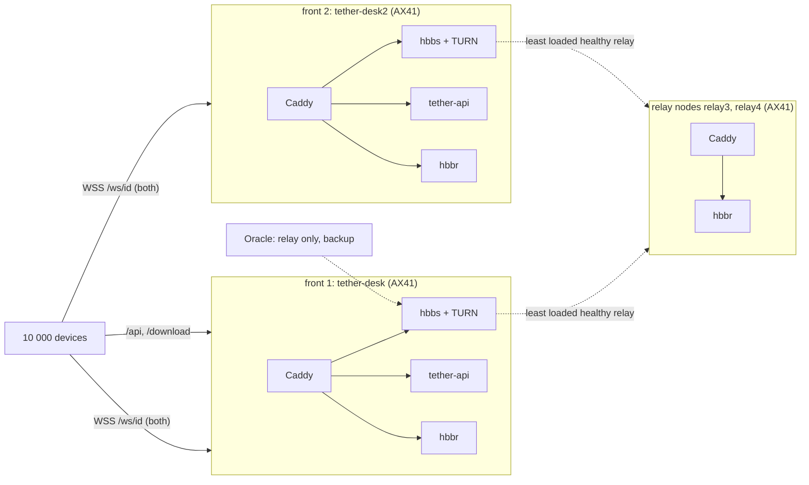

# Scaling to 10 000 users and 3 000 concurrent sessions

Target: 10 000 registered devices (hosts and technician apps; every one keeps a registration at
each rendezvous node) and 3 000 sessions at the same time. This page has the capacity model, what
was measured and how, the bottlenecks found and fixed, the architecture and cost, and the rollout
and runbook. Everything stays wire-compatible: old clients keep working with the new servers and
new clients with old servers.

Numbers marked *measured* come from `tools/load` on one PC (method below); *assumed* ones are
estimates with the reason given; *computed* ones follow from the two.

## Short version

| | Today (CX23 + Oracle) | Needed for 10k / 3k |
|---|---|---|
| Rendezvous (hbbs + Caddy), per node | breaks around 4 000 devices on Oracle (1 GB RAM), ~5 000 on the CX23 (CPU) | 10 000 WebSockets: Caddy 1.4 GB + 0.8 core, hbbs 0.24 GB + 0.22 core (*measured*) |
| Relay traffic | one 1 Gbit node | 1.6–1.8 Gbit/s peak expected, 3.5 Gbit/s if every session were relayed (*computed*) |
| Relay CPU | – | 4.4 cores per relayed Gbit/s, three quarters of it Caddy's TLS (*measured*) |
| tether-api | fine | 33 req/s normal, 500 req/s with `policy.fast-apply`; 1 500 req/s took one core (*measured*) |
| Recommended | | 4 × Hetzner AX41 (dedicated, 1 Gbit/s guaranteed, unlimited traffic): **€236/month** |
| Cheaper | | 10 × Hetzner CX33 (shared vCPU, 20 TB each): **€90/month**, best effort bandwidth |

Fixed on this branch (tests before/after below): hbbs restart took minutes behind busy NATs, hbbs
listen backlog overflowed in reconnect storms, hbbr spent a third of its CPU in musl's allocator,
tether-api rate-limited whole offices' heartbeats, custom-app downloads held tether-api workers,
the device list was capped at exactly 10 000.

## Capacity model

### Sessions: direct or relayed

Paths in order of preference ([relay-ha.md](relay-ha.md)): same LAN, WebRTC (IPv6 / NAT hole
punching), TURN over UDP through hbbs, WebSocket relay through hbbr on 443. A proxy at either end,
UDP blocked, or `network.direct = off` forces the WebSocket relay; Tether's market (managed
companies) has many such ends.

| Path | Expected | Pessimistic | Why (*assumed*) |
|---|---|---|---|
| LAN | 10 % | 5 % | in-house IT supporting colleagues |
| WebRTC direct (IPv6 / P2P) | 35 % | 15 % | both ends without proxy, UDP open, NATs not both symmetric |
| TURN (Relay UDP, hbbs) | 5 % | 5 % | at most `TURN_MAX_ALLOCATIONS` = 64 per hbbs node; the rest goes to hbbr |
| WebSocket relay (hbbr) | 50 % | 75 % | proxy or UDP blocked at either end |

At 3 000 sessions: 1 500 relayed by hbbr expected, 2 250 pessimistic, 3 000 worst case.

### Bitrate per session

Host to viewer, from [performance.md](performance.md) (*measured* there, AV1, internet relay):
idle 136–169 kbit/s, scrolling 533–641 kbit/s, photo every 2 s 5.6–7.6 Mbit/s, full-screen
motion 4.8 Mbit/s on a constrained path (36–38 Mbit/s unconstrained). Time mix of a support
session (*assumed*):

| Content | Share of time | Mbit/s |
|---|---|---|
| idle / reading | 55 % | 0.16 |
| typing, scrolling, office | 35 % | 0.6 |
| photos, image-heavy pages | 8 % | 6.5 |
| video / full-screen motion | 2 % | 10 (path- and QoS-limited) |
| **mean** | | **1.0** |

Viewer to host (input, acks): 0.05 Mbit/s (*assumed*, not measured). hbbr carries both
directions, so a relayed session costs **1.05 Mbit/s in and 1.05 Mbit/s out** of the relay node.
Per session the spread is large (σ ≈ 2.1 Mbit/s); summed over n independent sessions the peak
(p99.9) is mean + 3.1 σ √n:

| Relayed sessions | Mean out | p99.9 out |
|---|---|---|
| 1 500 (expected) | 1.58 Gbit/s | 1.83 Gbit/s |
| 2 250 (pessimistic) | 2.36 Gbit/s | 2.67 Gbit/s |
| 3 000 (all relayed) | 3.15 Gbit/s | 3.51 Gbit/s |

Monthly relay egress (*computed*, 3 000 concurrent for the equivalent of 6 h on 22 workdays =
132 h): 94 TB expected, 140 TB pessimistic. Hetzner bills outgoing traffic only.

### Rendezvous (hbbs) per node

Each device keeps one TLS WebSocket to every rendezvous node (`tether-desk`, `tether-desk2`), so
**each** node holds all 10 000:

| | Per second | Source |
|---|---|---|
| WebSocket pings in / pongs out | 10 000 / 10 000 | client pings every second (3 s silence = reconnect) |
| hbbs heartbeats out / echoes in | 500 / 500 | every 20 s |
| Session set-ups | ~2 (×2: viewers race both nodes) | 3 000 sessions of ~30 min (*assumed*) |
| Outbound bytes | ~0.8 MB/s = 6.4 Mbit/s = **2.1 TB/month** | pong 24 B TLS record + 52 B TCP/IP per device per second (*computed*) |
| Sockets | 10 000 TLS + 10 000 loopback (Caddy↔hbbs): Caddy 20 012 fds, hbbs 10 020 (*measured*) |
| conntrack entries | ~20 000 (both legs tracked) + relayed legs |

Stock RustDesk clients on UDP or TCP 21116 are cheaper for hbbs than WebSockets (below).

### tether-api

All devices use the **first** reachable relay API (`tether-desk`). Per device every
`policy.refresh-minutes` (15): `GET /api/server-keys`, `GET /api/policy` (304 when current),
`POST /api/heartbeat`.

| | Requests/s |
|---|---|
| normal (15 min) | 33 |
| `policy.fast-apply` (1 min) | 500 |
| all 10 000 devices within 20 s (after an outage) | 1 500 |
| update manifests (`update.check-hours` 6, served by Caddy) | 0.5 |
| session audit posts (~4 per session) | ~7 |

Audit volume: ~7 records/s × ~450 B ≈ 120 MB per busy day, so the default `AUDIT_MAX_MB=50` keeps
less than a day. For 90 days set `AUDIT_MAX_MB=12000` in `/etc/tether/api.env` (12 GB disk;
the admin audit view reads files linearly, so keep `since` narrow).

Releases: a 35 MB update to all 10 000 devices is 350 GB, normally spread over
`update.check-hours` (6 h: 130 Mbit/s). A **forced** update or a policy change makes every device
check within its 15-minute policy cycle: 350 GB in 15 min would need 3.1 Gbit/s, so one 1 Gbit
node is saturated for ~50 minutes, together with the sessions it relays. Roll releases out per
channel (policy groups with `update.channel`), not to everyone at once, or point `platforms.*.url`
in `latest.json` at a node that relays nothing (the updaters accept any https URL; the files are
signed). Downloads cost Caddy little CPU: 5 Gbit/s over TLS took 1.8 cores (*measured*).

### TURN

TURN media runs inside hbbs on its single UDP socket, at most 64 allocations per node
(`TURN_MAX_ALLOCATIONS`), 32 Mbit/s each. Not load-tested here (it needs WebRTC clients;
`tools/turn-bench` measures one session). With 64 × ~1 Mbit/s per node it is a small share; when
allocations run out, ICE fails over to the WebSocket relay, which the node count above already
covers. hbbs now asks for an 8 MiB UDP receive buffer (`-M`, sysctl `rmem_max`).

## Measured

### Method

- PC: Intel i5-13600KF, WSL2 Ubuntu 24.04 (12 CPUs visible, 16 GB), everything on loopback. CPU
  is given as **% of one PC core** (`/proc/<pid>/stat`, 5 s samples, `tools/load/sample.sh`);
  memory is RSS. A Hetzner vCPU is slower than one of these cores; this page assumes 0.5–0.7 of
  one (*not measured*).
- `tools/load/stack.sh` starts hbbs, hbbr, tether-api and Caddy 2.10.2 with the production
  Caddyfile (`tls internal`, ports 25xxx/28xxx) and a second, client-side Caddy that adds TLS for
  the load generator, so the Caddy under test does exactly the production TLS work.
- `tether-load` (`vendor/rustdesk-server/src/bin/tether-load.rs`): hosts register like the
  client (RegisterPk, WebSocket ping every second, heartbeat echo, 3 s silence = reconnect) from
  many loopback source IPs (127.1.x.y, i.e. NATs of a given size); viewers send PunchHoleRequest
  and the host answers RelayResponse through hbbs; relay pairs pump timestamped frames at a given
  bitrate both ways; tether-api devices run their 15-minute cycle with X-Forwarded-For.
- Raw results: `tools/load/results/*.jsonl` (one JSON line per 5 s report or sample). Each script
  in `tools/load` says how to run it; builds: `scripts/build-relay.sh` (now also `tether-load`).
- Limits: loopback has no RTT, loss or NIC (relay latencies here are CPU queueing only); one PC
  runs server and load generator, which share CPUs; runs are 1–2 minutes.

### Rendezvous

| Run | hbbs CPU | hbbs RSS | Caddy CPU | Caddy RSS | Latency |
|---|---|---|---|---|---|
| 10 000 WebSocket hosts, direct, before | 25 % | 239 MB | – | – | ping RTT p99 0.3 ms, PunchHole p99 0.3 ms, RelayResponse p99 0.6 ms |
| same, after (no lock per frame) | 20–23 % | 239 MB | – | – | same |
| 30 000 WebSocket hosts, direct | 46–50 % | 697 MB | – | – | ping p99 0.7 ms, RelayResponse p99 2.0 ms |
| 10 000 hosts through Caddy with TLS | 22 % | 239 MB | **78–81 %** | **1 415–1 430 MB** | registration p99 7–21 ms, RelayResponse p99 3.2 ms |
| 10 000 hosts through Caddy, no TLS | – | 238 MB | – | 1 090 MB | |
| 10 000 TCP hosts (21116) | 5–7 % | 385 MB | | | |
| 10 000 UDP hosts (21116) | 6 % | 46 MB | | | |

hbbs is linear (≈ 2.2 % of a core per 1 000 WebSocket hosts, 24 KB per host) and not the limit.
**Caddy is**: ~145 KB and ~0.08 % of a core per idle TLS WebSocket. Its WebSocket proxy holds
two 32 KB copy buffers per connection, which no Caddyfile option changes. `GOMEMLIMIT=400MiB`
(below the working set) made Caddy spend 10 cores on garbage collection: never set GOMEMLIMIT or
a systemd MemoryMax below ~1.6 × devices × 145 KB.

### Relay

1 Mbit/s host→viewer + 50 kbit/s back per pair, 30 frames/s each way:

| Run | hbbr CPU | Caddy CPU | Throughput | Frame latency |
|---|---|---|---|---|
| 500 pairs, direct, musl allocator / mimalloc | 93 % / 58 % | – | 0.5 Gbit/s | p99 1.1 / 0.9 ms |
| 1 000 pairs, direct, musl / mimalloc | 178 % / 124 % | – | 1.0 Gbit/s | p99 1.6 / 1.4 ms |
| 1 500 pairs, direct, musl / mimalloc | 238 % / 157 % | – | 1.5 Gbit/s | p99 2.2 / 1.7 ms |
| 1 500 pairs, direct, hbbr default `TOTAL_BANDWIDTH` | 140–155 % | – | **capped at 1.06 Gbit/s** | **p50 1.2–1.5 s, p99 14–16 s**, stalls |
| 500 pairs through Caddy with TLS (mimalloc) | 51 % | **170 %** | 0.5 Gbit/s | p99 1.9 ms |

Per relayed Gbit/s: hbbr ~1.1 cores, Caddy (TLS) ~3.3 cores, together **4.4 PC cores**. Caddy
RSS during relaying: ~210 KB per relayed WebSocket (two per session). hbbr: ~45 KB per session.

hbbr's `TOTAL_BANDWIDTH` (default 1024 Mb/s for the whole process) is a hard cap: above it every
session on that relay queues, by seconds. It equals a 1 Gbit/s port, so size nodes so that
neither is reached (≤ 65 %), and set `TOTAL_BANDWIDTH` to what the node can actually send if that
is more (k8s pods, 10G servers).

### tether-api

| Run | CPU | RSS | Latency | Notes |
|---|---|---|---|---|
| 10 000 devices, 1-min cycle (500 req/s), 200 IPs | 10–13 % | 6.4 MB | p99 1 ms | before: a 429 burst for 50 % of heartbeats every minute (50 devices per IP > 30/min); after: only new devices in the first minute |
| all 10 000 devices in 20 s (1 500 req/s) | 74–89 % | 5 MB | p99 6 ms | no 503; `devices.json` 1.36 MB |
| 30 slow `/q/` downloads (2 Mbit/s each) + 8 API clients, before | | | | 30 of 32 workers held; 503 to heartbeats and policy fetches |
| same, after (Caddy sends the file) | | | | 0 × 503, tether-api 35 threads instead of 65 |

tether-api's cost grows with its open file descriptors (each request scans `/proc/self/fd` to
set socket timeouts): fine at Caddy's keep-alive pool sizes, the reason the 1 500 req/s run used
almost a core.

### Restarts and reconnect storms

| Run | Before | After |
|---|---|---|
| hbbs restart, 2 000 known hosts behind 20 NAT IPs (100 each) | 640 back per minute, all after ~200 s | all back within 5 s |
| hbbs restart, 10 000 known hosts behind 100 IPs | (≈ 3 200 per minute, computed) | all back within 10 s, no refusals |
| 10 000 connects in 0.5 s (Caddy or node restart) | 18 040 SYNs dropped (`ListenOverflows`), registration p50 340 ms | 0 dropped, p50 31–96 ms |

The remaining tail in a storm of **new** devices (registration p99 3 s, some 3-second reconnects)
is hbbs's single SQLite writer inserting 10 000 new keys; it happens once per device, not after
restarts.

## Bottlenecks found and fixed

1. **hbbs: per-IP registration limit after a restart.** Every WebSocket (re)connect sends
   RegisterPk, and upstream allows 32 per source IP per minute (and 300 new ids per IP per day).
   An office of 500 hosts behind one NAT needed 16 minutes to come back after any hbbs restart
   (the 04:00 reboot included). Now a RegisterPk that repeats the exact registered uuid and key
   passes the limit (it changes nothing); wrong uuids and new ids still count. Both limits are
   configurable (`IP_BLOCK_PER_MIN`, `IP_BLOCK_IDS_PER_DAY`; the unit sets 300 and 5 000 for
   large sites). Test: `hosts_behind_one_nat_reregister_after_restart` (fails before, passes
   after); load: table above.
2. **hbbs/hbbr: listen backlog 128.** 10 000 clients reconnecting at once overflowed it
   (18 040 dropped SYNs, retried after 1–3 s). Backlog 8192 (capped by `net.core.somaxconn`,
   set to 8192 by the sysctl file): 0 dropped.
3. **hbbr: musl's allocator.** perf showed `a_cas`/`get_meta` (musl mallocng's lock) and
   `memcpy` on top; hbbr's CPU grew faster than its traffic. mimalloc as global allocator:
   30–38 % less CPU at every load (table above). hbbs keeps musl's allocator: same CPU at 10 000
   hosts, 22 % less memory than with mimalloc.
4. **tether-api: heartbeats limited per IP.** 30 heartbeats per IP per minute meant any site with
   more than 450 devices behind one IP (30 × 15 min) lost heartbeats every cycle. The per-IP limit
   now applies only to unknown devices; known ones are limited by their own 60 s interval
   (`heartbeat` test).
5. **tether-api: custom-app downloads (`/q/<token>`) held workers.** A 35 MB TetherQS to a slow
   customer held one of 32 workers for minutes. tether-api now prepares the exe with its profile
   trailer once (`qcache/<id>--<exe>`, outside `download/`, dropped when the app changes) and
   answers with `X-Accel-Redirect`; Caddy's `handle_response` sends the file. Only when Caddy
   sets `X-Tether-Accel: 1` (new Caddyfile); old Caddyfile + new tether-api and new Caddyfile +
   old tether-api both still download correctly (`tools/load/qdl-check.sh`, all three
   combinations checked; `qcache` is not reachable by URL). Test: `custom_apps`.
6. **tether-api: `MAX_DEVICES` = 10 000.** Equal to the target; reinstalls (new uuids) within the
   180-day device TTL would push real devices out. Now 50 000 (~7 MB `devices.json`).
7. **hbbs: global lock per WebSocket frame** (audit item 16). Each ping took the `TCP_PEERS`
   lock; now it is read only after a registration message. Not measurable at 10 000 hosts
   (25 % → 20–23 % CPU, within noise), but it removes 10 000 lock round trips per second.
8. **hbbs: the punch-request log grew without bound** (one entry per session set-up, ~150 B,
   tens of MB per month). Capped at the last 10 000.

Checked and left as they are:
- `send_to_tcp_keep` holds the `tcp_punch` lock while writing (audit item 16): it blocks only when
  a viewer's socket buffer is full (hundreds of KB of signalling); not reproducible with real
  message sizes.
- hbbs's SQLite (one connection): reads are cached in memory after the first registration; only
  first-time registrations write.
- Caddy memory per WebSocket: no setting; buy RAM (below).
- Kernel: `ip_local_port_range` is ample (Caddy's upstream connections are per destination
  port), but the service ports are now reserved so a restarted service can always bind them.

## Architecture for 10 000 / 3 000

- **Two front nodes** (the names clients already know). Each runs the full bundle; devices
  register with both, viewers race both, each hbbs hands out any relay. Each front holds 10 000
  WebSockets (Caddy 1.4 GB, ~1 core) and relays too.
- **Relay-only nodes**: the same bundle installed under their own name (`install.sh relay3.…`);
  they are in every hbbs's `RELAY_SERVERS`, not in the client list, so adding relays needs no
  client change. Their hbbs and tether-api stay idle.
- Relay choice: least loaded healthy primary, Oracle as `|backup` only. The Oracle VM must
  **not** stay a registration node (`tether-desk2`) beyond ~4 000 devices: 1 GB RAM holds about
  4 000 TLS WebSockets in Caddy (*computed* from 145 + 24 KB per device and ~350 MB for the rest).
- `RELAY_SERVERS` on both fronts (same line):
  `tether-desk.…|http://127.0.0.1:21121/readyz,tether-desk2.…|https://tether-desk2.…/readyz/relay,relay3.…|https://relay3.…/readyz/relay,relay4.…|https://relay4.…/readyz/relay,<oracle>|https://<oracle>/readyz/relay|backup`
  (on front 2 its own entry may use the local URL).
- **tether-api consistency**: unchanged model, Tether Manage writes to every node in its relay
  list. Only the two fronts serve the API (clients use their server list), so Manage's list is
  the two fronts; relay-only nodes need no policy, releases or audit. Devices heartbeat to front
  1 while it answers; Manage merges both device lists.
- **DNS**: one name per node. DuckDNS works; a domain of your own (A records, TTL 300) is better
  for more than two names.
- Failure of a front: devices stay registered at the other front; its hbbs hands out the same
  relays. Failure of a relay: its sessions reconnect within seconds through another (measured in
  relay-ha.md), N+1 keeps the peak covered.

### Node sizes and count

Planning per relay node, at ≤ 65 % of the port and ≤ 70 % CPU, 4.4 PC cores per Gbit/s:

| Node | € / month (excl. VAT) | CPU (PC-core equivalents, *assumed*) | Network | Plan per node |
|---|---|---|---|---|
| AX41 (Ryzen 5 3600 6C/12T, 64 GB, 2×512 GB NVMe) | 59, no setup fee, no minimum term | ~6 | 1 Gbit/s guaranteed, traffic unlimited | **0.65 Gbit/s** (port) |
| CX33 (4 shared vCPU, 8 GB) | 8.99, hourly | ~2–2.8 | "expect about 300–500 Mbit/s", 20 TB incl., €1/TB more | **0.30 Gbit/s** |
| CPX32 (4 shared AMD vCPU, 8 GB) | 35.99 | ~2–2.8 | same | 0.30 Gbit/s |
| CCX23 (4 dedicated AMD vCPU, 16 GB) | 86.49 | ~2.8 | same | 0.35 Gbit/s |

Prices from hetzner.com on 2026-11-07 (eu-central); CX/CAX "Cost-Optimized" were marked
"currently unavailable" that day. Hetzner Cloud servers have no bandwidth guarantee; the AX line
has a guaranteed 1 Gbit/s port and unlimited traffic (traffic on Cloud: only outgoing counts).

| Scenario (p99.9 relay out) | AX41 nodes (N+1) | Cost | CX33 nodes (2 fronts + relays, N+1) | Cost | Traffic/month |
|---|---|---|---|---|---|
| expected 1.83 Gbit/s | 3 + 1 = **4** | **€236** | 2 + 7 + 1 = 10 | €90 | 94 TB (cloud: 200 TB incl.) |
| pessimistic 2.67 Gbit/s | 5 + 1 = 6 | €354 | 2 + 9 + 1 = 12 | €108 | 140 TB (240 TB incl.) |
| all relayed 3.51 Gbit/s | 6 + 1 = 7 | €413 | 2 + 12 + 1 = 15 | €135 | 190 TB (300 TB incl.) |

The two fronts count as relays in the AX41 column (they have the CPU and RAM for both). Their
registrations need ~1 PC core and 1.7 GB each, which an AX41 has to spare; on CX33 fronts they
would take half the node, so CX33 fronts do not relay.

Recommendation: **4 × AX41** (€236/month): guaranteed bandwidth, no traffic accounting, 2.6 Gbit/s
planned capacity, 1.95 with one node down. Cheaper: CX33 fleet (€90/month) if the type is
available and best-effort bandwidth is acceptable; watch for steal time and throughput. Keep the
Oracle VM as `|backup` relay (free), never as a front.

## Kernel and limits

`server/sysctl/90-tether.conf` (installed by `install.sh`):
`nf_conntrack_max` 524 288 (two tracked connections per proxied WebSocket),
`somaxconn` / `tcp_max_syn_backlog` 8192 (storms), `rmem_max` 8 MiB (hbbs `-M`), BBR + fq,
`ip_local_reserved_ports` 21114-21125. File descriptors: hbbs/hbbr/Caddy units already have
`LimitNOFILE` ~1M (a front needs ~20 000 for Caddy, 10 000 for hbbs, plus 2 per relayed session);
tether-api now 65 536.

## Monitoring (for the metrics work in progress)

What this model needs per node, and the alert levels it implies (the Prometheus exporter is being
added separately; names here are descriptive):

| Signal | Source today | Alert |
|---|---|---|
| registered hosts (WebSocket) | hbbs `/readyz` `sessions=N` | < 80 % of yesterday's at the same time (mass disconnect) |
| relayed sessions | hbbr `/readyz` `sessions=N` | per node > 70 % of planned (AX41 ~620, CX33 ~285 at 1.05 Mbit/s) |
| egress bit/s | NIC (`/proc/net/dev`) | > 65 % of port (AX41) / > 300 Mbit/s (Cloud) for 5 min |
| Caddy RSS | process | > 1.6 × devices × 145 KB + 420 KB × relayed sessions |
| CPU, steal | `/proc/stat` | > 70 % for 5 min; steal > 10 % (Cloud) |
| `ListenOverflows`, `ListenDrops` | `nstat` | any increase |
| conntrack count / max | `/proc/sys/net/netfilter/` | > 70 % |
| tether-api 429 / 503 rate | Caddy access log or a counter | 503 > 0 |
| hbbs `TOO_FREQUENT` answers | hbbs log | sudden rise (new site behind one IP: raise `IP_BLOCK_*`) |
| relay failover lines | hbbs log `relay failover:` | any |

## Rollout plan

1. **Now, current nodes** (no new servers): build from this branch (`scripts/build-relay.sh`,
   `scripts/test-relay.sh`), then on Oracle 2 (backup) first, Hetzner after, as in the previous
   updates: back up binaries, Caddyfile and units (`*.bak-…`); install `hbbs`, `hbbr`,
   `tether-api`, `server/caddy/Caddyfile`, `server/systemd/tether-{hbbs,api}.service`,
   `server/sysctl/90-tether.conf` to `/etc/sysctl.d/` (`sysctl -e -p …`; a `dist/linux-relay` bundle needs `sysctl/` next to `install.sh`, which installs it when present); `systemctl daemon-reload`; restart
   tether-api, then hbbs (hosts re-register in seconds now), then Caddy (`systemctl restart
   tether-https`; validate first with `RELAY_HOST` set, see relay-ha.md), hbbr last (it drains).
   Checks: `/readyz` on 21121/21122, `/api/policy`, a `/q/` link download (headers + size), a
   session through each relay, `nstat ListenOverflows`, hbbs log free of `TOO_FREQUENT` bursts.
   Rollback: the `.bak` files.
2. **Before ~3 000 devices**: move `tether-desk2` off the Oracle VM (1 GB) to a front-sized node;
   keep Oracle as `|backup` relay in `RELAY_SERVERS`.
3. **When relayed peak passes ~300 Mbit/s** (or ~300 relayed sessions on the CX23): add relay
   nodes: `install.sh relay3.<domain>` with the same key pair (and `keys.env` during a rotation),
   add them to both fronts' `RELAY_SERVERS`, restart hbbs (sessions on hbbr are untouched).
4. **Before ~5 000 devices**: replace the CX23 front by an AX41 (registrations alone need ~1 core
   per 10 000 devices). Move as in "Hetzner primary, Oracle backup" (relay-ha.md): copy key,
   tether-api data, Caddy certificate; switch the DNS name.
5. Each step: watch the signals above for a week before the next.

## Runbook

- *Many hosts offline after a restart*: `journalctl -u tether-hbbs | grep -c TOO_FREQUENT`; known
  hosts are no longer limited, new ones from one IP are: raise `IP_BLOCK_PER_MIN` /
  `IP_BLOCK_IDS_PER_DAY` in `/etc/tether/server.env`, restart hbbs.
- *Sessions lag on one relay*: `curl -s localhost:21121/readyz` (sessions), NIC throughput,
  hbbr log `Downgrade` lines; at the 1 Gbit/s cap every session there queues: add a relay node.
- *Caddy killed (OOM)*: devices × 145 KB is the floor; no GOMEMLIMIT/MemoryMax below it.
- *API 503 "busy"*: 32 workers busy; with the new Caddyfile downloads no longer hold workers.
  Check for slow clients in Caddy's log.
- *Heartbeats 429 for a whole site*: new devices behind one IP are limited to 30/min; they appear
  over the next minutes.
- *Release day*: publish per channel; a forced update to all devices saturates the first front
  for ~50 minutes.
- Load test a change: `tools/load/hosts-run.sh`, `relay-run.sh`, `relay-ab.sh` (two builds),
  `api-run.sh`, `qdl-run.sh`, `dl-run.sh`, `restart-run.sh`; profile hbbr with `relay-perf.sh`.

## Not verified

- Hetzner vCPU speed relative to the test PC (0.5–0.7 assumed), AX41 CPU equivalent (~6 PC cores
  assumed). Measure on the first new node with `tools/load/relay-run.sh` from a second machine.
- Real paths (RTT, loss, NICs); all tests ran on loopback. Viewer→host bitrate (0.05 Mbit/s) and
  the session content mix are assumptions.
- The path mix (how many sessions are relayed) is an estimate; the new metrics should replace it.
- TURN under load; Kubernetes (`examples/scale-10k.yaml` was linted and rendered with `helm`, the
  sidecar and proxy Caddyfiles adapted with `caddy adapt`, not deployed to kind).
- mimalloc 0.1.52 / libmimalloc-sys 0.1.49 were the current crates at build time; their age was
  not checked against the two-week rule.
